# AI Lab

A structured workspace for prototyping, experimenting with AI ideas, scripts, and models.

[](https://www.python.org/)
[](https://jupyter.org/)
[](https://docs.pytest.org/)
[](https://mermaid.js.org/)

## Tech Stack

| Layer | Tool |
| --- | --- |
| Language | Python 3 |
| Prototyping & Exploration | Jupyter Notebook (`.ipynb`) |
| Core Modules | `src/` (Clean, modular experiment runners) |
| Unit Testing | `unittest` / `pytest` in `tests/` |
| Data Layer | `data/raw/` and `data/processed/` |
| Diagrams | Mermaid in this README |

## Architecture

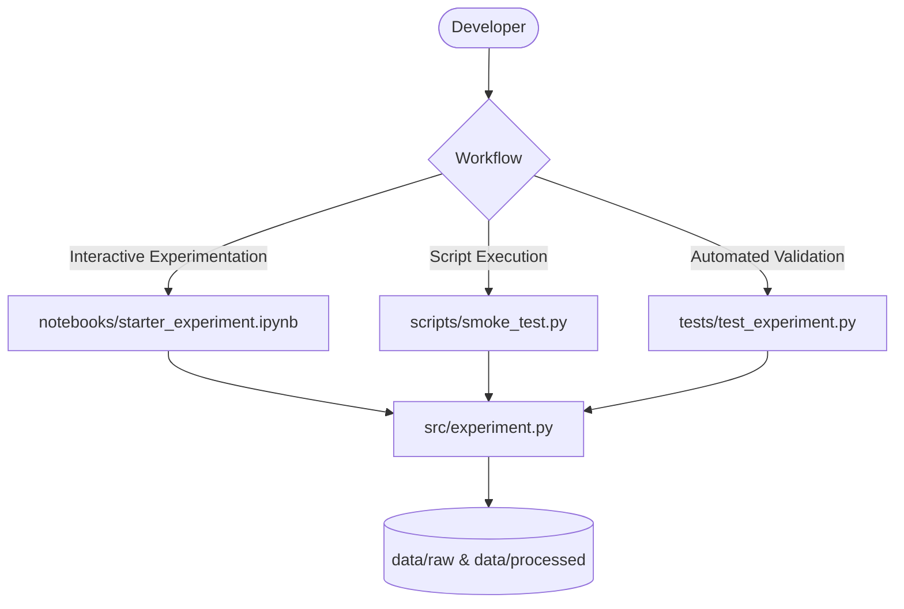

## Project Layout

```text
ai-lab/
├── notebooks/
│   ├── goal_based_navigation_agent.ipynb# Question 4: Goal-Based Navigation Agent simulation & Viva guide
│   ├── model_based_reflex_agent.ipynb   # Question 3: Model-Based Reflex Agent simulation & Viva guide
│   ├── multi_agent_simulation.ipynb     # Question 6: Multi-Agent Environment Simulation (4x4 Grid)
│   ├── randomized_reflex_agent.ipynb    # Question 2: Randomized Reflex Agent simulation & Viva guide
│   ├── simple_reflex_vacuum_agent.ipynb # Question 1: Simple Reflex Vacuum Agent simulation & Viva guide
│   ├── starter_experiment.ipynb         # Interactive experimentation starter notebook
│   ├── environment_type_classifier.ipynb# Question 8: Environment Type Classifier & Knowledge Base
│   ├── stochastic_vacuum_agent.ipynb    # Question 7: Stochastic Vacuum Agent simulation & Viva guide
│   ├── agent_performance_evaluator.ipynb# Question 9: Agent Performance Measure Evaluator simulation & Viva guide
│   ├── state_space_visualizer.ipynb     # Question 10: State-Space Visualizer for Reflex Agent & Viva guide
│   ├── breadth_first_search.ipynb       # Question 11: Breadth-First Search (BFS) on User-Defined Graph & Viva guide
│   ├── depth_first_search.ipynb         # Question 12: Depth-First Search (DFS) for Graph Traversal & Viva guide
│   ├── uniform_cost_search.ipynb        # Question 14: Uniform Cost Search (UCS) Implementation & Viva guide
│   ├── bfs_2d_maze_solver.ipynb         # Question 15: BFS 2D Maze Solver (Implicit Graph Search) & Viva guide
│   ├── depth_limited_search.ipynb       # Question 16: Depth-Limited Search (DLS), Tri-State Outcomes & Viva guide
│   ├── iterative_deepening_search.ipynb # Question 17: Iterative Deepening Search (IDS), Optimality & Viva guide
│   ├── bfs_vs_dfs_performance_analyzer.ipynb# Question 18: BFS vs DFS Performance Analyzer & Viva guide
│   ├── bidirectional_search.ipynb       # Question 19: Bidirectional Search (BDS) Simulation & Viva guide
│   ├── water_jug_bfs.ipynb              # Question 20: Water Jug Problem using BFS & Viva guide
│   ├── missionaries_cannibals_dfs.ipynb # Question 21: Missionaries and Cannibals Problem using DFS & Viva guide
│   ├── ucs_grid_navigation.ipynb        # Question 22: UCS Grid Navigation with Cost Modifiers & Viva guide
│   ├── maze_with_multiple_exits.ipynb   # Question 23: Maze with Multiple Exits (Multi-Goal BFS) & Viva guide
│   ├── manhattan_euclidean_distance_calculators.ipynb # Question 24: Manhattan & Euclidean Distance Calculators & Viva guide
│   ├── eight_puzzle_heuristic_evaluator.ipynb # Question 25: 8-Puzzle Heuristic Evaluator (h1 & h2) & Viva guide
│   └── utility_based_agent.ipynb        # Question 5: Utility-Based Agent simulation & Viva guide
├── scripts/
│   ├── __init__.py                      # Scripts package marker
│   ├── run_goal_based_agent.py          # CLI & interactive runner for Question 4 (5x5 Grid Simulation)
│   ├── run_model_based_agent.py         # CLI & interactive runner for Question 3 (2x2 Grid Simulation)
│   ├── run_multi_agent_simulation.py    # CLI & interactive runner for Question 6 (Builder vs Destroyer)
│   ├── run_randomized_agent.py          # CLI & interactive runner for Question 2 (1D Grid Simulation)
│   ├── run_stochastic_vacuum_agent.py   # CLI & interactive runner for Question 7 (Monte Carlo Simulation)
│   ├── run_utility_based_agent.py       # CLI & interactive runner for Question 5 (Utility Optimization)
│   ├── run_environment_classifier.py    # CLI & interactive runner for Question 8 (Environment Classifier)
│   ├── run_agent_performance_evaluator.py# CLI & interactive runner for Question 9 (PEAS Performance Evaluator)
│   ├── run_state_space_visualizer.py    # CLI & interactive runner for Question 10 (State-Space Graph Visualizer)
│   ├── run_breadth_first_search.py      # CLI & interactive runner for Question 11 (Level-Order BFS & Graph Depth)
│   ├── run_depth_first_search.py        # CLI & interactive runner for Question 12 (LIFO DFS & Recursive Comparison)
│   ├── run_uniform_cost_search.py       # CLI & interactive runner for Question 14 (Priority Queue UCS & Cycle Detection)
│   ├── run_bfs_maze_solver.py           # CLI & interactive runner for Question 15 (Implicit BFS Maze Solver & Moves)
│   ├── run_depth_limited_search.py      # CLI & interactive runner for Question 16 (DLS Bounded Search & Deepest Node)
│   ├── run_iterative_deepening_search.py# CLI & interactive runner for Question 17 (IDS Loop, BFS Compare & Expansions)
│   ├── run_bfs_dfs_performance_analyzer.py# CLI & interactive runner for Question 18 (BFS vs DFS on 10x10 Maze)
│   ├── run_bidirectional_search.py      # CLI & interactive runner for Question 19 (Simultaneous BDS & Maze Challenge)
│   ├── run_water_jug_bfs.py             # CLI & interactive runner for Question 20 (Water Jug Problem using BFS)
│   ├── run_missionaries_cannibals_dfs.py# CLI & interactive runner for Question 21 (Missionaries and Cannibals DFS)
│   ├── run_ucs_grid_navigation.py       # CLI & interactive runner for Question 22 (UCS Grid Navigation)
│   ├── run_multi_goal_bfs_maze.py       # CLI & interactive runner for Question 23 (Multi-Goal BFS Solver)
│   ├── run_distance_calculators.py      # CLI & interactive runner for Question 24 (Distance Calculators & Metrics)
│   ├── run_eight_puzzle_heuristics.py   # CLI & interactive runner for Question 25 (8-Puzzle h1 & h2 Evaluator)
│   ├── run_vacuum_agent.py              # CLI & interactive runner for Question 1 (2-Square & 3x3 Grid)
│   └── smoke_test.py                    # Starter entry point and verification smoke test
├── src/
│   ├── __init__.py                      # Package initialization & public exports
│   ├── __main__.py                      # CLI dispatcher (python -m src {vacuum,randomized,model-based,goal-based,utility-based,multi-agent,stochastic,environment-classifier,agent-evaluator,state-space,bfs,dfs,ucs,maze,dls,ids,bfs-dfs,bidirectional,water-jug,missionaries-cannibals,ucs-grid,multi-goal-bfs,distance-calculators,eight-puzzle,smoke-test})
│   ├── experiment.py                    # Core experiment metrics and simulation runner
│   ├── goal_based_agent.py              # Question 4: Goal-Based Navigation Agent & 5x5 Grid Environment
│   ├── model_based_agent.py             # Question 3: Model-Based Reflex Agent & 2x2 Grid Environment
│   ├── multi_agent_simulation.py        # Question 6: Multi-Agent Environment Simulation & Shared 4x4 Grid
│   ├── randomized_agent.py              # Question 2: Randomized Reflex Agent & 1D Grid Environment
│   ├── stochastic_vacuum_agent.py       # Question 7: Stochastic Vacuum Agent & Non-deterministic Environment
│   ├── environment_classifier.py        # Question 8: Environment Type Classifier & Knowledge Base
│   ├── utility_based_agent.py           # Question 5: Utility-Based Agent & Terrain Graph Cost Optimization
│   ├── agent_performance_evaluator.py   # Question 9: Autonomous Delivery Drone PEAS Performance Evaluator
│   ├── state_space_visualizer.py        # Question 10: State-Space Visualizer, Combinatorial Model & Graph Renderer
│   ├── breadth_first_search.py          # Question 11: Breadth-First Search, FIFO Frontier, Cycle Avoidance & Levels
│   ├── depth_first_search.py            # Question 12: Depth-First Search, LIFO Stack, Recursion, Cycles & Back-Edges
│   ├── uniform_cost_search.py          # Question 14: Uniform Cost Search (UCS), Min-Heap Frontier, Cumulative Cost & Cycles
│   ├── bfs_maze_solver.py               # Question 15: BFS 2D Grid Maze Solver, Dynamic Successors & Move Strings
│   ├── depth_limited_search.py          # Question 16: Depth-Limited Search (DLS), Bounded Recursion & Tri-State Outcomes
│   ├── iterative_deepening_search.py    # Question 17: Iterative Deepening Search (IDS), Optimal Depth & Linear Memory
│   ├── bfs_dfs_performance_analyzer.py  # Question 18: BFS vs DFS Performance Analyzer on 10x10 Mazes
│   ├── bidirectional_search.py          # Question 19: Bidirectional Search (BDS), Space Halving & Maze Solver
│   ├── water_jug_bfs.py                 # Question 20: Water Jug Problem using BFS, 6 Production Rules & GCD
│   ├── missionaries_cannibals_dfs.py    # Question 21: Missionaries and Cannibals DFS, 5 Moves & Constraint Checking
│   ├── ucs_grid_navigation.py           # Question 22: UCS Grid Navigation, Cost Modifiers, Min-Heap & Diagonals
│   ├── multi_goal_bfs_maze.py           # Question 23: Maze with Multiple Exits, Multi-Goal BFS, Set Hashing & All Exits
│   ├── distance_calculators.py          # Question 24: Manhattan, Euclidean, Chebyshev & Octile Distance Metrics
│   ├── eight_puzzle_heuristics.py       # Question 25: 8-Puzzle Heuristic Evaluator (h1 Misplaced & h2 Manhattan)
│   └── vacuum_agent.py                  # Question 1: Simple Reflex Vacuum Agent & Environments
├── tests/
│   ├── __init__.py                      # Test package marker
│   ├── test_experiment.py               # Unit test suite for experiment runner
│   ├── test_goal_based_agent.py         # Unit tests for Question 4 goal-based agent & 5x5 grid
│   ├── test_model_based_agent.py        # Unit tests for Question 3 model-based agent & 2x2 grid
│   ├── test_multi_agent_simulation.py   # Unit tests for Question 6 multi-agent simulation & rules
│   ├── test_randomized_agent.py         # Unit tests for Question 2 randomized agent & 1D grid
│   ├── test_scripts.py                  # Unit tests for script runners & CLI dispatcher
│   ├── test_stochastic_vacuum_agent.py  # Unit tests for Question 7 stochastic transitions & Monte Carlo
│   ├── test_utility_based_agent.py      # Unit tests for Question 5 utility-based agent & terrain costs
│   ├── test_agent_performance_evaluator.py# Unit tests for Question 9 linear evaluation, PEAS metric & CSV
│   ├── test_state_space_visualizer.py   # Unit tests for Question 10 combinatorial states, transitions & graph
│   ├── test_breadth_first_search.py     # Unit tests for Question 11 BFS traversal, tie-breaking, cycles & levels
│   ├── test_depth_first_search.py       # Unit tests for Question 12 DFS traversal, cycles, edge types & challenge
│   ├── test_uniform_cost_search.py      # Unit tests for Question 14 UCS optimality, priority queue & negative cycles
│   ├── test_bfs_maze_solver.py          # Unit tests for Question 15 BFS 2D maze solver, successors, moves & bounds
│   ├── test_depth_limited_search.py     # Unit tests for Question 16 DLS tri-states, limit budget & deepest node
│   ├── test_iterative_deepening_search.py# Unit tests for Question 17 IDS iterations, BFS optimality & cyclic graphs
│   ├── test_bfs_dfs_performance_analyzer.py# Unit tests for Question 18 BFS vs DFS comparison & metrics
│   ├── test_bidirectional_search.py     # Unit tests for Question 19 BDS dual queues, intersection & maze
│   ├── test_water_jug_bfs.py            # Unit tests for Question 20 Water Jug state-space, 6 rules & GCD
│   ├── test_missionaries_cannibals_dfs.py# Unit tests for Question 21 Missionaries and Cannibals DFS, 5 Moves & Cycles
│   ├── test_ucs_grid_navigation.py      # Unit tests for Question 22 UCS grid navigation, parsing, costs & diagonals
│   ├── test_multi_goal_bfs_maze.py      # Unit tests for Question 23 Multi-Goal BFS, sets, detours & all exits
│   ├── test_distance_calculators.py     # Unit tests for Question 24 Manhattan, Euclidean & Chebyshev calculators
│   ├── test_eight_puzzle_heuristics.py  # Unit tests for Question 25 8-Puzzle h1, h2, dominance & solvability
│   └── test_vacuum_agent.py             # Unit tests for vacuum agent reflex rules & simulation traces
├── data/
│   ├── processed/                       # Processed artifacts & experiment outputs
│   └── raw/                             # Raw inputs & data snapshots
├── .gitignore                           # Comprehensive ignores (Python, Jupyter, venv, IDE)
├── pyproject.toml                       # Modern Python project configuration & packaging
├── README.md                            # Project documentation and practical guide
└── requirements.txt                     # Dependencies for notebooks and ML libraries
```

## Lab Practicals

### Question 1: Simple Reflex Vacuum Cleaner Agent

- **Syllabus Area**: Intelligent Agents
- **Difficulty**: 🟢 Beginner
- **Core AI Concept**: Simple Reflex Agent, Agent-Environment Interaction, Condition-Action Mapping
- **Complexity**: Time Complexity: $O(1)$ per step | Space Complexity: $O(1)$

#### Condition-Action Reflex Rules
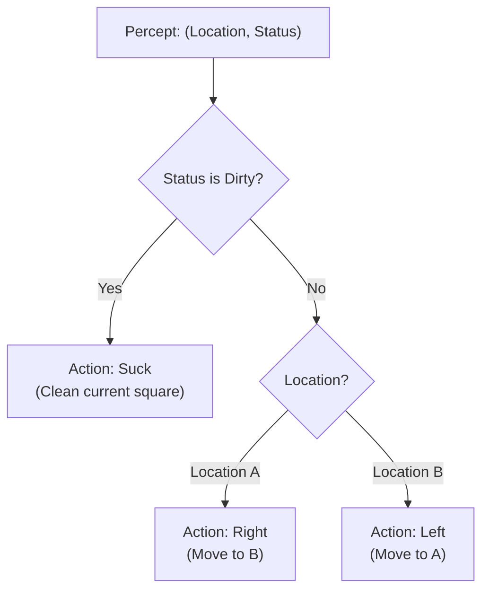

#### Running the Vacuum Agent Simulation

1. **Default Sample Scenario** (Initial Location: `A`, Location A: `Dirty`, Location B: `Clean`, 5 Steps):
   ```bash
   python scripts/run_vacuum_agent.py
   ```

2. **Custom Location & Square States**:
   ```bash
   python scripts/run_vacuum_agent.py --location B --status-a Dirty --status-b Dirty --steps 5
   ```

3. **Interactive Mode**:
   ```bash
   python scripts/run_vacuum_agent.py --interactive
   ```

4. **Optional Challenge (3x3 Grid with Randomized Dirt Placement)**:
   ```bash
   python scripts/run_vacuum_agent.py --grid --steps 10
   ```

5. **Display Viva Voce Q&A and Theory Guide**:
   ```bash
   python scripts/run_vacuum_agent.py --viva
   ```

6. **Interactive Jupyter Notebook**:
   Open [`notebooks/simple_reflex_vacuum_agent.ipynb`](notebooks/simple_reflex_vacuum_agent.ipynb) in Jupyter Lab or Antigravity IDE.

---

### Question 2: Randomized Reflex Agent

- **Syllabus Area**: Intelligent Agents
- **Difficulty**: 🟢 Beginner
- **Core AI Concept**: Randomized Agent Behavior, Handling Unobservable States, Escaping Boundary Loops
- **Complexity**: Time Complexity: $O(N)$ average | Space Complexity: $O(N)$

#### Condition-Action Stochastic Rules
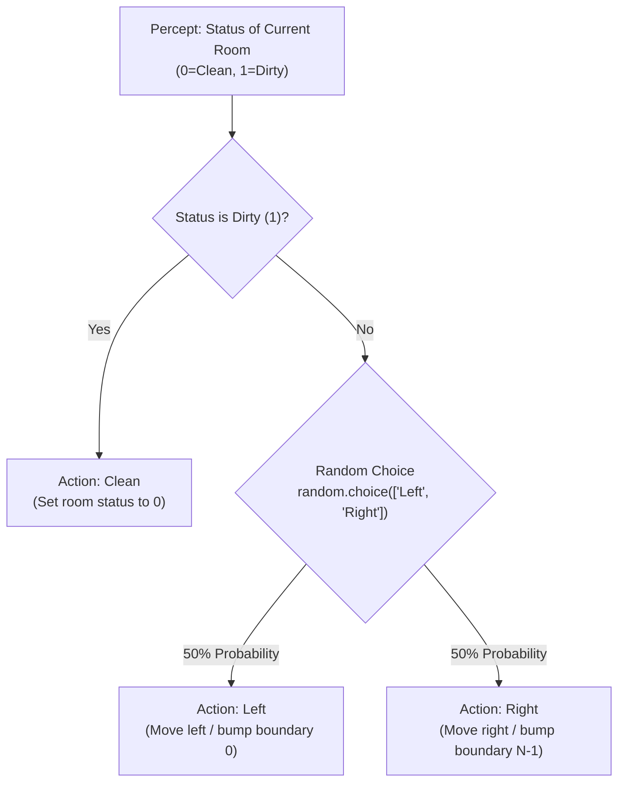

#### Running the Randomized Reflex Agent Simulation

1. **Sample Scenario with Exact 12-Step Reproducibility** (`[1, 0, 0, 1, 1]`, Start Index: `2`, Seed: `58`):
   ```bash
   python scripts/run_randomized_agent.py --seed 58
   ```
   *Output*:
   ```text
   All rooms clean in 12 steps.
   Total Navigation Moves   : 9
   Total Cleaning Actions   : 3
   Final Grid State         : [0, 0, 0, 0, 0]
   Final Agent Location     : Room [4]
   ```

2. **Custom Room State & Start Index**:
   ```bash
   python scripts/run_randomized_agent.py --state "1 0 1 1 0" --start-index 1
   ```

3. **Interactive Mode**:
   ```bash
   python scripts/run_randomized_agent.py --interactive
   ```

4. **Monte Carlo Empirical Benchmark (100 Trials)**:
   ```bash
   python scripts/run_randomized_agent.py --benchmark --trials 100
   ```

5. **Display Viva Voce Theory Guide**:
   ```bash
   python scripts/run_randomized_agent.py --viva
   ```

6. **Interactive Jupyter Notebook**:
   Open [`notebooks/randomized_reflex_agent.ipynb`](notebooks/randomized_reflex_agent.ipynb) in Jupyter Lab or Antigravity IDE.

---

### Question 3: Model-Based Reflex Agent

- **Syllabus Area**: Intelligent Agents
- **Difficulty**: 🟡 Intermediate
- **Core AI Concept**: Model-Based Reflex Agent, Internal State Representation, Transition Models, Sensor Models
- **Complexity**: Time Complexity: $O(N)$ | Space Complexity: $O(N)$ where $N=4$ for 2x2 grid

#### Model-Based Architecture & Decision Flow
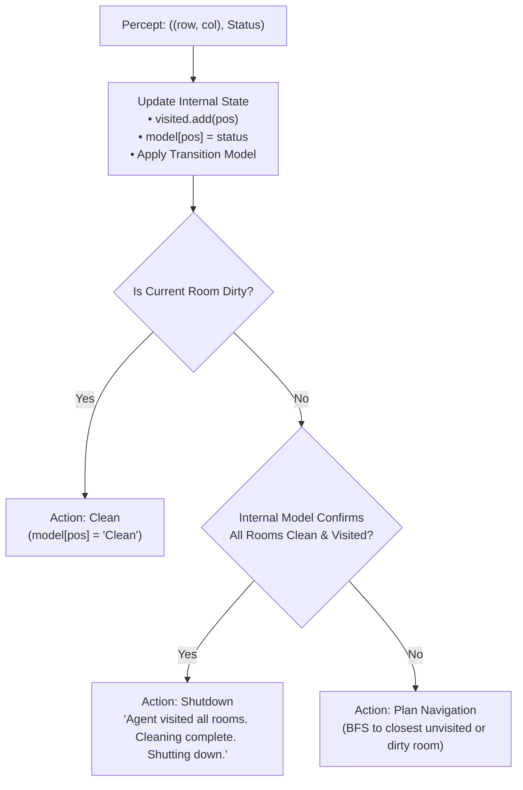

#### Running the Model-Based Agent Simulation

1. **Default Sample Scenario** (2x2 Grid: `[[Dirty, Clean], [Dirty, Dirty]]`, Start at `(0, 0)`):
   ```bash
   python scripts/run_model_based_agent.py
   ```
   *Expected Output*:
   ```text
   Step  1: Pos (0, 0) | Percept: Dirty | Action: Clean    | Visited: {(0,0)}
   Step  2: Pos (0, 0) | Percept: Clean | Action: Down     | Visited: {(0,0)}
   Step  3: Pos (1, 0) | Percept: Dirty | Action: Clean    | Visited: {(0,0), (1,0)}
   Step  4: Pos (1, 0) | Percept: Clean | Action: Right    | Visited: {(0,0), (1,0)}
   Step  5: Pos (1, 1) | Percept: Dirty | Action: Clean    | Visited: {(0,0), (1,0), (1,1)}
   Step  6: Pos (1, 1) | Percept: Clean | Action: Up       | Visited: {(0,0), (1,0), (1,1)}
   Step  7: Pos (0, 1) | Percept: Clean | Action: Shutdown | Visited: {(0,0), (0,1), (1,0), (1,1)} -> Agent visited all rooms. Cleaning complete. Shutting down.
   ```

2. **Custom Grid & Start Position**:
   ```bash
   python scripts/run_model_based_agent.py --grid "Dirty Clean, Dirty Dirty" --start-row 0 --start-col 0
   ```

3. **Optional Challenge (Stochastic Sensor Failure)**:
   ```bash
   python scripts/run_model_based_agent.py --sensor-failure 0.2 --seed 42
   ```

4. **Interactive Walkthrough Mode**:
   ```bash
   python scripts/run_model_based_agent.py --interactive
   ```

5. **Display Viva Voce Reference & Theory Guide**:
   ```bash
   python scripts/run_model_based_agent.py --viva
   ```

6. **Interactive Jupyter Notebook**:
   Open [`notebooks/model_based_reflex_agent.ipynb`](notebooks/model_based_reflex_agent.ipynb) in Jupyter Lab or Antigravity IDE.

---

### Question 4: Goal-Based Navigation Agent

- **Syllabus Area**: Intelligent Agents
- **Difficulty**: 🟡 Intermediate
- **Core AI Concept**: Goal-Based Agent, Distance Metrics (Manhattan & Euclidean), Greedy Coordinate Reduction
- **Complexity**: Time Complexity: $O(D)$ | Space Complexity: $O(D)$ where $D = |x_1 - x_2| + |y_1 - y_2|$ is Manhattan distance

#### Goal-Based Decision Architecture
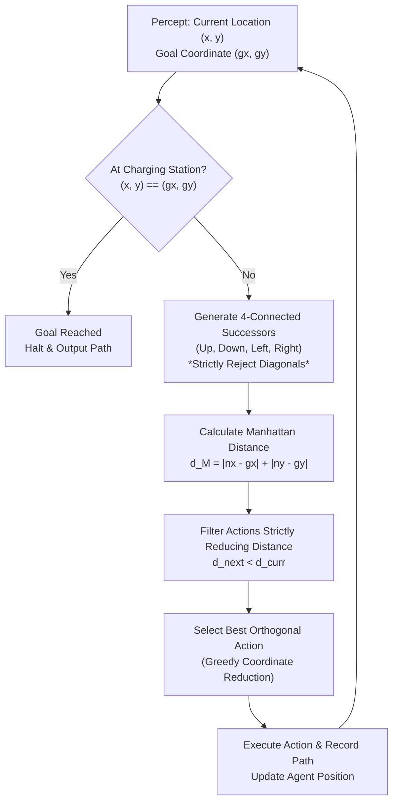

#### Running the Goal-Based Agent Simulation

1. **Default Sample Scenario** (Start: `(0, 0)`, Goal: `(3, 4)`):
   ```bash
   python scripts/run_goal_based_agent.py
   ```
   *Expected Output*:
   ```text
   Step  1: Pos (0, 0) -> Action: Down  -> Next: (1, 0) | Dist: 7 -> 6 (Decreased)
   Step  2: Pos (1, 0) -> Action: Down  -> Next: (2, 0) | Dist: 6 -> 5 (Decreased)
   Step  3: Pos (2, 0) -> Action: Down  -> Next: (3, 0) | Dist: 5 -> 4 (Decreased)
   Step  4: Pos (3, 0) -> Action: Right -> Next: (3, 1) | Dist: 4 -> 3 (Decreased)
   Step  5: Pos (3, 1) -> Action: Right -> Next: (3, 2) | Dist: 3 -> 2 (Decreased)
   Step  6: Pos (3, 2) -> Action: Right -> Next: (3, 3) | Dist: 2 -> 1 (Decreased)
   Step  7: Pos (3, 3) -> Action: Right -> Next: (3, 4) | Dist: 1 -> 0 (Decreased)

   Path: [(0, 0), (1, 0), (2, 0), (3, 0), (3, 1), (3, 2), (3, 3), (3, 4)]
   ```

2. **Custom Start & Goal Coordinates**:
   ```bash
   python scripts/run_goal_based_agent.py --start 1 1 --goal 4 2
   ```

3. **Random Goal Placement (with Seed Reproducibility)**:
   ```bash
   python scripts/run_goal_based_agent.py --random-goal --seed 42
   ```

4. **Optional Challenge (Explicit Diagonal Movement Prevention)**:
   ```bash
   python scripts/run_goal_based_agent.py --challenge
   ```

5. **Distance Metric Comparison (Manhattan $L_1$ vs. Euclidean $L_2$)**:
   ```bash
   python scripts/run_goal_based_agent.py --compare-metrics
   ```

6. **Interactive Terminal Mode**:
   ```bash
   python scripts/run_goal_based_agent.py --interactive
   ```

7. **Display Viva Voce Reference & Theory Guide**:
   ```bash
   python scripts/run_goal_based_agent.py --viva
   ```

8. **Interactive Jupyter Notebook**:
   Open [`notebooks/goal_based_navigation_agent.ipynb`](notebooks/goal_based_navigation_agent.ipynb) in Jupyter Lab or Antigravity IDE.

---

### Question 5: Utility-Based Agent Simulation

- **Syllabus Area**: Intelligent Agents
- **Difficulty**: 🟠 Advanced
- **Practical Type**: Optimization
- **Core AI Concept**: Utility-Based Agent, Cost Minimization vs. Utility Maximization, Expected Utility Theory
- **Complexity**: Time Complexity: $O(P \times L)$ | Space Complexity: $O(1)$ where $P$ is candidate paths and $L$ is path length

#### Decision & Optimization Flow
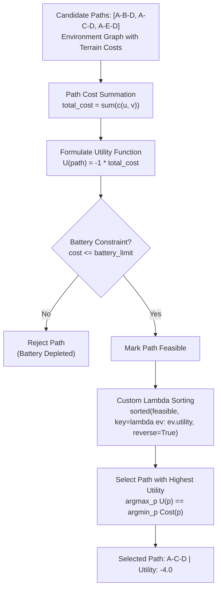

#### Running the Utility-Based Agent Simulation

1. **Default Run (3 Predefined Paths on Sample Graph)**:
   ```bash
   python scripts/run_utility_based_agent.py
   ```
   *Expected Output*:
   ```text
   Candidate Path Evaluations:
   ---------------------------------------------------------------------------
   #   Path             Terrain Breakdown          Cost    Utility  Status
   ---------------------------------------------------------------------------
   1   A-B-D            G:1 + W:5                  6.0     -6.0     FEASIBLE
   2   A-C-D            G:1 + M:3                  4.0     -4.0     SELECTED (Optimal)
   3   A-E-D            M:3 + W:5                  8.0     -8.0     FEASIBLE
   ---------------------------------------------------------------------------

   Optimization Result:
     Selected Path: A-C-D
     Total Cost:    4.0
     Utility:       -4.0
   ```

2. **Custom Paths via CLI**:
   ```bash
   python scripts/run_utility_based_agent.py --paths "A-B-D" "A-C-D"
   ```

3. **Optional Challenge (Battery Capacity Constraint)**:
   ```bash
   python scripts/run_utility_based_agent.py --challenge
   ```
   *Output*:
   ```text
   Battery Capacity Limit: 5.0 units
   Rule: Reject any path with total_cost > battery_limit regardless of utility.

   Challenge Analysis:
     [REJECTED] Path A-B-D      Cost: 6.0 > 5.0 (Battery Depleted)
     [ACCEPTED] Path A-C-D      Cost: 4.0 <= 5.0
     [REJECTED] Path A-E-D      Cost: 8.0 > 5.0 (Battery Depleted)

   Best Feasible Path: A-C-D (Cost: 4.0, Utility: -4.0)
   ```

4. **Auto-Discovery of All Directed Paths (DFS)**:
   ```bash
   python scripts/run_utility_based_agent.py --all-paths
   ```

5. **Top-Level Module Dispatcher**:
   ```bash
   python -m src utility-based
   ```

6. **Interactive Terminal Mode**:
   ```bash
   python scripts/run_utility_based_agent.py --interactive
   ```

7. **Display Viva Voce Reference & Theory Guide**:
   ```bash
   python scripts/run_utility_based_agent.py --viva
   ```

8. **Interactive Jupyter Notebook**:
   Open [`notebooks/utility_based_agent.ipynb`](notebooks/utility_based_agent.ipynb) in Jupyter Lab or Antigravity IDE.

---

### Question 6: Multi-Agent Environment Simulation

- **Syllabus Area**: Intelligent Agents
- **Difficulty**: 🟠 Advanced
- **Practical Type**: Simulation
- **Core AI Concept**: Multi-Agent Systems, Competitive/Zero-Sum Environments, Sequential vs. Episodic, Dynamic vs. Static, Turn-Based Execution, Collision Avoidance
- **Complexity**: Time Complexity: $O(S)$ where $S$ is steps | Space Complexity: $O(\text{Grid Size}) = O(16) = O(1)$

#### Multi-Agent Architecture & Turn-Based Interaction Loop
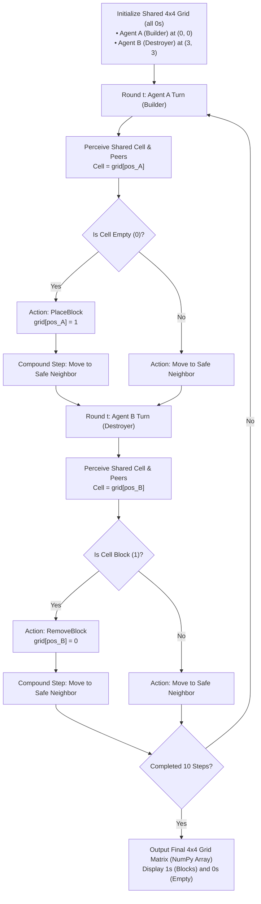

#### Running the Multi-Agent Simulation

1. **Default 10-Step Simulation** (4x4 Grid, Builder at `(0, 0)`, Destroyer at `(3, 3)`):
   ```bash
   python scripts/run_multi_agent_simulation.py --steps 10
   ```
   *Sample Output*:
   ```text
   Sample Output (NumPy Matrix displaying 1s and 0s):
   [[1 1 0 0]
    [1 1 1 0]
    [0 1 1 0]
    [0 0 0 0]]

   ======================================================================
                  MULTI-AGENT ENVIRONMENT SIMULATION SUMMARY             
   ======================================================================
   Execution Mode:             Compound Turns
   Total Rounds (Steps):       10
   Agent A:                    Agent_A (Builder) | Start: (0, 0) -> Final: (1, 3)
   Agent B:                    Agent_B (Destroyer) | Start: (3, 3) -> Final: (2, 0)
   Performance Metrics:        Builder placed 9 blocks | Destroyer removed 2 blocks | Net: +7
   Final Block Count in Grid:  7 / 16
   Collision Avoidance:        Disabled
   Collisions Avoided:         0
   Collisions Occurred:        1
   ----------------------------------------------------------------------
   Final Grid State Matrix (NumPy Array):
   [[1 1 0 0]
    [1 1 1 0]
    [0 1 1 0]
    [0 0 0 0]]
   ======================================================================
   ```

2. **Optional Challenge (Active Collision Awareness & Avoidance)**:
   ```bash
   python scripts/run_multi_agent_simulation.py --challenge
   ```
   *Output Highlights*:
   ```text
   Collision Avoidance: ENABLED (Optional Challenge)
   Collisions Avoided:  2
   Collisions Occurred: 0
   ```

3. **Discrete Turn Mode (Act OR Move)**:
   ```bash
   python scripts/run_multi_agent_simulation.py --mode discrete --steps 10
   ```

4. **Greedy Heuristic Movement Strategy**:
   ```bash
   python scripts/run_multi_agent_simulation.py --strategy greedy --steps 10
   ```

5. **Top-Level Module Dispatcher**:
   ```bash
   python -m src multi-agent --steps 10
   ```

6. **Interactive Step-by-Step Walkthrough**:
   ```bash
   python scripts/run_multi_agent_simulation.py --interactive
   ```

7. **Display Viva Voce Reference & Theory Guide**:
   ```bash
   python scripts/run_multi_agent_simulation.py --viva
   ```

8. **Interactive Jupyter Notebook**:
   Open [`notebooks/multi_agent_simulation.ipynb`](notebooks/multi_agent_simulation.ipynb) in Jupyter Lab or Antigravity IDE.

### Question 7: Stochastic Environment Vacuum Agent

- **Syllabus Area**: Intelligent Agents
- **Difficulty**: 🟠 Advanced
- **Practical Type**: Simulation
- **Core AI Concept**: Stochastic Environments, Non-deterministic Actions, Actuator Slippage, Monte Carlo Estimation
- **Python Concepts Tested**: `random` module (`random.random()`), statistical averaging (`statistics`), loops, dataclasses
- **Complexity**: Time Complexity: $O(\text{Runs} \times \text{Steps})$ | Space Complexity: $O(\text{Runs})$

#### Probabilistic Actuator State Transition Model
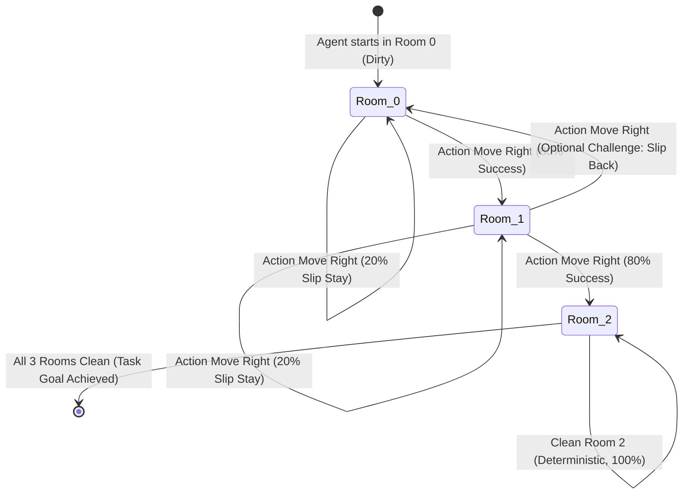

#### Theoretical Expectation vs. Deterministic Baseline

| Metric | Deterministic Baseline | Stochastic Environment ($p=0.8$) |
| :--- | :--- | :--- |
| **Cleaning Steps** | 3 steps ($1$ step per room) | 3 steps ($1$ step per room) |
| **Room Transitions** | 2 steps ($1$ step per move) | $\mathbb{E}[\text{Moves}] = 2 \times \frac{1}{0.8} = 2.5$ steps |
| **Total Expected Steps** | **5.0 steps** | **5.5 steps** |
| **Performance Penalty** | Baseline (0.0 steps) | **+0.5 steps (+10.0% execution delay)** |

#### Running the Stochastic Vacuum Agent Simulation

1. **Standard Monte Carlo Batch (20 Runs)**:
   ```bash
   python scripts/run_stochastic_vacuum_agent.py --runs 20
   ```
   *Expected Output*:
   ```text
   Average steps to clean 3 rooms: 5.4 steps
   ```

2. **Reproducible Benchmark (Seed 28 reproduces sample output exactly)**:
   ```bash
   python scripts/run_stochastic_vacuum_agent.py --runs 20 --seed 28
   ```

3. **Detailed Step-by-Step Trajectory Trace**:
   ```bash
   python scripts/run_stochastic_vacuum_agent.py --runs 20 --seed 28 --trace
   ```

4. **Optional Challenge: Actuator 'Slip Back' Mechanics**:
   ```bash
   python scripts/run_stochastic_vacuum_agent.py --challenge --seed 42
   ```

5. **Display Viva Voce Theory & Reference Guide**:
   ```bash
   python scripts/run_stochastic_vacuum_agent.py --viva
   ```

6. **Top-Level Package Dispatcher**:
   ```bash
   python -m src stochastic --runs 20 --seed 28
   ```

7. **Interactive Jupyter Notebook**:
   Open [`notebooks/stochastic_vacuum_agent.ipynb`](notebooks/stochastic_vacuum_agent.ipynb) in Jupyter Lab or Antigravity IDE.

---

### Question 8: Environment Type Classifier

- **Syllabus Area**: Intelligent Agents
- **Difficulty**: 🟡 Intermediate
- **Practical Type**: Knowledge Representation
- **Core AI Concept**: Environment Properties (PEAS), Environmental Taxonomy, Knowledge Dictionary Representation
- **Python Concepts Tested**: Tuples as dictionary keys, robust boolean input parsing, nearest-neighbor Hamming distance
- **Complexity**: Time Complexity: (1)$ dictionary lookup | Space Complexity: (K)$ for knowledge base ( \le 32$)

#### Knowledge Representation & Lookup Flowchart
`mermaid
flowchart TD
    User([User Prompt / CLI Input]) --> Parse[Parse Flexible Booleans]
    Parse --> Vector[5-Boolean Tuple Key: Obs, Det, Epi, Stat, Disc]
    Vector --> Lookup{O 1 Hash Key in Knowledge Base?}
    Lookup -->|Exact Key Found| Meta[Retrieve EnvironmentMetadata]
    Meta --> Success([Display Exact Match & PEAS Breakdown])
    Lookup -->|Unknown Combination| Challenge{Nearest-Neighbor Fallback?}
    Challenge -->|Enabled| Metric[Compute Hamming Distance D_H to all K entries]
    Metric --> Rank[Find Minimum Distance Tier]
    Rank --> Nearest([Display Nearest Environment & Property Differences])
    Challenge -->|Disabled| Graceful([Inform Unknown Combination Gracefully])
`

#### Canonical AI Environment Taxonomy (Russell & Norvig Table 2.1)

| Environment | Observable | Deterministic | Episodic | Static | Discrete | Agent Type |
| :--- | :---: | :---: | :---: | :---: | :---: | :--- |
| **Backgammon (with clock)** *(Sample)* | **True** | **False** (Dice) | **False** (Seq) | **False** (Clock) | **True** | Multi-Agent (Competitive) |
| **Backgammon (without clock)** | **True** | **False** (Dice) | **False** (Seq) | **True** | **True** | Multi-Agent (Competitive) |
| **Chess (with clock)** | **True** | **True** | **False** (Seq) | **False** (Clock) | **True** | Multi-Agent (Competitive) |
| **Chess (without clock) / Crossword** | **True** | **True** | **False** (Seq) | **True** | **True** | Multi / Single-Agent |
| **Poker (with clock)** | **False** (Hidden) | **False** (Deck) | **False** (Seq) | **False** (Clock) | **True** | Multi-Agent (Imperfect Info) |
| **Poker (without clock)** | **False** (Hidden) | **False** (Deck) | **False** (Seq) | **True** | **True** | Multi-Agent (Imperfect Info) |
| **Medical Diagnosis / Taxi Driving** | **False** | **False** | **False** (Seq) | **False** (Dynamic) | **False** (Cont) | Single / Multi-Agent |
| **Part-Picking Robot** | **False** | **False** | **True** (Episodic) | **False** (Belt) | **False** (Cont) | Single-Agent |
| **Image Analysis (Discrete)** | **True** | **True** | **True** (Episodic) | **True** | **True** | Single-Agent |
| **Battleship (Simplified)** | **False** | **True** | **False** (Seq) | **True** | **True** | Multi-Agent (Competitive) |

#### Running the Environment Type Classifier

1. **Interactive Prompt Mode** (Prompts user for 5 environmental properties):
   `ash
   python scripts/run_environment_classifier.py
   `

2. **Direct Tuple Input** (Sample execution matching Backgammon):
   `ash
   python scripts/run_environment_classifier.py --input True,False,False,False,True
   `
   *Expected Output*:
   `	ext
   Environment Match: Backgammon
   `

3. **Individual Environmental Dimension Flags**:
   `ash
   python scripts/run_environment_classifier.py --observable yes --deterministic yes --episodic no --static no --discrete yes
   `
   *Output*:
   `	ext
   Environment Match: Chess (with clock)
   `

4. **Standard Textbook Environments Demonstration Suite**:
   `ash
   python scripts/run_environment_classifier.py --demo
   `

5. **Optional Challenge: Nearest-Neighbor Distance Metric (Hamming Distance)**:
   `ash
   python scripts/run_environment_classifier.py --challenge
   `

6. **Display Viva Voce Theory & Reference Guide**:
   `ash
   python scripts/run_environment_classifier.py --viva
   `

7. **Top-Level Package Dispatcher**:
   `ash
   python -m src environment-classifier --input True,False,False,False,True
   `

8. **Interactive Jupyter Notebook**:
   Open [
otebooks/environment_type_classifier.ipynb](notebooks/environment_type_classifier.ipynb) in Jupyter Lab or Antigravity IDE.

---

### Question 9: Agent Performance Measure Evaluator

- **Syllabus Area**: Intelligent Agents
- **Difficulty**: 🟡 Intermediate
- **Practical Type**: Algorithm Design
- **Core AI Concept**: Performance Measure, Rationality, Omniscience vs. Rationality, PEAS Evaluation
- **Python Concepts Tested**: List iteration, arithmetic updates, string matching, CSV stream processing
- **Complexity**: Time Complexity: $O(N)$ log length | Space Complexity: $O(1)$ auxiliary space

#### Autonomous Delivery Drone PEAS Specification

| PEAS Dimension | Drone Specification | Impact on Agent Rationality |
| :--- | :--- | :--- |
| **Performance Measure (P)** | $+10$ / delivery, $-1$ / move, $-5$ / bump | Objective utility function balancing mission completion, latency, and flight safety |
| **Environment (E)** | Urban airspace, buildings, power lines, wind, landing pads | Dynamic, partially observable, stochastic, continuous 3D world |
| **Actuators (A)** | Quadcopter/hexacopter rotors, pitch/yaw motors, parcel winch/gripper | Translates movement actions into physical flight trajectory |
| **Sensors (S)** | GPS receiver, 3D LiDAR scanner, ultrasonic sonars, downward camera, IMU | Supplies real-time percepts for obstacle detection and landing |

#### Performance Score Evaluation Model

```mermaid
flowchart TD
  Log["Simulated Action Event Stream: [move, move, bump, move, deliver]"] --> Seq[Linear Sequential Processing O(N)]
  Seq --> Match{Action Type}
  Match -->|move| Cost["Subtract Move Cost (-1 pt)"]
  Match -->|bump| Penalty["Subtract Collision Penalty (-5 pts)"]
  Match -->|deliver| Reward["Add Delivery Reward (+10 pts)"]
  Cost --> Running["Update Running Score (O(1) Memory)"]
  Penalty --> Running
  Reward --> Running
  Running --> Next{More Events?}
  Next -->|Yes| Match
  Next -->|No| Final["Output Final PEAS Performance Score: 2 (10 - 3 moves - 5 bump)"]
```

#### Running the Agent Performance Evaluator

1. **Standard Sample Benchmark Run**:
   ```bash
   python scripts/run_agent_performance_evaluator.py
   ```
   *Expected Output*:
   ```text
   Performance Score: 2 (10 - 3 moves - 5 bump)
   ```

2. **Custom Inline Event Sequence**:
   ```bash
   python scripts/run_agent_performance_evaluator.py --events move,move,bump,move,deliver
   ```

3. **Detailed Step-by-Step Flight Audit Table**:
   ```bash
   python scripts/run_agent_performance_evaluator.py --detailed
   ```

4. **Optional Challenge: Read Action Log from External CSV File**:
   ```bash
   python scripts/run_agent_performance_evaluator.py --csv data/raw/drone_actions_sample.csv
   ```

5. **Automated Demonstration Benchmark Suite**:
   ```bash
   python scripts/run_agent_performance_evaluator.py --demo
   ```

6. **Interactive Step-by-Step Terminal Prompt**:
   ```bash
   python scripts/run_agent_performance_evaluator.py --interactive
   ```

7. **Display Viva Voce Theory & Reference Guide**:
   ```bash
   python scripts/run_agent_performance_evaluator.py --viva
   ```

8. **Top-Level Package Dispatcher**:
   ```bash
   python -m src agent-evaluator --events move,move,bump,move,deliver
   ```

9. **Interactive Jupyter Notebook**:
   Open [`notebooks/agent_performance_evaluator.ipynb`](notebooks/agent_performance_evaluator.ipynb) in Jupyter Lab or Antigravity IDE.

---

### Question 10: State-Space Visualizer for Reflex Agent

- **Syllabus Area**: Intelligent Agents
- **Difficulty**: 🟠 Advanced
- **Practical Type**: Visualization & State-Space Formulation
- **Core AI Concept**: State-Space Formulation, Transition Model, Goal States, Cyclic Transitions
- **Python Concepts Tested**: Combinatorial state generation (`itertools`), NetworkX directed graphs (`DiGraph` & `MultiDiGraph`), Matplotlib publication-grade plotting
- **Complexity**: Time Complexity: $O(|S|^2)$ | Space Complexity: $O(|S|^2)$
- **Optional Challenge**: Highlight the goal states (both rooms clean) in emerald green.

#### State Space Size Formula & Combinatorial Model

For an environment with $n$ locations and $k$ cleanliness status levels:
$$|S| = n \times k^n$$

For the standard 2-room vacuum cleaner environment ($n = 2, k = 2$):
$$|S| = 2 \times 2^2 = 8 \text{ discrete states}$$

#### The 8 Canonical States (Russell & Norvig AIMA Convention)

| State ID | Agent Location | Room A Status | Room B Status | Goal State? |
| :--- | :--- | :--- | :--- | :--- |
| **S1** | A | Dirty | Dirty | No |
| **S2** | B | Dirty | Dirty | No |
| **S3** | A | Clean | Dirty | No |
| **S4** | B | Clean | Dirty | No |
| **S5** | A | Dirty | Clean | No |
| **S6** | B | Dirty | Clean | No |
| **S7** | A | Clean | Clean | **YES (Emerald Green Goal State)** |
| **S8** | B | Clean | Clean | **YES (Emerald Green Goal State)** |

#### Action Transitions & Cyclic Self-Loop Dynamics

Valid actions are $A = \{\text{Left}, \text{Right}, \text{Suck}\}$. Total transitions across the state space:
$$8 \text{ states} \times 3 \text{ actions} = 24 \text{ directed transitions}$$

- **Cyclic Transitions (Self-Loops)**: Exactly 12 out of 24 transitions (50%) produce $\text{Result}(s, a) = s$:
  - 4 `Left` self-loops: Occur whenever agent is in Room A (States 1, 3, 5, 7).
  - 4 `Right` self-loops: Occur whenever agent is in Room B (States 2, 4, 6, 8).
  - 4 `Suck` self-loops: Occur whenever agent sucks in an already clean room (States 3, 6, 7, 8).
- **State-Changing Transitions**: Exactly 12 out of 24 transitions (50%) transition to a different state.

#### State Space Graph Architecture

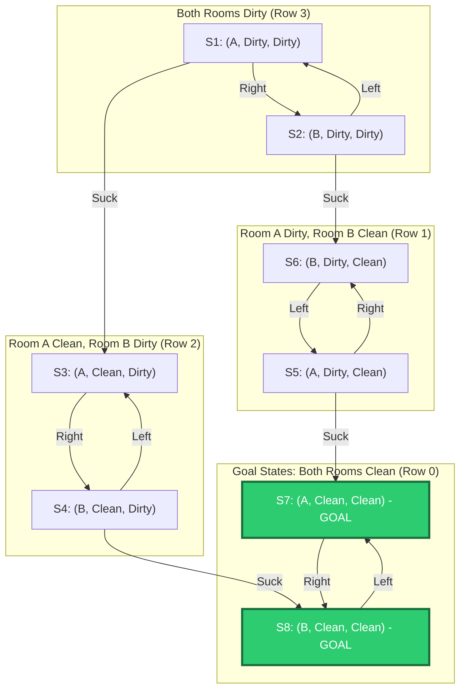

#### Running the State-Space Visualizer

1. **Default Run (ASCII Table & Graph Generation)**:
   ```bash
   python scripts/run_state_space_visualizer.py
   ```

2. **Display Interactive Matplotlib Graph Window**:
   ```bash
   python scripts/run_state_space_visualizer.py --show
   ```

3. **Save High-Resolution Graph Image**:
   ```bash
   python scripts/run_state_space_visualizer.py --save reports/state_space_graph.png
   ```

4. **Alternative Graph Topologies (Circular, Spring)**:
   ```bash
   python scripts/run_state_space_visualizer.py --layout circular --save reports/state_space_circular.png
   ```

5. **Display Detailed 8-State Transition Table**:
   ```bash
   python scripts/run_state_space_visualizer.py --table
   ```

6. **Display 8x8 Adjacency Matrix ($O(|S|^2)$)**:
   ```bash
   python scripts/run_state_space_visualizer.py --matrix
   ```

7. **Cyclic Transitions & Self-Loop Audit**:
   ```bash
   python scripts/run_state_space_visualizer.py --cycles
   ```

8. **Optimal Shortest Paths to Goal (BFS Search)**:
   ```bash
   python scripts/run_state_space_visualizer.py --search
   ```

9. **Run Complete Demonstration Suite**:
   ```bash
   python scripts/run_state_space_visualizer.py --demo
   ```

10. **Display Viva Voce Theory & Reference Guide**:
    ```bash
    python scripts/run_state_space_visualizer.py --viva
    ```

11. **Top-Level Package Dispatcher**:
    ```bash
    python -m src state-space --table
    ```

12. **Interactive Jupyter Notebook**:
    Open [`notebooks/state_space_visualizer.ipynb`](notebooks/state_space_visualizer.ipynb) in Jupyter Lab or Antigravity IDE.

---

### Question 11: Breadth-First Search (BFS) on User-Defined Graph

- **Syllabus Area**: Uninformed Search Techniques
- **Difficulty**: 🟢 Beginner
- **Practical Type**: Implementation & Level-Order Traversal
- **Core AI Concept**: Breadth-First Search (BFS), FIFO Frontier Queue, Visited / Explored Set
- **Python Concepts Tested**: Dictionaries (`Dict` adjacency list), `collections.deque`, `while` loops, path reconstruction
- **Expected Algorithm / Technique**: Level-order graph traversal (FIFO queue)
- **Complexity Expectation**: Time Complexity: $O(V + E)$ | Space Complexity: $O(V)$
- **Constraints / Conditions**: Nodes must be visited in alphabetical order if tied.
- **University Practical Importance**: Very High
- **Optional Challenge**: Modify to return the number of levels (depth) of the graph.

#### Problem Statement & Task Requirements

Write a Python program to implement Breadth-First Search (BFS) on a directed graph. The program must traverse the graph starting from a user-defined source node, maintain a visited set to avoid cycles, and print the nodes in the exact order they are expanded.

1. **Graph Representation**: Represent the directed graph using a Python dictionary (adjacency list).
2. **FIFO Frontier Queue**: Use `collections.deque` for the search frontier open list.
3. **Visited Set**: Maintain a `set` to track discovered nodes and avoid infinite loops on cycles.
4. **Deterministic Tie-Breaking**: When multiple successor nodes are tied at the same parent, expand them in alphabetical order.
5. **Output**: Print the nodes in the exact order they are expanded.
6. **Optional Challenge**: Return the total number of depth levels and the maximum depth of the graph.

#### Sample Input & Output Verification

- **Sample Graph**: `{'A': ['B', 'C'], 'B': ['D'], 'C': [], 'D': []}`
- **Start Node**: `'A'`
- **Expected Traversal**: `BFS Traversal: A, B, C, D`
- **Optional Challenge Levels**:
  - Level 0 (depth 0): `['A']`
  - Level 1 (depth 1): `['B', 'C']`
  - Level 2 (depth 2): `['D']`
  - Total Levels Count: `3` | Maximum Depth: `2`

#### Algorithm Walkthrough & Architectural Diagram

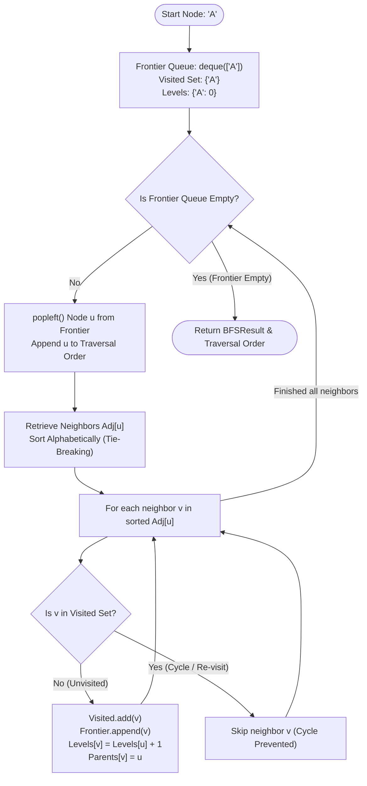

#### Chronological FIFO Frontier Trace Table (Sample Graph)

| Step | Node Expanded | Depth Level | Parent | Discovered & Enqueued | FIFO Frontier Queue Snapshot | Visited Set Snapshot |
| :--- | :--- | :--- | :--- | :--- | :--- | :--- |
| **1** | **A** | 0 | `ROOT` | `['B', 'C']` | `['B', 'C']` | `{'A', 'B', 'C'}` |
| **2** | **B** | 1 | `A` | `['D']` | `['C', 'D']` | `{'A', 'B', 'C', 'D'}` |
| **3** | **C** | 1 | `A` | `[]` (None) | `['D']` | `{'A', 'B', 'C', 'D'}` |
| **4** | **D** | 2 | `B` | `[]` (None) | `[]` (Empty) | `{'A', 'B', 'C', 'D'}` |

#### Performance & Asymptotic Complexity Analysis

- **Time Complexity: $O(V + E)$**
  - **Vertex Processing**: Every vertex $v \in V$ reachable from the start node is enqueued once and dequeued once from the `collections.deque` frontier. Because `deque.append()` and `deque.popleft()` operate in $O(1)$ amortized time, all queue manipulations take $O(V)$ time.
  - **Edge Processing**: When node $u$ is expanded, each of its outgoing directed edges $(u, v) \in E$ is scanned exactly once. Across the entire traversal, the sum of outgoing degrees is $\sum_{u \in V} \text{deg}^+(u) = O(E)$.
  - **Total Time**: $O(V + E)$ for adjacency list representation.
- **Space Complexity: $O(V)$**
  - **Visited Set**: Stores at most $V$ node identifiers, requiring $O(V)$ memory.
  - **Frontier Queue**: At any moment, the frontier contains vertices from at most two consecutive depth layers. In the worst case (e.g., a star graph or dense level), it stores $O(V)$ vertices.
  - **Parents & Levels Mappings**: Each maps at most $V$ vertices, requiring $O(V)$ memory.

#### Complete Execution Guide

1. **Default Run (Sample Graph from Question 11)**:
   ```bash
   python scripts/run_breadth_first_search.py
   ```

2. **Custom Graph via Command Line**:
   ```bash
   # Python dictionary literal
   python scripts/run_breadth_first_search.py --graph "{'A': ['B', 'C'], 'B': ['D'], 'C': [], 'D': []}" --start A

   # Compact adjacency format
   python scripts/run_breadth_first_search.py --graph "A: B, C; B: D; C:; D:" --start A

   # Directed edge-list format
   python scripts/run_breadth_first_search.py --graph "A->B, A->C, B->D" --start A
   ```

3. **Interactive Console Wizard**:
   ```bash
   python scripts/run_breadth_first_search.py --interactive
   ```

4. **Run Optional Challenge (Levels and Graph Depth Analysis)**:
   ```bash
   python scripts/run_breadth_first_search.py --challenge
   ```

5. **Run Benchmark Demonstration Suite (Cycles, Trees, Disconnected Graphs)**:
   ```bash
   python scripts/run_breadth_first_search.py --demo
   ```

6. **Generate and Save Graphical Visualization**:
   ```bash
   python scripts/run_breadth_first_search.py --save reports/bfs_traversal.png
   ```

7. **Display Viva Voce Theory & Reference Guide**:
   ```bash
   python scripts/run_breadth_first_search.py --viva
   ```

8. **Top-Level Package Dispatcher**:
   ```bash
   python -m src bfs --start A
   ```

9. **Interactive Jupyter Notebook**:
   Open [`notebooks/breadth_first_search.ipynb`](notebooks/breadth_first_search.ipynb) in Jupyter Lab or Antigravity IDE.

#### Viva Voce Questions & Authoritative Answers

##### 1. FIFO Queue Mechanism & `collections.deque` vs. `list`
- **Question**: Why does BFS require a FIFO queue, and why must `collections.deque` be used instead of a standard Python `list`?
- **Answer**:
  - BFS must explore states in exact order of their distance (depth) from the root. A First-In, First-Out (FIFO) queue guarantees that all nodes at level $k$ are dequeued and expanded before any node at level $k+1$ is expanded.
  - In CPython, `collections.deque` is implemented as a doubly-linked list of fixed-size contiguous memory blocks (chunks of 64 elements). Appending (`append()`) and popping from the left (`popleft()`) both execute in **$O(1)$ amortized time**.
  - In contrast, a Python `list` is a contiguous dynamic array of object references. While `list.append()` is $O(1)$ amortized, `list.pop(0)` is strictly **$O(N)$** because all remaining $N-1$ element pointers must be shifted in memory. Using `list.pop(0)` in BFS degrades overall search complexity from $O(V + E)$ to $O(V^2 + E)$.

##### 2. Completeness and Optimality of BFS
- **Question**: Is Breadth-First Search complete and optimal? Under what conditions?
- **Answer**:
  - **Completeness**: BFS is complete provided the branching factor $b$ is finite ($b < \infty$). In graph search with a `visited` set, it is guaranteed to terminate on finite graphs even if cyclic.
  - **Optimality**: BFS is optimal **if and only if all step costs are identical/uniform** (e.g., unit edge cost $c = 1$). Under uniform step costs, the shallowest goal state is guaranteed to be the least-cost path.
  - If step costs are non-uniform or arbitrary (e.g., varying road distances or terrain weights), BFS is **not optimal** because a deeper path with smaller weights might have lower total cost than a shallow path with heavy weights. In that case, **Uniform-Cost Search (UCS / Dijkstra's Algorithm)** must be used.

##### 3. Time Complexity Derivation
- **Question**: Derive the time complexity of BFS on both graph search and tree search formulations.
- **Answer**:
  - **Graph Search**: On a graph with $V$ vertices and $E$ edges using an adjacency list:
    $$\mathcal{O}(V + E)$$
    Each reachable vertex is pushed to the FIFO queue and visited set once ($O(V)$), and its outgoing adjacency list is traversed once during expansion ($\sum \text{deg}^+(u) = O(E)$).
  - **Tree Search (Branching Factor $b$, Goal Depth $d$)**:
    At depth 0: $1$ node.
    At depth 1: $b$ nodes.
    At depth 2: $b^2$ nodes.
    At depth $d$: $b^d$ nodes.
    Sum of geometric progression:
    $$T(b, d) = 1 + b + b^2 + \dots + b^d = \frac{b^{d+1} - 1}{b - 1} = \mathcal{O}(b^d)$$
    If the goal test is applied when a node is expanded rather than when generated, the algorithm explores nodes at level $d+1$, yielding $\mathcal{O}(b^{d+1})$.

##### 4. Space Complexity Bottleneck
- **Question**: Why is space complexity the primary practical limitation of BFS compared to DFS?
- **Answer**:
  - BFS has a space complexity of $\mathcal{O}(b^d)$ because every generated node must remain in memory (either in the frontier queue or the visited table). The frontier alone at level $d$ holds up to $b^d$ nodes.
  - In contrast, Depth-First Search (DFS) only needs to store the current active path from the root to the leaf plus unexpanded siblings, requiring only $\mathcal{O}(b \cdot d)$ linear memory.
  - For example, with branching factor $b = 10$ and depth $d = 8$, BFS must store $10^8$ nodes in memory ($\approx 10$ to $100\text{ GB}$ of RAM), exhausting system memory within minutes, whereas DFS requires storing only $10 \times 8 = 80$ nodes.

---

### Question 12: Depth-First Search (DFS) for Graph Traversal

- **Syllabus Area**: Uninformed Search Techniques
- **Difficulty**: 🟢 Beginner
- **Practical Type**: Implementation & Deep State-Space Exploration
- **Core AI Concept**: Depth-First Search (DFS), LIFO Frontier Stack, Backtracking, Visited Set, Cycle Prevention
- **Python Concepts Tested**: Recursion, explicit `list` stack manipulation (`append()` and `pop()`), dictionary adjacency lists
- **Expected Algorithm / Technique**: Depth-first traversal (LIFO frontier)
- **Complexity Expectation**: Time Complexity: $\mathcal{O}(V + E)$ | Space Complexity: $\mathcal{O}(V)$
- **Constraints / Conditions**: Graph may contain cycles (must prevent infinite loops).
- **University Practical Importance**: Very High
- **Optional Challenge**: Implement both iterative and recursive versions and compare output.

#### Problem Statement & Task Requirements

Implement Depth-First Search (DFS) in Python to traverse an unweighted graph. The program must explore as far as possible along each branch before backtracking. Output the exploration path.

1. **Stack or Recursion**: Implement DFS using an explicit stack (`list`) OR recursion.
2. **Cycle Avoidance**: Track explored nodes to prevent infinite loops in cyclic graphs.
3. **Neighbor Processing**: Process neighbor nodes systematically.
4. **Input Requirements**: Graph dictionary, Start node.
5. **Expected Output**: List of nodes in DFS traversal order.
6. **Optional Challenge**: Implement both iterative and recursive versions and compare output.

#### Sample Input & Output Verification

- **Sample Graph**: `{'1': ['2', '3'], '2': ['4'], '3': [], '4': []}`
- **Start Node**: `'1'`
- **Expected Traversal**: `DFS Traversal: 1, 3, 2, 4`

#### Traversal Order Nuance: Forward-Push Stack vs. Standard Recursion

A classic and insightful property of Depth-First Search is how successor node ordering impacts the visited sequence:

1. **Iterative DFS with Standard Forward-Push (Sample Output Match)**:
   - When node `'1'` expands its neighbors `['2', '3']` and pushes them onto the LIFO stack in order (`stack.append('2')`, then `stack.append('3')`), node `'3'` sits at the **top** of the stack.
   - The subsequent `stack.pop()` extracts `'3'` first, resulting in the exploration order:
     $$\mathbf{1 \to 3 \to 2 \to 4}$$
   - This matches the university problem statement's exact sample output!
2. **Standard Recursive DFS (Left-to-Right)**:
   - In standard recursive DFS, a loop `for neighbor in graph[node]` visits `'2'` before `'3'`. It explores deeply down `'2'` to `'4'`, backtracks to `'1'`, and then visits `'3'`:
     $$\mathbf{1 \to 2 \to 4 \to 3}$$
3. **Order-Preserving Iterative DFS (Reverse-Push)**:
   - If the iterative algorithm pushes neighbors in reversed order (`for neighbor in reversed(graph[node]): stack.append(neighbor)`), node `'2'` remains on top of the stack and is popped first, producing the identical sequence to standard recursion:
     $$\mathbf{1 \to 2 \to 4 \to 3}$$

Both ordering models are supported and compared side-by-side in this laboratory implementation.

#### Algorithm Walkthrough & Architectural Diagram

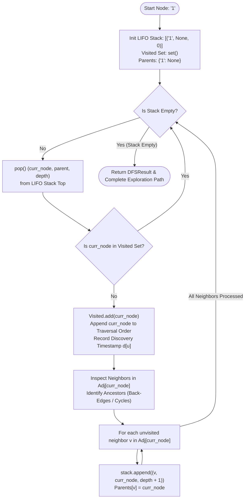

#### Chronological LIFO Frontier Trace Table (Sample Graph)

| Step | Node Popped | Action | Depth | Parent | Unvisited Pushed to Stack | LIFO Stack Snapshot (Top on Right) | Visited Nodes Sequence |
| :--- | :--- | :--- | :--- | :--- | :--- | :--- | :--- |
| **1** | **1** | `EXPAND` | 0 | `ROOT` | `['2', '3']` | `['2', '3']` (Top: 3) | `['1']` |
| **2** | **3** | `EXPAND` | 1 | `1` | `[]` (None) | `['2']` (Top: 2) | `['1', '3']` |
| **3** | **2** | `EXPAND` | 1 | `1` | `['4']` | `['4']` (Top: 4) | `['1', '3', '2']` |
| **4** | **4** | `EXPAND` | 2 | `2` | `[]` (None) | `[]` (Empty) | `['1', '3', '2', '4']` |

#### Optional Challenge: Side-by-Side Comparison of Iterative vs. Recursive DFS

| Implementation Variant | Traversal Order | Step Count | Frontier Mechanism | Order Preserved? |
| :--- | :--- | :--- | :--- | :--- |
| **1. Iterative (Standard Forward-Push)** | `1, 3, 2, 4` | 4 | Explicit `list` stack (`pop()`) | No (LIFO reverses order) |
| **2. Recursive (Standard Forward-Call)** | `1, 2, 4, 3` | 8 | Implicit runtime call stack | Yes (Left-to-right) |
| **3. Iterative (Order-Preserving Reverse-Push)** | `1, 2, 4, 3` | 4 | Explicit `list` stack (`pop()`) | Yes (Matches standard recursion) |
| **4. Recursive (Reversed-Call)** | `1, 3, 2, 4` | 8 | Implicit runtime call stack | No (Matches forward-push stack) |

#### Performance & Asymptotic Complexity Analysis

- **Time Complexity: $\mathcal{O}(V + E)$**
  - **Vertex Processing**: Every vertex $v \in V$ reachable from the start node is pushed and popped from the stack at most once. Visited set operations (`add`, `in`) execute in $\mathcal{O}(1)$ average time. Total vertex time is $\mathcal{O}(V)$.
  - **Edge Processing**: When node $u$ is expanded, each of its outgoing directed edges $(u, v) \in E$ is evaluated once to check whether $v$ is an ancestor (back edge), unvisited neighbor (tree edge), or cross edge. The sum across all vertices is $\sum_{u \in V} \text{deg}^+(u) = \mathcal{O}(E)$.
  - **Total Time**: $\mathcal{O}(V + E)$ for adjacency list graph representation.
- **Space Complexity: $\mathcal{O}(V)$ (Graph Search) / $\mathcal{O}(b \cdot m)$ (Tree Search)**
  - **Graph Search**: The `visited` set and LIFO stack store at most $V$ node labels, yielding $\mathcal{O}(V)$ auxiliary memory.
  - **Tree Search Advantage**: Unlike BFS which must maintain the entire exponential frontier width $\mathcal{O}(b^d)$, DFS needs to retain only the single current branch from root to leaf, plus unexpanded sibling choices at each level, requiring strictly linear memory $\mathcal{O}(b \cdot m)$ where $b$ is the branching factor and $m$ is the maximum tree depth.

#### Complete Execution Guide

1. **Default Run (Sample Graph from Question 12: Output `1, 3, 2, 4`)**:
   ```bash
   python scripts/run_depth_first_search.py
   ```

2. **Custom Graph via Command Line**:
   ```bash
   # Python dictionary literal
   python scripts/run_depth_first_search.py --graph "{'1': ['2', '3'], '2': ['4'], '3': [], '4': []}" --start 1

   # Compact adjacency format
   python scripts/run_depth_first_search.py --graph "1: 2, 3; 2: 4; 3:; 4:" --start 1

   # Directed edge-list format
   python scripts/run_depth_first_search.py --graph "1->2, 1->3, 2->4" --start 1
   ```

3. **Optional Challenge (Iterative vs. Recursive Comparison)**:
   ```bash
   python scripts/run_depth_first_search.py --challenge
   ```

4. **Interactive Console Wizard**:
   ```bash
   python scripts/run_depth_first_search.py --interactive
   ```

5. **Run Benchmark Demonstration Suite (Cycles, Trees, Disconnected Graphs, DAGs)**:
   ```bash
   python scripts/run_depth_first_search.py --demo
   ```

6. **Generate and Save Graphical Visualization**:
   ```bash
   python scripts/run_depth_first_search.py --save reports/dfs_traversal.png
   ```

7. **Display Viva Voce Theory & Reference Guide**:
   ```bash
   python scripts/run_depth_first_search.py --viva
   ```

8. **Top-Level Package Dispatcher**:
   ```bash
   python -m src dfs --start 1
   ```

9. **Interactive Jupyter Notebook**:
   Open [`notebooks/depth_first_search.ipynb`](notebooks/depth_first_search.ipynb) in Jupyter Lab or Antigravity IDE.

#### Viva Voce Questions & Authoritative Answers

##### 1. Stack vs. Queue (LIFO vs. FIFO)
- **Question**: What is the fundamental difference between the frontier data structures of DFS and BFS, and how are they implemented in Python?
- **Answer**:
  - DFS uses a **Last-In, First-Out (LIFO) Stack**, whereas BFS uses a **First-In, First-Out (FIFO) Queue**.
  - In DFS, the most recently generated successor is expanded first, forcing search deep along a single branch before backtracking. In BFS, nodes are expanded in chronological discovery order, enforcing level-by-level exploration.
  - In Python, an iterative DFS stack is implemented directly using a built-in `list` with amortized $\mathcal{O}(1)$ `append()` and $\mathcal{O}(1)$ `pop()`. In contrast, BFS requires `collections.deque` because `list.pop(0)` is $\mathcal{O}(N)$ due to dynamic memory element shifting.

##### 2. Why DFS is Not Optimal
- **Question**: Why is Depth-First Search considered non-optimal, even when step costs are uniform?
- **Answer**:
  - An algorithm is optimal if it guarantees returning the lowest-cost solution path.
  - DFS is **not optimal** because it commits deeply down the first branch it encounters. If a goal node exists at depth 1 along branch B, but branch A plunges down 1,000 edges to another goal, DFS will explore all 1,000 edges along branch A and return that path without ever checking branch B.
  - Even under uniform unit edge costs ($c = 1$), BFS is optimal because it guarantees finding the shallowest goal, whereas DFS finds an arbitrary path dictated strictly by neighbor expansion order.

##### 3. Space Complexity Advantage of DFS over BFS
- **Question**: Why does DFS possess a decisive space complexity advantage over BFS in practical AI problems?
- **Answer**:
  - Space complexity is the primary practical bottleneck of BFS, and the greatest asset of DFS.
  - In a state space with branching factor $b = 10$ and goal depth $d = 8$:
    - **BFS** must store the entire current frontier layer: $\mathcal{O}(b^d) = 10^8$ nodes ($\approx 10\text{ to }100\text{ GB}$ of RAM), exhausting system memory within minutes.
    - **DFS** only retains the single active branch path plus unexpanded siblings at each level: $\mathcal{O}(b \cdot m) = 10 \times 8 = 80$ nodes, requiring mere kilobytes of memory.

##### 4. Completeness of DFS
- **Question**: Under what conditions is DFS complete or incomplete?
- **Answer**:
  - **Graph Search DFS (with a visited set)**: Complete on finite state spaces because the visited set prevents revisiting expanded vertices, guaranteeing termination even in cyclic graphs.
  - **Tree Search DFS (without a visited set)**: Incomplete on cyclic graphs (it gets trapped in infinite loops) and incomplete on infinite state spaces (it can plunge endlessly down infinite branches).
  - **Iterative Deepening Search (IDS)**: Solves this dilemma by pairing the $\mathcal{O}(b \cdot d)$ linear memory advantage of DFS with the completeness and optimality of BFS via progressive depth limits.

##### 5. Cycle Detection via Back-Edges (CLRS Classification)
- **Question**: How does Depth-First Search detect cycles in directed graphs?
- **Answer**:
  - In CLRS DFS edge classification, an edge $(u, v)$ is a **Back Edge** if vertex $v$ is an ancestor of vertex $u$ in the active DFS search tree (i.e., $v$ is currently on the active recursion stack / un-finished).
  - **Theorem**: A directed graph $G$ contains a directed cycle **if and only if** a DFS traversal of $G$ encounters at least one back edge.

---

### Question 14: Uniform Cost Search (UCS) Implementation

- **Syllabus Area**: Uninformed Search Techniques
- **Difficulty**: 🟡 Intermediate
- **Practical Type**: Implementation
- **Core AI Concepts**: Uniform Cost Search (UCS), Priority Queue, Optimal Cost Search, Dijkstra's Algorithm Variant
- **Python Concepts Tested**: `heapq` module, min-heap invariant, tuple sorting, lazy deletion
- **Complexity Expectation**: Time: $\mathcal{O}(E \log V)$, Space: $\mathcal{O}(V)$
- **Sample Input**: `A->B:1, B->C:2, A->C:4. Start:A, Goal:C`
- **Sample Output**: `Path: A->B->C, Total Cost: 3`
- **University Practical Importance**: High

#### Problem Statement

Write a Python program to implement **Uniform Cost Search (UCS)** on a weighted directed graph to find the minimum cost path between a source and a destination. The algorithm must use a priority queue to always expand the lowest-cost node.

#### Task Requirements & Architecture

1. **Weighted Graph Representation**: Graph represented with explicit directed edge costs $c(u, v) > 0$. Supports arrow syntax (`A->B:1, B->C:2, A->C:4`), adjacency lists, JSON mappings, and edge tuples.
2. **Priority Queue Frontier**: Utilizes Python's standard `heapq` module maintaining a binary min-heap where the minimum element is accessible at index 0.
3. **Cumulative Cost Tracking $g(n)$**: Tracks the exact path cost $g(n)$ from the origin start state to current state $n$.
4. **Path & Cost Return**: Reconstructs the optimal sequence of vertices and reports the minimum total cost.
5. **Goal Test Placement**: Enforces the foundational AI requirement that the goal test is executed **upon expansion** (popping from the queue), NOT upon generation.
6. **Optional Challenge**: Detects non-positive edge weights and implements a Bellman-Ford cycle detection engine that identifies and isolates reachable negative cycles.

#### Theoretical Background & Key Mechanisms

1. **Uninformed Optimal Path Search**:
   - Uniform Cost Search is an uninformed (blind) search technique that generalizes Breadth-First Search to state spaces with non-uniform step costs.
   - It operates without a heuristic estimate ($h(n) = 0$), guiding exploration solely by cumulative cost $g(n)$.
   - While BFS finds the path with the minimum number of edges, UCS finds the path with the minimum cumulative edge cost.

2. **Priority Queue & Python Tuple Sorting**:
   - In Python, `heapq` operates on lists in-place.
   - Queue elements are structured as tuples: `(cost, tie_breaker, node_id, path)`.
   - Python compares tuple elements lexicographically: `(cost_a, tie_a, ...) < (cost_b, tie_b, ...)`.
   - The cumulative cost is always the primary sorting key. If costs match, a deterministic tie-breaker (alphabetical by node label, monotonic sequence counter for FIFO, or hop count) resolves priority, preventing `TypeError` on non-comparable payloads.

3. **Goal Test Timing (Expansion vs. Generation)**:
   - In BFS, testing for goal upon generation is valid because all step costs are equal ($c = 1$).
   - In UCS, a goal generated early via a direct high-cost edge (e.g. $A \to C: 4$) must **not** cause termination; an indirect cheaper path (e.g. $A \to B: 1 \to C: 2$, cost 3) might still exist in the frontier.
   - Terminating only when the goal is **popped from the min-heap** guarantees that no cheaper path remains anywhere in the search space.

4. **Lazy Deletion of Stale Entries**:
   - Standard binary heaps do not support efficient $\mathcal{O}(\log N)$ `decrease_key`.
   - When a cheaper path to an unexpanded node is discovered, the new tuple is pushed to the heap.
   - When popped, if `current_cost > best_cost[node]`, the entry is discarded in $\mathcal{O}(1)$ time as a superseded state.

#### Sample Execution Trace (Question 14 Default)

- **Input Graph**: `A->B:1, B->C:2, A->C:4`
- **Start**: `A`, **Goal**: `C`

```text
Step  | Node   | g(n)  | Action         | Parent | Enqueued         | Frontier Priority Queue 
----------------------------------------------------------------------------------------------
1     | A      | 0     | EXPAND         | START  | [B:1, C:4]       | [B:1, C:4]
2     | B      | 1     | EXPAND         | A      | [C:3]            | [C:3, C:4]
3     | C      | 3     | GOAL_REACHED   | B      | -                | [C:4]
```

**Output**:
```text
Path: A->B->C, Total Cost: 3
```

#### Running Question 14 Implementations

1. **Default Run (Sample Input from Question 14)**:
   ```bash
   python scripts/run_uniform_cost_search.py
   ```

2. **Custom Graph, Start, and Goal**:
   ```bash
   python scripts/run_uniform_cost_search.py --graph "A->B:1, B->C:2, A->C:4" --start A --goal C
   ```

3. **Interactive Console Mode**:
   ```bash
   python scripts/run_uniform_cost_search.py --interactive
   ```

4. **Optional Challenge (Negative Edges & Bellman-Ford Negative Cycle Detection)**:
   ```bash
   python scripts/run_uniform_cost_search.py --challenge
   ```

5. **Automated Benchmark Suite (Diamond, Cyclic, Romania Map, Disconnected)**:
   ```bash
   python scripts/run_uniform_cost_search.py --demo
   ```

6. **Generate Graphical Visual Diagram**:
   ```bash
   python scripts/run_uniform_cost_search.py --save reports/ucs_optimal_path.png
   ```

7. **Display Viva Voce Theory Guide**:
   ```bash
   python scripts/run_uniform_cost_search.py --viva
   ```

8. **Top-Level Package Dispatcher**:
   ```bash
   python -m src ucs --start A --goal C
   ```

9. **Interactive Jupyter Notebook**:
   Open [`notebooks/uniform_cost_search.ipynb`](notebooks/uniform_cost_search.ipynb) in Jupyter Lab or Antigravity IDE.

#### Viva Voce Questions & Authoritative Answers

##### 1. UCS vs. BFS
- **Question**: What is the key difference between Uniform Cost Search (UCS) and Breadth-First Search (BFS)?
- **Answer**:
  - **Step Costs**: BFS assumes uniform step costs ($c = 1$ per hop) and explores level by level based on edge count. UCS accommodates arbitrary non-negative costs ($c(u, v) \ge \epsilon > 0$) and explores based on cumulative path cost $g(n)$.
  - **Frontier Data Structure**: BFS uses a First-In, First-Out (FIFO) queue (`collections.deque` with $\mathcal{O}(1)$ push/pop), whereas UCS uses a Priority Queue (`heapq` min-heap with $\mathcal{O}(\log N)$ push/pop).
  - **Optimality**: BFS is optimal only when step costs are equal. When costs vary, BFS may choose a path with fewer hops but much higher cost. UCS is guaranteed to find the minimal cost path for non-negative weights.
  - **Equivalence**: When all edge weights in a graph are identical positive constants, UCS expands nodes in identical order to BFS (up to tie-breaking).

##### 2. Priority Queue Mechanisms & Python `heapq`
- **Question**: How does Python's `heapq` manage the frontier, and how does tuple sorting prevent comparison errors?
- **Answer**:
  - `heapq` maintains a binary min-heap on top of a standard Python `list` where element 0 is always the minimum. Children of index $i$ reside at $2i + 1$ and $2i + 2$.
  - When pushing tuples `(cost, tie_breaker, node_id, path)`, Python compares tuple items sequentially from left to right.
  - By inserting a deterministic secondary key (node label for alphabetical order or a monotonic integer counter for FIFO order), Python never evaluates the path list or non-comparable objects on equal costs, guaranteeing strict reproducibility and zero `TypeError` exceptions.
  - Because Python heaps lack an $\mathcal{O}(\log N)$ `decrease_key` method, UCS uses **lazy deletion**: newly discovered cheaper paths are pushed into the heap; stale entries popped later with `cost > best_cost[node]` are discarded in $\mathcal{O}(1)$ time.

##### 3. Effect of Negative Edge Weights on UCS
- **Question**: What happens when a graph contains negative edge weights or negative cycles in UCS?
- **Answer**:
  - **Greedy Invariant Violation**: UCS relies on the invariant that path cost $g(n)$ is monotonically non-decreasing along any path ($g(v) \ge g(u)$ because $c(u, v) \ge 0$). Once a node is popped and added to `explored`, its cost is assumed final. A negative edge breaks this guarantee because an explored node could later receive a cheaper path.
  - **Suboptimality**: UCS with a closed/explored set will produce suboptimal paths because it refuses to reopen closed vertices.
  - **Negative Cycles**: If a cycle has a net negative sum, looping through it reduces path cost toward $-\infty$. An uninformed search without cycle detection will either loop infinitely or produce undefined behavior.
  - **Proper Alternative**: Graphs with negative edges require the **Bellman-Ford algorithm** ($\mathcal{O}(V \cdot E)$), which successfully relaxes edges $|V|-1$ times and detects negative cycles on the $|V|$-th pass.

##### 4. Goal Test Placement: Expansion vs. Generation
- **Question**: Why MUST the goal test in Uniform Cost Search be performed upon expansion rather than generation?
- **Answer**:
  - In BFS, testing upon generation is sound because the first time a goal node is generated, it is guaranteed to be at the shallowest depth level.
  - In UCS, the first path generated to a goal node might have a high cost (e.g. $A \to \text{Goal}: 10$). A multi-hop path through an unexpanded frontier node might be vastly cheaper (e.g. $A \to B: 1 \to \text{Goal}: 2$, total 3).
  - If UCS stopped upon generation of Goal at cost 10, it would fail to find the optimal path. Testing only upon extraction (expansion) from the min-heap guarantees that all nodes with cost $< g(\text{Goal})$ have already been expanded, proving optimality.

##### 5. Search Algorithm Comparison Matrix

| Algorithm | Frontier Data Structure | Optimal? | Complete? | Time Complexity | Space Complexity |
| :--- | :--- | :--- | :--- | :--- | :--- |
| **BFS** | FIFO Queue (`deque`) | Yes (if uniform costs) | Yes (finite $b$) | $\mathcal{O}(b^d) / \mathcal{O}(V + E)$ | $\mathcal{O}(b^d) / \mathcal{O}(V)$ |
| **DFS** | LIFO Stack (`list` / recursion) | No | No (infinite paths) | $\mathcal{O}(b^m) / \mathcal{O}(V + E)$ | $\mathcal{O}(b \cdot m) / \mathcal{O}(V)$ |
| **UCS** | Priority Queue (`heapq` min-heap) | Yes ($c \ge \epsilon > 0$) | Yes ($c \ge \epsilon > 0$) | $\mathcal{O}(E \log V)$ | $\mathcal{O}(V)$ |
| **Greedy Best-First** | Priority Queue (by $h(n)$) | No | No (loops possible) | $\mathcal{O}(b^m)$ | $\mathcal{O}(b^m)$ |
| **A\* Search** | Priority Queue (by $f = g + h$) | Yes (admissible $h$) | Yes ($c \ge \epsilon > 0$) | $\mathcal{O}(b^d) \text{ to } \mathcal{O}(E \log V)$ | $\mathcal{O}(b^d) / \mathcal{O}(V)$ |

---

### Question 15: BFS 2D Maze Solver (Implicit Graph Search)

- **Syllabus Area**: Uninformed Search Techniques
- **Difficulty**: 🟡 Intermediate
- **Practical Type**: Problem Solving
- **Core AI Concepts**: Grid Search, Successor Function, Implicit Graph Exploration
- **Python Concepts Tested**: 2D array indexing, coordinate tuples, `collections.deque`, set hashing
- **Expected Algorithm / Technique**: Breadth-First Search (BFS) on implicit graphs
- **Recommended Python Libraries**: `collections`
- **Complexity Expectation**: Time: $\mathcal{O}(N \times M)$, Space: $\mathcal{O}(N \times M)$
- **Constraints / Conditions**: Grid can be non-square ($N \ne M$)
- **Sample Input**: `[[0, 1, 0], [0, 0, 0], [1, 1, 0]]`
- **Sample Output**: `Shortest steps: 4`
- **Optional Challenge**: Output a string of moves: `"D, R, R, D"`
- **University Practical Importance**: High

#### Problem Statement

Design a Python program that uses **Breadth-First Search (BFS)** to solve a 2D grid maze. The maze is represented as a 2D list where `0` is an open path and `1` is a wall. The agent can move **Up**, **Down**, **Left**, and **Right** (orthogonal transitions). Find the shortest path from the top-left corner `(0, 0)` to the bottom-right corner `(N-1, M-1)`.

#### Task Requirements & Architecture

1. **2D Grid Parsing & Normalization**: Supports native 2D Python lists, JSON strings (`"[[0,1,0],[0,0,0],[1,1,0]]"`), multiline space/comma separated matrices, and ASCII character grids (`.` for open, `#` for wall). Handles non-square dimensions ($N \ne M$) seamlessly.
2. **Dynamic Successor Function**: Computes valid next coordinates on demand without pre-building an explicit graph. Evaluates:
   - **Boundary Safety**: $0 \le \text{next\_r} < N$ and $0 \le \text{next\_c} < M$.
   - **Obstacle Checking**: $\text{grid}[\text{next\_r}][\text{next\_c}] == 0$.
3. **Visited Coordinate Tracking**: Employs a Python `set` of coordinate tuples `(r, c)`. Marks nodes visited upon **enqueueing** (generation time) to prevent duplicate insertions into the queue and eliminate exponential branch explosion.
4. **Shortest Path Length Guarantee**: Returns the integer number of shortest steps to reach the destination ($4$ for sample input, $-1$ if unreachable).
5. **Optional Challenge (Directional Moves String)**: Tracks predecessor parent pointers `(parent_coord, action)` and reconstructs the chronological action string (e.g. `"D, R, R, D"`).

#### Theoretical Background & Key Mechanisms

1. **Implicit vs. Explicit Graphs**:
   - In an *explicit graph*, all nodes and connections are pre-stored in memory as an adjacency list or matrix.
   - In an *implicit graph* (such as a 2D grid maze or chess board), states and edges are generated dynamically using an initial state and a successor function $S(s) \to \{(a, s')\}$. This avoids allocating $N \times M$ nodes and up to $4NM$ edges upfront.

2. **FIFO Frontier & `collections.deque`**:
   - BFS requires First-In, First-Out (FIFO) queue ordering to explore states level by level.
   - In Python, `collections.deque` provides $\mathcal{O}(1)$ amortized `append()` and `popleft()`.
   - Using standard Python `list.pop(0)` incurs an $\mathcal{O}(K)$ memory-shift penalty on every dequeue, degrading overall time complexity from $\mathcal{O}(NM)$ to an unacceptable $\mathcal{O}((NM)^2)$.

3. **Manhattan Distance Relation (Admissible Heuristic)**:
   - For orthogonal grid movement, Manhattan distance $D_{\text{Manhattan}} = |r_{\text{start}} - r_{\text{goal}}| + |c_{\text{start}} - c_{\text{goal}}|$ represents the strict theoretical minimum path length.
   - In an **obstacle-free grid**, the BFS shortest path length is strictly equal to the Manhattan distance.
   - In a grid with walls, detours are required, so $\text{BFS Steps} \ge D_{\text{Manhattan}}$. Therefore, Manhattan distance serves as an admissible heuristic for informed algorithms like A*.

4. **Enqueue-Time vs. Expansion-Time Visited Marking**:
   - In unweighted BFS, states must be marked as visited as soon as they are **enqueued**.
   - If visited marking was deferred until expansion (dequeueing), multiple paths discovered on the same level would enqueue duplicate copies of the same cell, leading to combinatorial memory explosion.

#### Sample Execution Trace (Question 15 Default)

- **Input Grid**: `[[0, 1, 0], [0, 0, 0], [1, 1, 0]]`
- **Start**: `(0, 0)`, **Goal**: `(2, 2)`

```text
=== ASCII SOLUTION GRID ===
S # .
* * *
# # G

=== STEP-BY-STEP FIFO FRONTIER TRACE ===
Step  | Popped (r,c)   | Action   | Dist | Frontier (FIFO Queue)  | Generated Successors
------+----------------+----------+------+------------------------+---------------------
1     | (0, 0)         | START    | 0    | (1, 0)                 | D:(1, 0)
2     | (1, 0)         | D        | 1    | (1, 1)                 | R:(1, 1)
3     | (1, 1)         | R        | 2    | (1, 2)                 | R:(1, 2)
4     | (1, 2)         | R        | 3    | (0, 2), (2, 2)         | U:(0, 2), D:(2, 2)
5     | (0, 2)         | U        | 4    | (2, 2)                 | 
6     | (2, 2)         | D        | 4    |                        | 
```

**Output**:
```text
Shortest steps: 4
Moves: "D, R, R, D"
Path: [(0, 0), (1, 0), (1, 1), (1, 2), (2, 2)]
```

#### Running Question 15 Implementations

1. **Default Run (Sample Input from Question 15)**:
   ```bash
   python scripts/run_bfs_maze_solver.py
   ```

2. **Custom Grid via CLI (JSON or ASCII string)**:
   ```bash
   python scripts/run_bfs_maze_solver.py --grid "[[0,1,0],[0,0,0],[1,1,0]]"
   ```

3. **Custom Start and Goal Coordinates**:
   ```bash
   python scripts/run_bfs_maze_solver.py --grid "[[0,0,0],[1,1,0],[0,0,0]]" --start 0,0 --goal 2,0
   ```

4. **Optional Challenge (String of Moves: `"D, R, R, D"`)**:
   ```bash
   python scripts/run_bfs_maze_solver.py --challenge
   ```

5. **Automated Benchmark Suite (Non-Square, Serpentine, Blocked, Single-Cell)**:
   ```bash
   python scripts/run_bfs_maze_solver.py --demo
   ```

6. **Interactive Console Input**:
   ```bash
   python scripts/run_bfs_maze_solver.py --interactive
   ```

7. **Generate and Save Graphical Diagram**:
   ```bash
   python scripts/run_bfs_maze_solver.py --save reports/bfs_maze_solution.png
   ```

8. **Display Viva Voce Theory Guide**:
   ```bash
   python scripts/run_bfs_maze_solver.py --viva
   ```

9. **Top-Level Package Dispatcher**:
   ```bash
   python -m src maze
   ```

10. **Interactive Jupyter Notebook**:
    Open [`notebooks/bfs_2d_maze_solver.ipynb`](notebooks/bfs_2d_maze_solver.ipynb) in Jupyter Lab or Antigravity IDE.

#### Viva Voce Questions & Authoritative Answers

##### 1. Implicit vs. Explicit Graphs
- **Question**: Why is a 2D grid maze modeled as an implicit graph rather than an explicit graph?
- **Answer**: In an explicit graph, all vertices, edges, and connections are pre-allocated in memory (e.g. adjacency lists). In an implicit graph, states (coordinates) and edges (valid moves) are generated dynamically on demand using an initial state and a successor function $S(s)$. For an $N \times M$ grid, dynamic successor generation uses $O(1)$ memory per step rather than pre-allocating thousands of edge objects in memory.

##### 2. Dynamic Successor Function & Action Safety
- **Question**: How does the successor function ensure the agent never crashes or causes errors?
- **Answer**: For each cardinal displacement (Up, Down, Left, Right), the successor function enforces two mandatory checks:
  1. **Boundary check**: $0 \le r < N$ and $0 \le c < M$, preventing `IndexError`.
  2. **Obstacle check**: $\text{grid}[r][c] == 0$, guaranteeing the agent cannot enter walls (`1`).

##### 3. Manhattan Distance as an Admissible Lower Bound
- **Question**: What is the relationship between Manhattan distance and the BFS shortest path length on a grid?
- **Answer**: Because movement is strictly orthogonal (4-connected), Manhattan distance $L_1 = |r_1 - r_2| + |c_1 - c_2|$ is the absolute minimum number of steps required to reach the destination in the absence of obstacles. In an open grid, BFS steps equal Manhattan distance. When walls are present, detours increase the path length ($\text{BFS Steps} \ge D_{\text{Manhattan}}$). Manhattan distance never overestimates true distance, making it an admissible heuristic.

##### 4. Frontier Queue Mechanics: `collections.deque` vs. Python `list`
- **Question**: Why is `collections.deque` strictly required over Python's built-in `list` for BFS?
- **Answer**: Python lists are contiguous arrays; `list.pop(0)` requires shifting all $K-1$ remaining pointers left in memory, taking $\mathcal{O}(K)$ time. `collections.deque` is a doubly-linked list of blocks in C, giving $\mathcal{O}(1)$ amortized `popleft()` and `append()`. Using `list.pop(0)` degrades overall BFS runtime from $\mathcal{O}(NM)$ to $\mathcal{O}((NM)^2)$.

---

### Question 16: Depth-Limited Search (DLS)

- **Syllabus Area**: Uninformed Search Techniques
- **Difficulty**: 🟠 Advanced
- **Practical Type**: Algorithm Design
- **Core AI Concept**: Depth-Limited Search (DLS), Incompleteness Mitigation, Tri-State Search Cutoffs
- **Python Concepts Tested**: Recursion, multi-state returns, parameter decrementing, branch backtracking
- **Expected Algorithm / Technique**: Bounded Depth-First Search (`recursive_dls`)
- **Recommended Python Libraries**: Standard Library Only (no external dependencies required)
- **Complexity Expectation**:
  - **Time Complexity**: $\mathcal{O}(b^l)$, where $b$ is the branching factor and $l$ is the depth limit.
  - **Space Complexity**: $\mathcal{O}(b \cdot l)$, linear space proportional to maximum recursion stack depth.
- **Constraints / Conditions**: Depth limit is non-negative ($l \ge 0$).
- **Sample Input**: Limit: 2, Goal is at depth 3.
- **Sample Output**: `Result: Cutoff`
- **Optional Challenge**: Keep track of the deepest node reached before cutoff.
- **University Practical Importance**: Viva Important.

#### Theoretical Foundations & Algorithmic Design

##### 1. The Infinite State-Space Problem & DFS Failure Mode
Standard Depth-First Search (DFS) explores unguided down the first available branch. In infinite state spaces (e.g. arithmetic progression $n \to 2n, n+1$, unbounded theorem proving, or continuous motion) or finite state spaces with cycles, standard DFS can plunge forever down an infinite path ($m = \infty$). It will never backtrack, thus failing to find a goal even if one exists at depth 1 on an adjacent branch.

##### 2. Bounded Recursion & Parameter Decrementing
Depth-Limited Search (DLS) resolves this failure mode by supplying a maximum depth bound $l$. The search operates recursively:
$$\text{recursive\_dls}(u, \text{goal}, \text{limit}, \text{path})$$
- On each recursive step to a child vertex $v \in \text{Adj}[u]$, the remaining limit is strictly decremented:
  $$\text{limit}_{\text{child}} = \text{limit}_{\text{current}} - 1$$
- When $\text{limit} == 0$, further downward expansion is blocked.

##### 3. The Tri-State Return Model
Unlike binary search algorithms (Found / Not Found), DLS produces three semantic states:
1. **Success**: The goal node is discovered at depth $d \le l$. Returns the reconstructed path $\langle \text{start}, \dots, \text{goal} \rangle$.
2. **Cutoff**: The goal was not found within depth $l$, but at least one branch was truncated because the depth budget was exhausted ($\text{limit} == 0$). Indicates incompleteness at limit $l$; the goal might still exist at depth $d > l$.
3. **Failure**: The entire reachable search space was completely explored to natural dead ends without hitting any depth cutoffs. We have proved with certainty that the goal does **not** exist in this connected component.

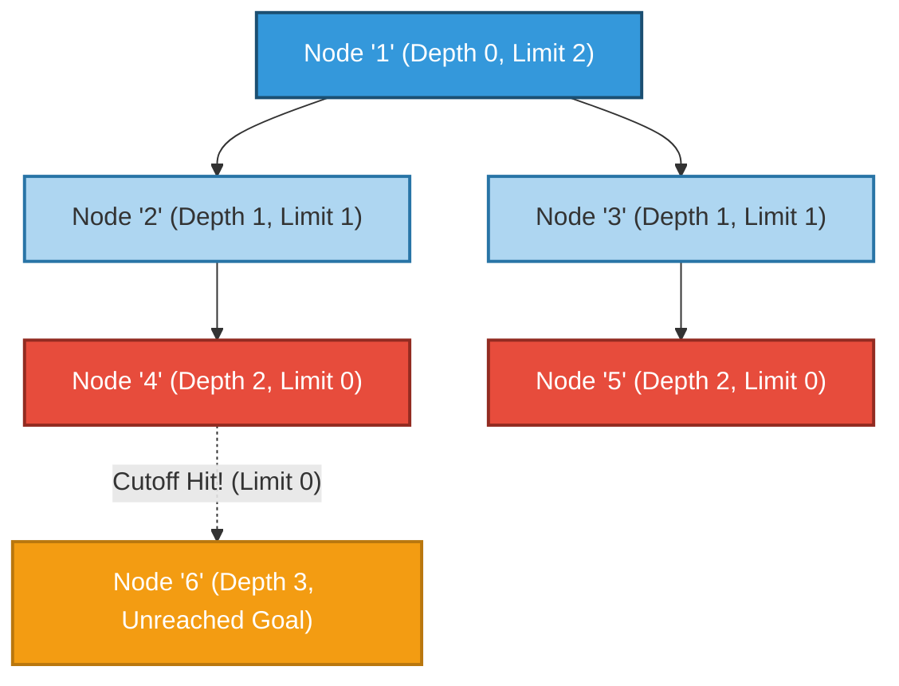

#### Execution Commands & Usage Examples

1. **Default Syllabus Sample Run** (Limit: 2, Goal at depth 3 -> `Result: Cutoff`):
   ```bash
   python scripts/run_depth_limited_search.py
   ```

2. **Success State Run** (Limit increased to 3 -> `Result: Path: ['1', '2', '4', '6']`):
   ```bash
   python scripts/run_depth_limited_search.py --start 1 --goal 6 --limit 3
   ```

3. **Optional Challenge Demonstration** (Deepest node tracking before cutoff):
   ```bash
   python scripts/run_depth_limited_search.py --challenge
   ```

4. **Comprehensive Benchmark Suite** (Cutoff, Success, Failure, Cyclic graphs):
   ```bash
   python scripts/run_depth_limited_search.py --demo
   ```

5. **Display Step-by-Step Execution Trace Table**:
   ```bash
   python scripts/run_depth_limited_search.py --table
   ```

6. **Generate Graphical Visualizations**:
   ```bash
   python scripts/run_depth_limited_search.py --save reports/dls_search.png
   ```

7. **Display Viva Voce Theory Guide**:
   ```bash
   python scripts/run_depth_limited_search.py --viva
   ```

8. **Top-Level Package Dispatcher**:
   ```bash
   python -m src dls --start 1 --goal 6 --limit 2
   ```

9. **Interactive Jupyter Notebook**:
   Open [`notebooks/depth_limited_search.ipynb`](notebooks/depth_limited_search.ipynb) in Jupyter Lab or Antigravity IDE.

#### Viva Voce Questions & Authoritative Answers

##### 1. Infinite State Spaces & DFS Failure Mode
- **Question**: Why does standard DFS fail in infinite state spaces, and how does DLS resolve this?
- **Answer**: In an infinite state space (or continuous navigation, or unbounded recursive rules), DFS ventures down an infinite branch ($m = \infty$) without ever backtracking. Even if a goal exists at depth 1 on a neighboring branch, DFS will never discover it. DLS enforces a strict depth limit bound $l$. Once depth $l$ is reached, the search halts and backtracks, transforming an unbounded infinite exploration into a strictly finite search.

##### 2. Drawbacks of Standard DFS
- **Question**: What are the key drawbacks of standard Depth-First Search?
- **Answer**:
  1. **Incompleteness**: Gets trapped in infinite paths or cycles without visited sets.
  2. **Non-Optimality**: Returns the first path found along its deepest branch, which may be significantly longer or more expensive than a shallow alternative.
  3. **Stack Overflow**: Risk of exceeding the maximum recursion depth (`RecursionError` in Python) in deep trees.

##### 3. Cutoff vs. Failure Distinction
- **Question**: What is the difference between Cutoff and Failure in DLS, and why is this distinction critical?
- **Answer**:
  - **Cutoff**: The goal was not found within depth $l$, but at least one node reached depth $l$ and had successors that were suppressed by the depth limit. The goal *might* exist deeper ($d > l$).
  - **Failure**: The entire reachable space was exhaustively traversed to natural leaves without hitting any cutoffs. We have proved with certainty that the goal does *not* exist in this connected component.
  - **Foundation for Iterative Deepening Search (IDS)**: IDS uses this signal. If DLS returns Cutoff, IDS increments the limit ($l \leftarrow l + 1$). If DLS returns Failure, IDS halts immediately because searching deeper will never find nonexistent states.

##### 4. Time & Space Complexity of DLS
- **Question**: What are the time and space complexities of DLS, and how do they compare with BFS?
- **Answer**:
  - **Time Complexity**: $\mathcal{O}(b^l)$, where $b$ is the branching factor and $l$ is the depth limit.
  - **Space Complexity**: $\mathcal{O}(b \cdot l)$, requiring memory only for the active recursion stack and unexpanded siblings along the path. Unlike BFS, which suffers from an exponential memory bottleneck $\mathcal{O}(b^d)$, DLS retains the linear memory advantage of DFS.

---

### Question 17: Iterative Deepening Search (IDS)

- **Syllabus Area**: Uninformed Search Techniques
- **Difficulty**: 🟠 Advanced
- **Practical Type**: Algorithm Design
- **Core AI Concept**: Iterative Deepening Search (IDS), Completeness, Memory Optimization
- **Python Concepts Tested**: Loop control, recursive integration
- **Expected Algorithm / Technique**: Iterative Deepening DFS (`iterative_deepening_search` wrapping `depth_limited_search`)
- **Recommended Python Libraries**: Standard Library Only (no external dependencies required)
- **Complexity Expectation**:
  - **Time Complexity**: $\mathcal{O}(b^d)$, where $b$ is the branching factor and $d$ is the shallowest goal depth.
  - **Space Complexity**: $\mathcal{O}(b \cdot d)$, linear space matching DFS's active recursion stack.
- **Constraints / Conditions**: Graph may contain cycles.
- **Sample Input**: Goal at depth 2.
- **Sample Output**: `Limit 0: Cutoff. Limit 1: Cutoff. Limit 2: Found ['1', '2', '4'].`
- **Optional Challenge**: Count and display the total number of node expansions across all iterations.
- **University Practical Importance**: Advanced.

#### Theoretical Foundations & Algorithmic Design

Iterative Deepening Search (IDS) repeatedly executes `depth_limited_search` for depth bounds $l = 0, 1, 2, \dots$:
- **If DLS returns `Cutoff`**: At least one branch reached the depth ceiling; increment $l \leftarrow l + 1$.
- **If DLS returns `Failure`**: Every reachable branch ended naturally without hitting a depth cutoff; the graph is exhausted, so terminate immediately.
- **If DLS returns `Success`**: The shallowest (shortest-hop) path has been found, matching BFS optimality while retaining DFS's $\mathcal{O}(b \cdot d)$ linear memory footprint.

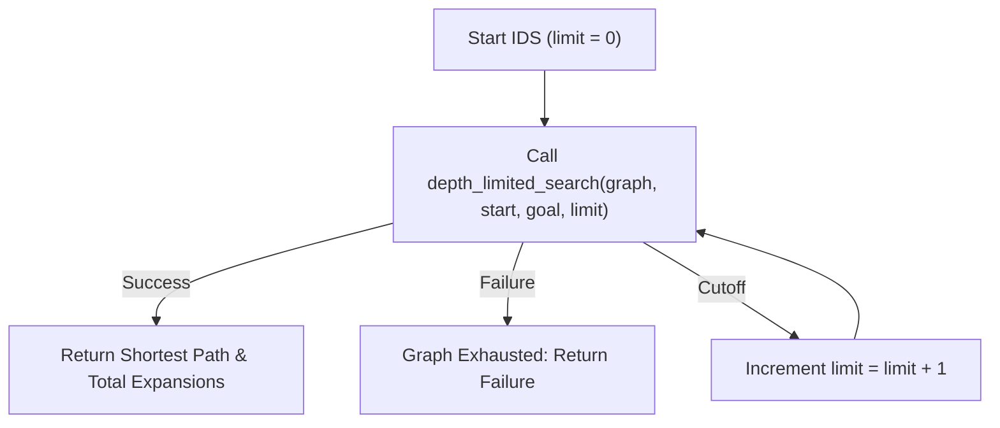

#### Execution Commands & Usage Examples

1. **Default Syllabus Sample Run** (Goal at depth 2 -> `Limit 0: Cutoff. Limit 1: Cutoff. Limit 2: Found ['1', '2', '4'].`):
   ```bash
   python scripts/run_iterative_deepening_search.py
   ```

2. **Compare IDS vs BFS** (Demonstrates identical shortest-path depth with linear $\mathcal{O}(b \cdot d)$ stack memory):
   ```bash
   python scripts/run_iterative_deepening_search.py --compare-bfs
   ```

3. **Optional Challenge Demonstration** (Total node expansions & redundant regenerations across all iterations):
   ```bash
   python scripts/run_iterative_deepening_search.py --challenge
   ```

4. **Comprehensive Benchmark Suite** (Sample, Shortcut, Cyclic, Exhausted Failure):
   ```bash
   python scripts/run_iterative_deepening_search.py --demo
   ```

5. **Generate Two-Panel Visualization**:
   ```bash
   python scripts/run_iterative_deepening_search.py --save reports/ids_search.png
   ```

6. **Display Viva Voce Theory Guide**:
   ```bash
   python scripts/run_iterative_deepening_search.py --viva
   ```

7. **Top-Level Package Dispatcher**:
   ```bash
   python -m src ids --start 1 --goal 4
   ```

8. **Interactive Jupyter Notebook**:
   Open [`notebooks/iterative_deepening_search.ipynb`](notebooks/iterative_deepening_search.ipynb) in Jupyter Lab or Antigravity IDE.

#### Viva Voce Questions & Authoritative Answers

##### 1. Why IDS is Preferred in Large State Spaces
- **Question**: Why is IDS preferred over BFS and DLS in large state spaces?
- **Answer**: BFS requires $\mathcal{O}(b^d)$ memory to retain its frontier and explored set, exhausting RAM at moderate depths. DLS requires guessing the depth limit $l$ in advance (failing if $l < d$ and losing optimality if $l > d$). IDS automatically finds the shallowest goal depth $d$ using only $\mathcal{O}(b \cdot d)$ linear space.

##### 2. Redundant Node Generation
- **Question**: Doesn't restarting DLS from the root at every depth limit waste massive computation?
- **Answer**: No. In a tree with branching factor $b > 1$, the vast majority of nodes reside at the bottom level $b^d$. Total generations are $N_{\text{IDS}} = (d+1)\cdot 1 + d\cdot b + \dots + 1\cdot b^d$, which yields only a constant factor $\frac{b}{b-1}$ over a single search to depth $d$ (e.g., ~11% overhead when $b = 10$), keeping time complexity $\mathcal{O}(b^d)$.

##### 3. Time vs Space Trade-off
- **Question**: What is the fundamental time vs. space trade-off in IDS?
- **Answer**: IDS accepts a small constant-factor increase in CPU work (regenerating shallow upper levels) in exchange for an **exponential reduction in memory** from $\mathcal{O}(b^d)$ down to $\mathcal{O}(b \cdot d)$.

---

### Question 18: BFS vs DFS Performance Analyzer

- **Syllabus Area**: Uninformed Search Techniques
- **Difficulty**: 🟠 Advanced
- **Practical Type**: Simulation / Comparison
- **Core AI Concept**: Algorithm Comparison, Time/Space Efficiency, Optimality Guarantees vs. Arbitrary Pathfinding
- **Python Concepts Tested**: Algorithm encapsulation, metric tracking, empirical benchmarking
- **Expected Algorithm / Technique**: Breadth-First Search (BFS) and Depth-First Search (DFS)
- **Recommended Python Libraries**: `time`, `matplotlib` (Optional Challenge)
- **Complexity Expectation**: Empirical timing and counting
- **Constraints / Conditions**: Use the exact same neighbor ordering (e.g., Up, Down, Left, Right)
- **Input Requirements**: Hardcoded 10x10 maze matrix
- **Sample Input**: Execute comparison
- **Sample Output**: `BFS Nodes Expanded: 45, Path Length: 12 | DFS Nodes Expanded: 14, Path Length: 22`
- **Optional Challenge**: Plot the expansion process dynamically using matplotlib
- **University Practical Importance**: High

#### Theoretical Foundations & Algorithmic Comparison

On a 2D grid maze with uniform transition costs ($c = 1$), BFS and DFS exhibit starkly contrasting performance characteristics:

1. **BFS Optimality**:
   - Maintains a First-In, First-Out (FIFO) queue (`collections.deque`).
   - Explores the state space in concentric spherical waves of non-decreasing depth $d$.
   - **Guaranteed to return the shortest path** (minimum number of transitions).
   - Space requirement is $\mathcal{O}(b^d)$, creating an exponential memory bottleneck.

2. **DFS Arbitrary Pathfinding**:
   - Maintains a Last-In, First-Out (LIFO) stack (`list.pop()` or recursion).
   - Plunges deeply down a single path until reaching a dead-end, wall, or cycle.
   - **Non-optimal**: Returns the first path that reaches the goal, frequently taking circuitous detours (e.g. 22 steps vs. 12 steps).
   - Space requirement is only $\mathcal{O}(b \cdot m)$ linear memory, proportional to maximum path depth.

3. **Strict Neighbor Ordering Constraint**:
   Both algorithms evaluate candidate moves in the exact same priority order:
   $\text{Up } (-1, 0) \to \text{Down } (+1, 0) \to \text{Left } (0, -1) \to \text{Right } (0, +1)$.
   To ensure that the iterative DFS stack pops neighbors in the strict forward order matching recursive DFS, candidate successors are pushed onto the LIFO stack in **reversed order** (`reversed(successors)`).

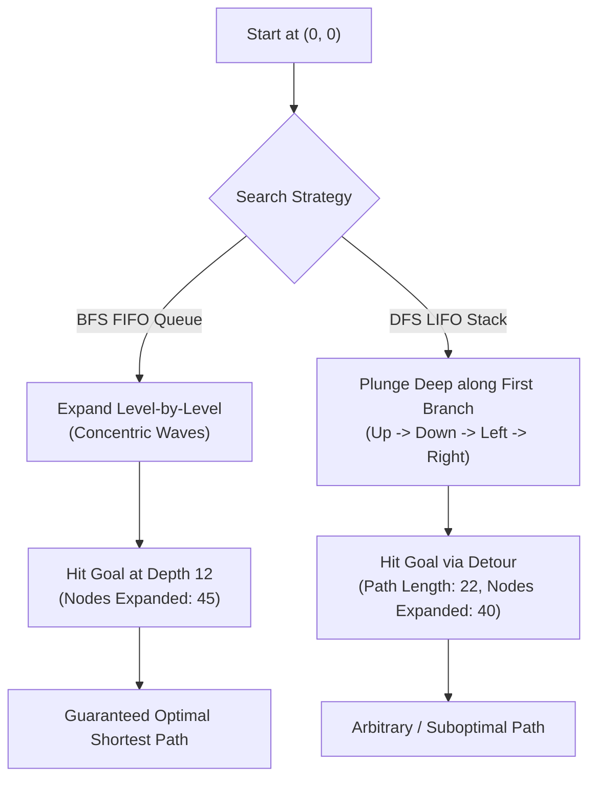

| Metric / Attribute | Breadth-First Search (BFS) | Depth-First Search (DFS) |
| :--- | :--- | :--- |
| **Frontier Structure** | FIFO Queue (`collections.deque`) | LIFO Stack (`list` with `reversed` push) |
| **Exploration Bias** | Concentric spherical waves (shallowest first) | Deep branch plunge until dead-end |
| **Time Complexity** | $\mathcal{O}(b^d)$ | $\mathcal{O}(b^m)$ |
| **Space Complexity** | $\mathcal{O}(b^d)$ *(Exponential RAM bottleneck)* | $\mathcal{O}(b \cdot m)$ *(Linear active branch)* |
| **Optimality Guarantee** | **Guaranteed Optimal** (Shortest path for unit cost) | **Non-Optimal** (Arbitrary pathfinding) |
| **Completeness** | **Yes** (if branching factor $b$ is finite) | **Yes** on finite state spaces with visited tracking |
| **Default 10x10 Maze Result** | **45 Nodes Expanded, Path Length: 12** | **40 Nodes Expanded, Path Length: 22** |
| **DFS-Favored Scenario** | 45 Nodes Expanded, Path Length: 12 | **14 Nodes Expanded, Path Length: 12** |

#### Execution Commands & Usage Examples

1. **Default Syllabus Sample Run** (10x10 Maze: BFS Optimal 12 vs DFS Arbitrary 22):
   ```bash
   python scripts/run_bfs_dfs_performance_analyzer.py
   ```

2. **Single-Line Format (Exact Syllabus Match)**:
   ```bash
   python scripts/run_bfs_dfs_performance_analyzer.py --format single
   ```

3. **DFS-Favored 10x10 Maze** (Demonstrating Viva Topic 2: DFS 14 Expansions vs BFS 45 Expansions):
   ```bash
   python scripts/run_bfs_dfs_performance_analyzer.py --maze dfs-favored
   ```

4. **Corner-to-Corner 10x10 Maze** (Start (0,0) to Goal (9,9)):
   ```bash
   python scripts/run_bfs_dfs_performance_analyzer.py --maze corner
   ```

5. **Comprehensive Benchmark Suite across all 10x10 Mazes**:
   ```bash
   python scripts/run_bfs_dfs_performance_analyzer.py --demo
   ```

6. **Optional Challenge: Generate & Save Dynamic Matplotlib Expansion Heatmaps**:
   ```bash
   python scripts/run_bfs_dfs_performance_analyzer.py --save reports/bfs_vs_dfs_performance.png
   ```

7. **Display Viva Voce Theory Guide**:
   ```bash
   python scripts/run_bfs_dfs_performance_analyzer.py --viva
   ```

8. **Top-Level Package Dispatcher**:
   ```bash
   python -m src bfs-dfs --format single
   ```

9. **Interactive Jupyter Notebook**:
   Open [`notebooks/bfs_vs_dfs_performance_analyzer.ipynb`](notebooks/bfs_vs_dfs_performance_analyzer.ipynb) in Jupyter Lab or Antigravity IDE.

#### Viva Voce Questions & Authoritative Answers

##### 1. Algorithm Optimality
- **Question**: Why is BFS guaranteed to find the optimal path in grid mazes, while DFS is not?
- **Answer**: In a grid maze where all orthogonal transitions have uniform unit cost ($c = 1$), path cost $g(n)$ equals node depth $d$. BFS uses a FIFO queue, guaranteeing all nodes at depth $d$ are expanded before any node at depth $d + 1$. Thus, the first goal reached is guaranteed to have minimal steps. DFS uses a LIFO stack, plunging down one path without depth synchronization, returning whatever arbitrary path hits the goal first.

##### 2. Scenarios Where DFS Outperforms BFS
- **Question**: In what practical scenarios does DFS significantly outperform BFS?
- **Answer**:
  1. **Goal in early deep branch**: When the goal lies along the first subtree searched by the neighbor ordering, DFS reaches it in $\mathcal{O}(d)$ expansions without exploring sibling branches, whereas BFS must expand $\mathcal{O}(b^d)$ nodes (e.g., DFS takes 14 expansions vs BFS's 45 expansions).
  2. **Memory limits**: BFS requires $\mathcal{O}(b^d)$ exponential memory; DFS requires only $\mathcal{O}(b \cdot m)$ linear memory.
  3. **Dense solution spaces**: When many solutions exist and any valid path is acceptable.

##### 3. Branching Factor Impact
- **Question**: What is the branching factor $b$, and how does it impact BFS vs DFS differently?
- **Answer**: Branching factor $b$ is the average number of valid moves per state ($1 \le b \le 4$ on grid mazes). Increasing $b$ causes BFS memory $\mathcal{O}(b^d)$ to explode exponentially, while DFS memory $\mathcal{O}(b \cdot m)$ grows only linearly.

---

### Question 19: Bidirectional Search Simulation

- **Syllabus Area**: Uninformed Search Techniques
- **Difficulty**: 🔴 Expert
- **Practical Type**: Algorithm Design
- **Core AI Concept**: Bidirectional Search, Search Space Halving, Simultaneous BFS, Frontier Collision
- **Complexity**: Time Complexity: $\mathcal{O}(b^{d/2})$ | Space Complexity: $\mathcal{O}(b^{d/2})$

#### Bidirectional Search Architecture & Dual Frontier Collision
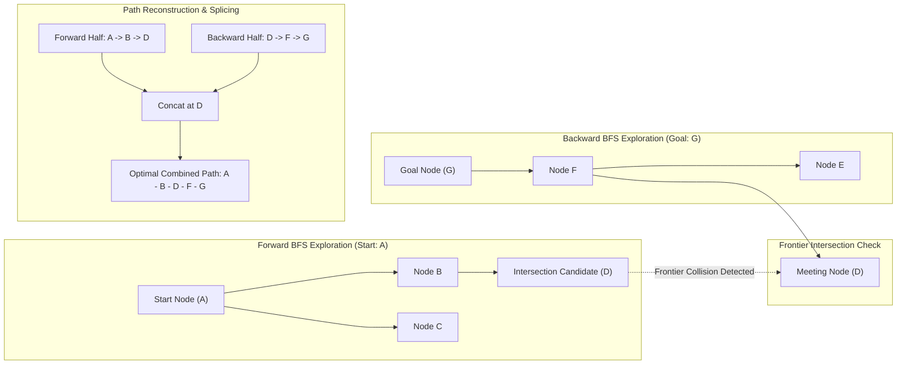

#### Dual Frontier Sequence Diagram
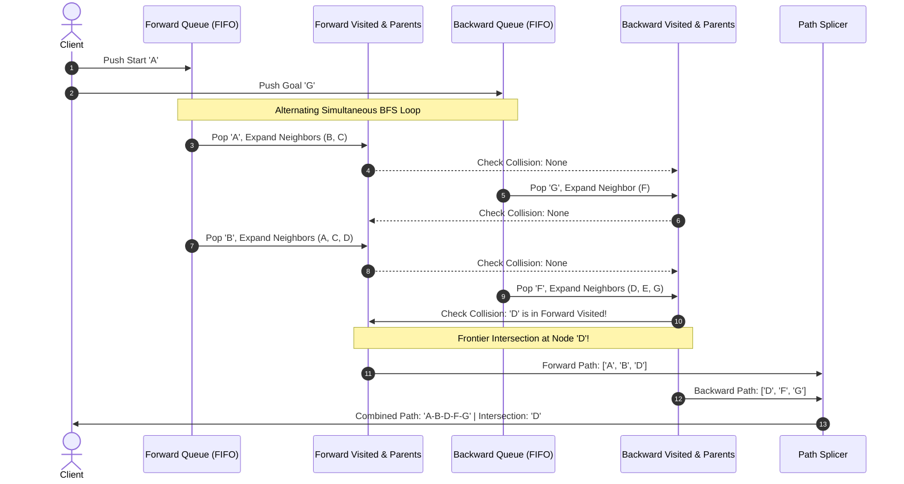

#### Mathematical Complexity Comparison: Standard BFS vs. Bidirectional Search

| Metric / Property | Standard Forward BFS | Bidirectional Search (BDS) | Efficiency Gain / Impact |
| :--- | :--- | :--- | :--- |
| **Search Frontiers** | 1 (Forward from Start) | 2 (Simultaneous Forward & Backward) | Search space divided into two halves |
| **Search Radius** | Radius $d$ | Two radii of $d/2$ | Halving the exponent |
| **Time Complexity** | $\mathcal{O}(b^d)$ | $\mathcal{O}(b^{d/2} + b^{d/2}) = \mathcal{O}(b^{d/2})$ | **Exponential reduction** |
| **Space Complexity** | $\mathcal{O}(b^d)$ | $\mathcal{O}(b^{d/2})$ | Prevents RAM exhaustion |
| **Optimality Guarantee** | **Guaranteed Optimal** | **Guaranteed Optimal** (Unit step cost) | Finds shortest path |
| **$b = 10, d = 10$ Nodes** | $10^{10} = \mathbf{10,000,000,000}$ | $2 \times 10^5 = \mathbf{200,000}$ | **50,000x faster execution!** |
| **Sample Graph Result** | Path: `A-B-D-F-G` | Path: `A-B-D-F-G` | **Intersection at D** |

#### Execution Commands & Usage Examples

1. **Default Syllabus Sample Run** (Start: `A`, Goal: `G`):
   ```bash
   python scripts/run_bidirectional_search.py
   ```
   *Output*:
   ```text
   Intersection at D. Path: A-B-D-F-G
   ```

2. **Single-Line Format (Exact Syllabus Match)**:
   ```bash
   python scripts/run_bidirectional_search.py --format single
   ```

3. **Custom Start and Goal Queries**:
   ```bash
   python scripts/run_bidirectional_search.py --start A --goal F
   ```

4. **Custom Graph Specification** (Semicolon-delimited or JSON):
   ```bash
   python scripts/run_bidirectional_search.py --graph "A: B, C; B: A, D; C: A, D; D: B, C, G; G: D" --start A --goal G
   ```

5. **Optional Challenge: 2D Grid Maze Bidirectional Search**:
   ```bash
   python scripts/run_bidirectional_search.py --challenge
   ```
   *Output*:
   ```text
   Search Status          : SUCCESS
   Intersection Coordinate: (4, 3)
   Shortest Path Length   : 12 steps
   Total Cells Expanded   : 23
   ```

6. **Comprehensive Benchmark Suite across Graph Topologies**:
   ```bash
   python scripts/run_bidirectional_search.py --demo
   ```

7. **Generate & Save Matplotlib Graphical Plot**:
   ```bash
   python scripts/run_bidirectional_search.py --save reports/bidirectional_search.png
   ```

8. **Display Viva Voce Theory Guide**:
   ```bash
   python scripts/run_bidirectional_search.py --viva
   ```

9. **Top-Level Package Dispatcher**:
   ```bash
   python -m src bidirectional --format single
   ```

10. **Interactive Jupyter Notebook**:
    Open [`notebooks/bidirectional_search.ipynb`](notebooks/bidirectional_search.ipynb) in Jupyter Lab or Antigravity IDE.

#### Viva Voce Questions & Authoritative Answers

##### 1. Why $\mathcal{O}(b^{d/2})$ is Massively Faster than $\mathcal{O}(b^d)$
- **Question**: Why is $\mathcal{O}(b^{d/2})$ massively faster than $\mathcal{O}(b^d)$?
- **Answer**:
  In a search space with branching factor $b$ and solution depth $d$, standard forward BFS explores a hypersphere of radius $d$, generating roughly:
  $$\sum_{i=0}^d b^i = \mathcal{O}(b^d) \text{ states.}$$
  Bidirectional Search grows two simultaneous hyperspheres of radius $d/2$—one from the start state and one from the goal state. When their frontiers meet at the midpoint, the total states generated is:
  $$b^{d/2} + b^{d/2} = 2 \cdot b^{d/2} = \mathcal{O}(b^{d/2}).$$
  Because exponential functions dominate polynomial constants, cutting the exponent in half produces exponential savings. For instance, when $b = 10$ and $d = 10$, $\mathcal{O}(b^d) = 10^{10} = 10,000,000,000$ states (10 billion nodes requiring gigabytes of RAM and days of computation), while $2 \cdot 10^5 = 200,000$ states runs in a fraction of a second with minimal memory—yielding a **50,000x performance improvement**.

##### 2. Difficulties of Backward Search in Directed Graphs
- **Question**: What are the primary difficulties of backward search in directed graphs?
- **Answer**:
  1. **Predecessor Inversion & Edge Directionality**: If directed edges represent one-way transitions ($u \to v$), moving backward from the goal requires computing predecessor states ($v \leftarrow u$). If the graph is stored as an outgoing adjacency list, computing predecessors requires an expensive graph-wide inversion step or runtime reverse lookup.
  2. **Multiple or Implicit Goal States**: Forward search starts from a single, explicit initial state $s_0$. If the problem defines goals via an abstract predicate or goal test (e.g., "checkmate in chess", "any configuration with zero dirt"), the backward search does not have a single root node. To search backward, one must create an artificial super-goal node with edges to all possible goal states, which can cause an explosive initial branching factor.
  3. **Irreversible Real-World Actions**: Physical operations may be strictly non-invertible (e.g., dropping an object, burning propellant, baking an ingredient). In such domains, predecessor functions cannot be formulated.

##### 3. Predecessor vs. Successor Generation
- **Question**: Explain Predecessor vs Successor generation and their impact on search efficiency.
- **Answer**:
  - **Successor Function**: $\text{Successors}(s) = \{s' \mid s \xrightarrow{a} s'\}$. Generates next states reachable by applying valid forward operators.
  - **Predecessor Function**: $\text{Predecessors}(s') = \{s \mid s \xrightarrow{a} s'\}$. Computes prior states from which the current state could have originated.
  - In undirected graphs, $\text{Predecessors}(s) = \text{Successors}(s)$ identically. In directed graphs, the forward branching factor $b_{\text{fwd}}$ (out-degree) and backward branching factor $b_{\text{bwd}}$ (in-degree) may differ substantially. For example, in theorem proving or planning, many distinct premise states often converge to a single simplified conclusion ($b_{\text{bwd}} \gg b_{\text{fwd}}$). If $b_{\text{bwd}}$ is significantly larger, backward search will experience severe combinatorial explosion. **Dynamic balanced expansion** (always expanding whichever queue has the smaller frontier) mitigates this asymmetry.

---

### Question 20: Water Jug Problem using BFS

- **Syllabus Area**: Uninformed Search Techniques
- **Difficulty**: 🟠 Advanced
- **Practical Type**: Problem Solving
- **Core AI Concept**: State-Space Formulation, Transition Models, Implicit Graph Search, FIFO Frontier
- **Python Concepts Tested**: Tuple states, mathematical operations, graph search with `collections.deque`
- **Expected Algorithm**: Breadth-First Search (BFS) on dynamically generated implicit state space
- **Complexity**: Time Complexity: $\mathcal{O}(X \times Y)$ | Space Complexity: $\mathcal{O}(X \times Y)$
- **Constraints / Conditions**: Discard invalid states (negative water, overflow, redundant self-loops)
- **Sample Input**: Capacities: `4, 3`. Target: `2`
- **Sample Output**: `(0,0) -> (4,0) -> (1,3) -> (1,0) -> (0,1) -> (4,1) -> (2,3)`
- **Optional Challenge**: Check algebraically if the target is reachable before searching (Bézout's identity & GCD rule)
- **University Practical Importance**: Very High

#### Problem Statement & AI State-Space Formulation
Given two jugs of capacities $X$ and $Y$ liters without intermediate markings, an infinite tap, and a drain, find the minimum sequence of operations to measure exactly $Z$ liters in one of the jugs.
- **State Representation**: A 2-tuple $(x, y)$ of integers representing the water content in Jug 1 and Jug 2, where $0 \le x \le X$ and $0 \le y \le Y$.
- **Initial State**: $s_0 = (0, 0)$.
- **Goal Condition**: $x = Z$ (or $y = Z$, or $x = Z \lor y = Z$).
- **State-Space Geometry**: The theoretical state space has size $(X + 1) \times (Y + 1)$. In practice, because all pouring operations continue until a jug is either empty or full, reachable states lie strictly along the boundary perimeter of the $[0, X] \times [0, Y]$ rectangle and specific diagonal chords, significantly pruning the effective search space.

#### The 6 Canonical Production Rules
The transition model consists of 6 discrete operators with strict preconditions to eliminate invalid states and non-progressing self-loops:

| Rule # | Action Name | Precondition | Operation / Transformation | Effect State $(x', y')$ | Description |
| :---: | :--- | :--- | :--- | :---: | :--- |
| **1** | `Fill 1` | $x < X$ | $x' = X, y' = y$ | $(X, y)$ | Fill Jug 1 to capacity from tap |
| **2** | `Fill 2` | $y < Y$ | $x' = x, y' = Y$ | $(x, Y)$ | Fill Jug 2 to capacity from tap |
| **3** | `Empty 1` | $x > 0$ | $x' = 0, y' = y$ | $(0, y)$ | Empty Jug 1 completely into drain |
| **4** | `Empty 2` | $y > 0$ | $x' = x, y' = 0$ | $(x, 0)$ | Empty Jug 2 completely into drain |
| **5** | `Pour 1->2` | $x > 0 \land y < Y$ | $d = \min(x, Y - y)$<br>$x' = x - d, y' = y + d$ | $(x - d, y + d)$ | Pour from Jug 1 into Jug 2 until Jug 2 is full or Jug 1 is empty |
| **6** | `Pour 2->1` | $y > 0 \land x < X$ | $d = \min(y, X - x)$<br>$x' = x + d, y' = y - d$ | $(x + d, y - d)$ | Pour from Jug 2 into Jug 1 until Jug 1 is full or Jug 2 is empty |

#### Production Rules Transition Architecture
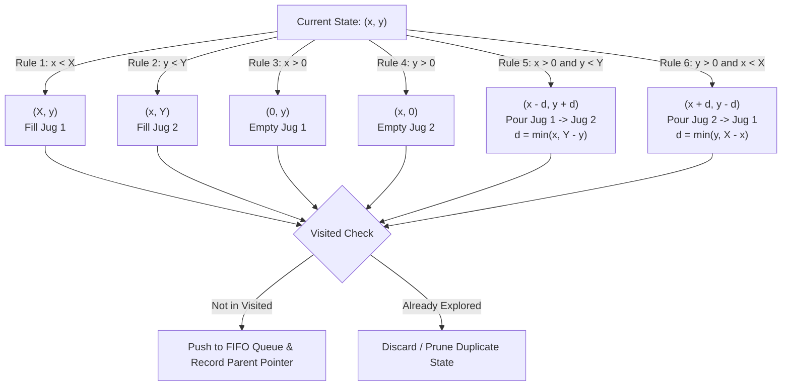

#### Canonical Solution Path State Machine (Capacities: 4L, 3L; Target: 2L)


#### Algebraic Solvability & Bézout's Identity (Optional Challenge)
Any sequence of water filling, emptying, and pouring operations alters total volume strictly by integer linear combinations of $X$ and $Y$:
$$\text{Measured Volume} = a \cdot X + b \cdot Y \quad (a, b \in \mathbb{Z})$$
By **Bézout's Identity**, the smallest positive integer expressible in this form is $g = \gcd(X, Y)$. Hence, every measurable volume must be an exact multiple of $\gcd(X, Y)$.

> **Necessary and Sufficient Reachability Conditions**:
> 1. **Capacity Upper Bound**: $Z \le \max(X, Y)$ (for measuring in one jug; $Z \le X$ if measuring in Jug 1 specifically).
> 2. **Divisibility Condition**: $Z \pmod{\gcd(X, Y)} = 0$.
> 
> *Example of Unsolvable State*: Capacities $X = 6\text{L}, Y = 4\text{L}$ with Target $Z = 5\text{L}$. Here $\gcd(6, 4) = 2$. Because $5 \pmod 2 = 1 \ne 0$, no sequence of operations can ever produce 5 liters.

#### Target in Jug 1 vs. Target in Any Jug Comparison

| Configuration | Target Jug | Optimal Path | Steps | Nodes Explored | Description |
| :--- | :---: | :--- | :---: | :---: | :--- |
| **Canonical Syllabus** | **Jug 1** | `(0,0) -> (4,0) -> (1,3) -> (1,0) -> (0,1) -> (4,1) -> (2,3)` | **6** | 10 | Exact match for Rich & Knight textbook problem |
| **Shortest Overall** | **Any** | `(0,0) -> (0,3) -> (3,0) -> (3,3) -> (4,2)` | **4** | 7 | Measures 2L in Jug 2 in fewer steps |
| **Die Hard 3** | **Jug 1** | `(0,0) -> (5,0) -> (2,3) -> (2,0) -> (0,2) -> (5,2) -> (4,3)` | **6** | 11 | Classic movie puzzle (Capacities 5, 3 -> Target 4) |
| **Unsolvable** | **Any** | `No solution path found.` | **0** | 0 | $\gcd(6, 4) = 2 \nmid 5$ (Pruned immediately by GCD check) |

#### Execution Commands & Usage Examples

1. **Default Syllabus Sample Run** (Capacities: 4, 3; Target: 2):
   ```bash
   python scripts/run_water_jug_bfs.py
   ```
   *Output*:
   ```text
   SYLLABUS SAMPLE OUTPUT:
     >>> (0,0) -> (4,0) -> (1,3) -> (1,0) -> (0,1) -> (4,1) -> (2,3)
   ```

2. **Single-Line Format (Exact Syllabus Match)**:
   ```bash
   python scripts/run_water_jug_bfs.py --format single
   ```
   *Output*:
   ```text
   (0,0) -> (4,0) -> (1,3) -> (1,0) -> (0,1) -> (4,1) -> (2,3)
   ```

3. **Step-by-Step Transition Trace Table**:
   ```bash
   python scripts/run_water_jug_bfs.py --format table
   ```

4. **Custom Capacities and Target** (e.g. Die Hard 3: Capacities 5L, 3L; Target 4L):
   ```bash
   python scripts/run_water_jug_bfs.py -x 5 -y 3 -z 4
   ```

5. **Target in Any Jug** (Find shortest path measuring target in either jug):
   ```bash
   python scripts/run_water_jug_bfs.py -x 4 -y 3 -z 2 --target-jug any
   ```

6. **Optional Challenge: Algebraic Reachability & GCD Rule Analysis**:
   ```bash
   python scripts/run_water_jug_bfs.py --challenge
   ```

7. **Comprehensive Automated Benchmark Suite**:
   ```bash
   python scripts/run_water_jug_bfs.py --demo
   ```

8. **Display Viva Voce Theory Guide**:
   ```bash
   python scripts/run_water_jug_bfs.py --viva
   ```

9. **Top-Level Package Dispatcher**:
   ```bash
   python -m src water-jug --format single
   ```
   or using the alias:
   ```bash
   python -m src jug-bfs --format single
   ```

10. **Interactive Jupyter Notebook**:
    Open [`notebooks/water_jug_bfs.ipynb`](notebooks/water_jug_bfs.ipynb) in Jupyter Lab or Antigravity IDE.

#### Viva Voce Questions & Authoritative Answers

##### 1. State Space Representation and Effective Size
- **Question**: How is the state space represented in the Water Jug Problem, and what is its effective size?
- **Answer**:
  A state is represented as an ordered tuple of non-negative integers $(x, y)$, where $x \in [0, X]$ denotes the volume in Jug 1 and $y \in [0, Y]$ denotes the volume in Jug 2. The initial state is $(0, 0)$.
  The theoretical discrete state space contains $(X + 1) \times (Y + 1)$ potential tuples. However, because pouring operations are executed until a jug is either completely full or completely empty, at least one jug is always at level $0$, $X$, or $Y$ in any non-initial state. Thus, all reachable states lie on the perimeter of the rectangle $[0, X] \times [0, Y]$ and specific internal diagonal line segments, making the effective reachable state space significantly smaller (e.g., exactly 14 reachable states for capacities 4L and 3L out of 20 theoretical states).

##### 2. Action Rules Definition and Precondition Pruning
- **Question**: Detail the 6 production rules used in the transition model and why preconditions are required.
- **Answer**:
  The 6 deterministic operators are:
  1. `Fill 1`: $(x, y) \to (X, y)$ requiring $x < X$.
  2. `Fill 2`: $(x, y) \to (x, Y)$ requiring $y < Y$.
  3. `Empty 1`: $(x, y) \to (0, y)$ requiring $x > 0$.
  4. `Empty 2`: $(x, y) \to (x, 0)$ requiring $y > 0$.
  5. `Pour 1->2`: $(x, y) \to (x - d, y + d)$ where $d = \min(x, Y - y)$, requiring $x > 0 \land y < Y$.
  6. `Pour 2->1`: $(x, y) \to (x + d, y - d)$ where $d = \min(y, X - x)$, requiring $y > 0 \land x < X$.
  Preconditions are essential to prune invalid transitions (e.g., negative water amounts or overflows) and eliminate useless self-loops (such as pouring from an empty jug or filling an already full jug), avoiding state explosion.

##### 3. Unsolvable States (GCD Rule and Bézout's Identity)
- **Question**: State and prove the GCD rule for unsolvable states.
- **Answer**:
  By Bézout's Identity from number theory, for any positive integers $X$ and $Y$, the set of integer linear combinations:
  $$L = \{a \cdot X + b \cdot Y \mid a, b \in \mathbb{Z}\}$$
  is equal to the set of all integer multiples of $\gcd(X, Y)$.
  Since every filling operation adds $X$ or $Y$, every emptying operation subtracts $X$ or $Y$, and pouring conserves total volume between jugs, the water amount in either jug at any step $k$ must be of the form $a \cdot X + b \cdot Y$, and consequently must be divisible by $\gcd(X, Y)$.
  Therefore, a target $Z$ can be measured if and only if:
  1. $Z \le \max(X, Y)$ (capacity constraint).
  2. $Z \pmod{\gcd(X, Y)} = 0$ (divisibility condition).
  If $Z \pmod{\gcd(X, Y)} \ne 0$, no sequence of physical operations can ever measure $Z$.

##### 4. BFS Optimality and Completeness
- **Question**: Why is BFS guaranteed to find the shortest action sequence?
- **Answer**:
  Because each production rule constitutes a single atomic step with uniform unit transition cost $c(s, a, s') = 1$, Breadth-First Search expands nodes in order of non-decreasing path cost (depth-by-depth). The first time the search discovers a state satisfying the goal test, the path leading to it is guaranteed to have the minimum number of transitions (shortest path). Furthermore, because the state space is finite and bounded by $(X + 1)(Y + 1)$, maintaining a hash set of visited states guarantees completeness—preventing cycles and ensuring termination in finite time.

##### 5. Time and Space Complexity
- **Question**: What are the asymptotic time and space complexities?
- **Answer**:
  - **Time Complexity**: $\mathcal{O}(X \times Y)$. There are at most $(X + 1) \times (Y + 1)$ unique reachable states. For each state dequeued, exactly 6 production rules are evaluated in $\mathcal{O}(1)$ time.
  - **Space Complexity**: $\mathcal{O}(X \times Y)$. The memory allocated for the FIFO queue (`collections.deque`) and the visited dictionary / parent pointers stores at most $(X + 1) \times (Y + 1)$ state tuples.

---

### Question 21: Missionaries and Cannibals Problem using Depth-First Search (DFS)

[](https://github.com/bhabakjishnu/ai-lab)
[](#question-21-missionaries-and-cannibals-problem-using-depth-first-search-dfs)
[](#question-21-missionaries-and-cannibals-problem-using-depth-first-search-dfs)
[](#question-21-missionaries-and-cannibals-problem-using-depth-first-search-dfs)

- **Syllabus Area**: Uninformed Search Techniques
- **Difficulty**: 🔴 Expert
- **Practical Type**: State-Space Search
- **Core AI Concept**: Constraint Checking in State Generation, Implicit Graph Traversal, Loop Avoidance
- **Python Concepts Tested**: Complex condition evaluation, tuple representation, recursive & iterative DFS
- **Expected Algorithm / Technique**: Depth-First Search (DFS) with cycle detection
- **Recommended Python Libraries**: None (Pure Python Standard Library)
- **Complexity**: Time/Space bounded by small state space ($|S| \le 32$, $|S_{\text{safe}}| = 20$, $|S_{\text{reachable}}| = 16$)
- **Constraints / Conditions**: DFS must avoid loops; at no time can cannibals outnumber missionaries on either bank
- **Input Requirements**: None (Standard 3M, 3C parameters)
- **Expected Output**: Trace of states leading to `(0, 0, 'Right')`
- **Sample Input**: Execute search
- **Sample Output**: `Step 1: 2C cross right... [Full path trace]`
- **Optional Challenge**: Animate the text output with delays
- **University Practical Importance**: Very High

#### Problem Statement & State-Space Formulation
Three missionaries ($M$) and three cannibals ($C$) must cross from the left bank to the right bank of a river using a boat that can hold at most two people (boat capacity = 2). The boat cannot cross without at least one person rowing (minimum passengers = 1). At no time, on either riverbank, can cannibals outnumber missionaries present on that bank, unless there are zero missionaries on that bank (if $M = 0$, cannibals have no missionaries to eat).

- **State Representation**: A 3-tuple `(M_left, C_left, Boat_pos)`:
  - `M_left`: Count of missionaries on the left riverbank ($0 \le M_l \le 3$)
  - `C_left`: Count of cannibals on the left riverbank ($0 \le C_l \le 3$)
  - `Boat_pos`: Position of the boat (`'Left'` or `'Right'`)
- **Complementary Bank (Right Bank)**:
  - $M_{\text{right}} = 3 - M_{\text{left}}$
  - $C_{\text{right}} = 3 - C_{\text{left}}$
- **Initial State**: $s_0 = (3, 3, \text{'Left'})$
- **Goal State**: $s_g = (0, 0, \text{'Right'})$

#### The 5 Canonical Moves
The boat holds at least 1 and at most 2 passengers, yielding exactly 5 permissible move operations:

| Move | Passenger Tuple $(m, c)$ | Total In Boat | Description | Directional Effect (from Left) | Directional Effect (from Right) |
| :---: | :---: | :---: | :--- | :--- | :--- |
| **1M** | $(1, 0)$ | 1 | 1 Missionary crosses | $(M_l - 1, C_l, \text{'Right'})$ | $(M_l + 1, C_l, \text{'Left'})$ |
| **2M** | $(2, 0)$ | 2 | 2 Missionaries cross | $(M_l - 2, C_l, \text{'Right'})$ | $(M_l + 2, C_l, \text{'Left'})$ |
| **1C** | $(0, 1)$ | 1 | 1 Cannibal crosses | $(M_l, C_l - 1, \text{'Right'})$ | $(M_l, C_l + 1, \text{'Left'})$ |
| **2C** | $(0, 2)$ | 2 | 2 Cannibals cross | $(M_l, C_l - 2, \text{'Right'})$ | $(M_l, C_l + 2, \text{'Left'})$ |
| **1M1C** | $(1, 1)$ | 2 | 1 Missionary + 1 Cannibal cross | $(M_l - 1, C_l - 1, \text{'Right'})$ | $(M_l + 1, C_l + 1, \text{'Left'})$ |

#### Constraint Checking: Generation vs Testing
- **Physical Feasibility**: A move is physically permissible only if sufficient missionaries and cannibals are located on the departure bank:
  $$\text{If } \text{Boat} = \text{'Left'} \implies M_l \ge m \land C_l \ge c$$
  $$\text{If } \text{Boat} = \text{'Right'} \implies (3 - M_l) \ge m \land (3 - C_l) \ge c$$
- **Cannibal Safety Condition**:
  - Left Bank: If $M_l > 0$, then $M_l \ge C_l$ (Cannibals $\le$ Missionaries)
  - Right Bank: If $M_r > 0$, then $M_r \ge C_r$ where $M_r = 3 - M_l, C_r = 3 - C_l$
- **Validation in State Generation (Forward Checking)**:
  Evaluates feasibility and safety rules *before* creating and pushing states onto the DFS search stack. This prunes unviable transitions immediately, reducing the effective branching factor from 5 to ~1–2.
- **Validation in State Testing (Generate-and-Test)**:
  Blindly creates all arithmetic candidates and filters out-of-bounds/unsafe states afterwards.

#### State Space Combinatorial Analysis
- **Theoretical Combinatorial Space**: $(3 + 1) \times (3 + 1) \times 2 = 32$ states
- **Safe (Valid) States**: Exactly 20 states satisfy the cannibal safety constraints on both banks
- **Reachable Safe States**: Exactly 16 states are reachable from $s_0 = (3, 3, \text{'Left'})$
- **Unreachable Safe States**: Exactly 4 states (such as $(3, 3, \text{'Right'})$ and $(0, 0, \text{'Left'})$) violate river conservation parity

#### State Transition Machine


#### Depth-First Search with Cycle Detection Architecture
```mermaid
flowchart TD
    Start([Initial State: 3M, 3C, Left]) --> PushStack[Push state to LIFO Stack with Active Path Set]
    PushStack --> Pop[Pop current state from Stack]
    Pop --> GoalCheck{Is state (0, 0, Right)?}
    GoalCheck -->|Yes| Success([Solution Found in 11 Trips!])
    GoalCheck -->|No| GenMoves[Evaluate 5 Moves: 2C, 1M1C, 2M, 1C, 1M]
    
    GenMoves --> Precond{Enough people on departure bank?}
    Precond -->|No| PruneCap[Prune: Insufficient Capacity]
    Precond -->|Yes| SafeCheck{Is next state safe on both banks?}
    SafeCheck -->|No| PruneSafe[Prune: Cannibals outnumber M]
    SafeCheck -->|Yes| CycleCheck{Is state in active path visited set?}
    CycleCheck -->|Yes| PruneCycle[Prune: Cycle / Loop Detected]
    CycleCheck -->|No| PushNext[Push successor to LIFO Stack with Updated Path]
    
    PushNext --> MoreNodes{Stack Empty?}
    PruneCap --> MoreNodes
    PruneSafe --> MoreNodes
    PruneCycle --> MoreNodes
    MoreNodes -->|No| Pop
    MoreNodes -->|Yes| Fail([Search Exhausted: No Path])
```

#### Canonical Sequence of 11 Boat Trips
| Step | Action | Left Bank (M, C) | River / Boat | Right Bank (M, C) | State Tuple |
| :---: | :--- | :---: | :---: | :---: | :---: |
| **0** | Initial State | 3M, 3C [BOAT] | ~~~~~~~~~~~~~~~~~~ | 0M, 0C | `(3, 3, 'Left')` |
| **1** | 2C cross right | 3M, 1C | ~~~ [2C] >>>> ~~~ | 0M, 2C [BOAT] | `(3, 1, 'Right')` |
| **2** | 1C cross left | 3M, 2C [BOAT] | ~~~ <<<< [1C] ~~~ | 0M, 1C | `(3, 2, 'Left')` |
| **3** | 2C cross right | 3M, 0C | ~~~ [2C] >>>> ~~~ | 0M, 3C [BOAT] | `(3, 0, 'Right')` |
| **4** | 1C cross left | 3M, 1C [BOAT] | ~~~ <<<< [1C] ~~~ | 0M, 2C | `(3, 1, 'Left')` |
| **5** | 2M cross right | 1M, 1C | ~~~ [2M] >>>> ~~~ | 2M, 2C [BOAT] | `(1, 1, 'Right')` |
| **6** | 1M1C cross left | 2M, 2C [BOAT] | ~~~ <<<< [1M1C] ~~~ | 1M, 1C | `(2, 2, 'Left')` |
| **7** | 2M cross right | 0M, 2C | ~~~ [2M] >>>> ~~~ | 3M, 1C [BOAT] | `(0, 2, 'Right')` |
| **8** | 1C cross left | 0M, 3C [BOAT] | ~~~ <<<< [1C] ~~~ | 3M, 0C | `(0, 3, 'Left')` |
| **9** | 2C cross right | 0M, 1C | ~~~ [2C] >>>> ~~~ | 3M, 2C [BOAT] | `(0, 1, 'Right')` |
| **10** | 1C cross left | 0M, 2C [BOAT] | ~~~ <<<< [1C] ~~~ | 3M, 1C | `(0, 2, 'Left')` |
| **11** | 2C cross right | 0M, 0C | ~~~ [2C] >>>> ~~~ | 3M, 3C [BOAT] | `(0, 0, 'Right')` |

#### How to Run
1. **Default standard trace**:
   ```bash
   python scripts/run_missionaries_cannibals_dfs.py
   ```
2. **Formatted table view**:
   ```bash
   python scripts/run_missionaries_cannibals_dfs.py --format table
   ```
3. **Compact arrow trace**:
   ```bash
   python scripts/run_missionaries_cannibals_dfs.py --format arrows
   ```
4. **Compare DFS vs BFS**:
   ```bash
   python scripts/run_missionaries_cannibals_dfs.py --compare-bfs
   ```
5. **Constraint validation comparison**:
   ```bash
   python scripts/run_missionaries_cannibals_dfs.py --compare-validation
   ```
6. **State space combinatorial breakdown**:
   ```bash
   python scripts/run_missionaries_cannibals_dfs.py --state-space
   ```
7. **Optional Challenge: Text Animation with Delays**:
   ```bash
   python scripts/run_missionaries_cannibals_dfs.py --animate --delay 0.4
   ```
8. **Viva Voce examination guide**:
   ```bash
   python scripts/run_missionaries_cannibals_dfs.py --viva
   ```
9. **Top-level CLI dispatcher**:
   ```bash
   python -m src mc
   ```
10. **Interactive Jupyter Notebook**:
    Open [`notebooks/missionaries_cannibals_dfs.ipynb`](notebooks/missionaries_cannibals_dfs.ipynb) in Jupyter Lab or Antigravity IDE.

#### Viva Voce Questions & Authoritative Answers

##### 1. Constraint Validation: Generation vs. Testing
- **Question**: Explain the difference between constraint validation during state generation versus constraint validation during state testing in state-space search.
- **Answer**:
  In state-space search, constraints can be evaluated at two distinct phases:
  1. *Validation During Generation (Precondition Checking / Forward Checking)*:
     The search agent evaluates physical preconditions (e.g. are there enough people on the departure bank?) and safety rules (e.g. will cannibals outnumber missionaries on either bank?) **before** creating or queueing the child node. If a move is invalid or unsafe, it is pruned immediately. This prunes unviable branches before memory allocation or stack insertion, reducing the effective branching factor from 5 to ~1–2 valid transitions per state.
  2. *Validation During Testing (Generate-and-Test)*:
     The generator blindly creates all 5 mathematical successor states $(M \pm m, C \pm c)$ and only later tests each state against constraint rules. While conceptually simpler, this wastes CPU cycles generating out-of-bounds states (e.g. negative people) and allocating stack objects for states that are instantly discarded.
  *Conclusion*: In AI constraint satisfaction and state-space search, validation during generation is strictly superior in terms of time and memory complexity.

##### 2. State Space Size of This Problem
- **Question**: What is the theoretical state space size of the 3M, 3C problem, how many states are safe, and how many are actually reachable?
- **Answer**:
  For 3 missionaries, 3 cannibals, and 1 boat:
  1. *Theoretical Combinatorial Size*:
     - $M_{\text{left}} \in \{0, 1, 2, 3\}$ (4 values)
     - $C_{\text{left}} \in \{0, 1, 2, 3\}$ (4 values)
     - $\text{Boat\_pos} \in \{\text{'Left'}, \text{'Right'}\}$ (2 values)
     - Total unrestricted state space = $4 \times 4 \times 2 = 32$ states.
  2. *Valid (Safe) States*:
     A state is safe if $M = 0$ or $M \ge C$ on both banks:
     - $M_{\text{left}} = 0$: $C_{\text{left}} \in \{0, 1, 2, 3\}$ (4 valid configurations)
     - $M_{\text{left}} = 1$: $C_{\text{left}}$ can only be 1 (Right has 2M, 2C) (1 valid configuration)
     - $M_{\text{left}} = 2$: $C_{\text{left}}$ can only be 2 (Right has 1M, 1C) (1 valid configuration)
     - $M_{\text{left}} = 3$: $C_{\text{left}} \in \{0, 1, 2, 3\}$ (4 valid configurations)
     - Total safe configurations = $4 + 1 + 1 + 4 = 10$ configurations.
     - With the boat on Left or Right: $10 \times 2 = 20$ safe states in total.
  3. *Reachable Safe States*:
     From the initial state $(3, 3, \text{'Left'})$, exactly 16 of the 20 safe states are reachable. The remaining 4 safe states (such as $(3, 3, \text{'Right'})$ or $(0, 0, \text{'Left'})$) are unreachable because they violate river conservation parity (the boat cannot be on the other side without people crossing).

##### 3. Why BFS Might Be Preferred Over DFS Here
- **Question**: Why might Breadth-First Search (BFS) be preferred over Depth-First Search (DFS) for solving the Missionaries and Cannibals problem?
- **Answer**:
  BFS is generally preferred over DFS for this problem for several key reasons:
  1. *Shortest Path Optimality*:
     BFS explores states level-by-level (by path length). The first time it encounters the goal $(0, 0, \text{'Right'})$, it is mathematically guaranteed to have found the shortest path (minimum number of boat trips, which is exactly 11 trips for 3M, 3C). DFS does **not** guarantee the shortest path; depending on move ordering, DFS may follow a long, convoluted path of 15, 20, or more crossings.
  2. *Risk of Infinite Loops in DFS*:
     Because river-crossing moves are reversible (an action can be undone immediately), DFS without cycle detection will enter an infinite loop ping-ponging between two states. BFS naturally terminates even with simpler tracking because it does not chase deep paths.
  3. *Small State Space*:
     The memory benefit of DFS ($\mathcal{O}(b \cdot d)$ vs $\mathcal{O}(b^d)$) is irrelevant here because the total state space is tiny (only 16 reachable states). BFS easily fits in memory (a few kilobytes) while providing the optimal solution.

##### 4. Generalization to N Missionaries and N Cannibals
- **Question**: Can the Missionaries and Cannibals problem be solved for $N = 4$ or higher with a 2-person boat?
- **Answer**:
  No. It is a famous mathematical theorem in Artificial Intelligence (Amarel, 1968) that for a boat capacity of $K = 2$, the Missionaries and Cannibals problem is solvable if and only if $N \le 3$.
  For $N \ge 4$, the problem is provably **unsolvable** with a 2-person boat unless an intermediate island in the river is introduced or the boat capacity is increased to $K \ge 3$.
  *Reason*: To transport missionaries across without being eaten, the boat must shuttle back and forth. With $N \ge 4$ and $K = 2$, every possible crossing leaves at least one bank where cannibals outnumber missionaries during the intermediate transition stage.

---

### Question 22: Uniform Cost Search (UCS) Grid Navigation with Cost Modifiers

[](https://github.com/bhabakjishnu/ai-lab)
[](#question-22-uniform-cost-search-ucs-grid-navigation-with-cost-modifiers)
[](#question-22-uniform-cost-search-ucs-grid-navigation-with-cost-modifiers)
[-brightgreen)](#question-22-uniform-cost-search-ucs-grid-navigation-with-cost-modifiers)

- **Syllabus Area**: Uninformed Search Techniques
- **Difficulty**: 🟠 Advanced
- **Practical Type**: Simulation
- **Core AI Concept**: Variable Step Costs, UCS Optimality, Min-Heap Priority Queue, Goal Test Placement (Expansion vs Generation)
- **Python Concepts Tested**: 2D coordinate mapping, priority queues (`heapq`), dictionary hashing, generator animations
- **Expected Algorithm / Technique**: Uniform Cost Search (Dijkstra over 2D State Space)
- **Recommended Python Libraries**: `heapq`, `math`
- **Complexity Expectation**:
  - **Time Complexity**: $\mathcal{O}(E \log V)$ where $V = H \times W$ (total cells) and $E \le 4V$ (orthogonal) or $E \le 8V$ (diagonal)
  - **Space Complexity**: $\mathcal{O}(V)$ auxiliary memory for frontier min-heap, `best_cost` dictionary, and parent pointer tree
- **Constraints / Conditions**: Cannot move diagonally (by default); strictly 4-directional movements: Up $(-1, 0)$, Down $(1, 0)$, Left $(0, -1)$, Right $(0, 1)$
- **Input Requirements**: Grid of characters, Start coords, Goal coords
- **Expected Output**: Coordinate list and integer/numerical cost
- **Sample Input**: `['...', '.M.', '..G']`
- **Sample Output**: `Cost: 4, Path: (0,0)->(1,0)->(2,0)->(2,1)->(2,2)`
- **Optional Challenge**: Allow diagonal moves with a calculated multiplier cost (Euclidean $\sqrt{2}$) and corner-cutting prevention
- **University Practical Importance**: Advanced

#### Problem Statement & Topological Grid Modeling
In realistic robotic navigation and path planning, the cost to traverse terrain is rarely uniform. An autonomous mobile agent navigates an $H \times W$ 2D topological map grid from start coordinates $(r_{\text{start}}, c_{\text{start}})$ to goal coordinates $(r_{\text{goal}}, c_{\text{goal}})$. Different terrain characters assign distinct movement cost modifiers to entering a cell:

| Terrain Character | Terrain Type | Step Cost Modifier | Description & AI Implications |
| :---: | :---: | :---: | :--- |
| `.` | Clear / Flat Ground | **1** | Standard frictionless surface; optimal baseline path cost |
| `M` | Mountain / Rough Terrain | **5** | Heavy elevation penalty; agent prefers 4 clear steps over climbing 1 mountain |
| `W` | Water / Marsh / Swamp | **10** | High-resistance aquatic hazard; forces long detours through dry terrain |
| `#` / `X` | Obstacle / Wall | $\infty$ | Impassable barrier; strictly forbidden for traversal |
| `S` | Start Cell | 1 (0 initial) | Origin coordinate of the search agent |
| `G` | Goal Cell | 1 | Destination target coordinate |

#### Coordinate Cost Dictionary Parsing (Task Requirement 1)
The 2D topological grid is parsed into a hash table mapping coordinate pairs $(r, c) \mapsto \text{cost}$:
$$\mathcal{M}: \mathbb{Z}^2 \cap [0, H-1] \times [0, W-1] \to \mathbb{R}^+$$

For the canonical sample grid `['...', '.M.', '..G']`:
```python
{
    (0, 0): 1, (0, 1): 1, (0, 2): 1,
    (1, 0): 1, (1, 1): 5, (1, 2): 1,
    (2, 0): 1, (2, 1): 1, (2, 2): 1
}
```

#### Uniform Cost Search Algorithm (Task Requirements 2, 3 & 4)
Uniform Cost Search explores states in order of cumulative path cost $g(n)$ from the start node:
1. **Frontier Priority Queue**: Managed using Python's `heapq` module as a binary min-heap storing tuples:
   $$(g(n), \text{counter}, (r, c))$$
   The monotonic `counter` guarantees deterministic FIFO tie-breaking for equal-cost states without invoking coordinate comparison.
2. **Goal Test Placement**: Crucially applied upon **expansion** (when popped from the min-heap), **not** upon generation (insertion). In spaces with variable edge weights, the first path discovered to the goal may carry a higher total cost than an alternate path currently pending in the frontier.
3. **Lazy Deletion / Superseded Entry Handling**: Because Python's `heapq` lacks an $\mathcal{O}(\log N)$ `decrease_key`, when a cheaper path is found, the lower-cost tuple is pushed to the heap. When popped, if `cost > best_cost[coord]`, the stale entry is discarded in $\mathcal{O}(1)$ time.
4. **4-Directional Movement**: Explores neighbors in orthogonal order: Up $(-1, 0)$, Down $(1, 0)$, Left $(0, -1)$, Right $(0, 1)$.

#### Optional Challenge: 8-Directional Diagonal Movement with Calculated Multiplier
When diagonal movement is enabled (`--diagonal`), the agent transitions across diagonal intersections with Euclidean distance scaling:
$$\Delta d = \sqrt{\Delta r^2 + \Delta c^2} = \sqrt{1^2 + 1^2} = \sqrt{2} \approx 1.41421356$$
$$\text{step\_cost} = \text{terrain\_cost} \times \sqrt{2}$$

- **Corner-Cutting Prevention**: If both orthogonal adjacent cells $(r+dr, c)$ and $(r, c+dc)$ contain impassable obstacles, diagonal squeezing between them is physically impossible and strictly prohibited.

#### Comparative Performance Analysis: UCS vs BFS
When step costs vary, Breadth-First Search (BFS) is **hop-optimal** but **cost-suboptimal**:
- On water barrier grid `['S.W.G', '..W..', '.....']`:
  - **BFS Path**: $(0,0) \to (0,1) \to (0,2) \to (0,3) \to (0,4)$
    - Hop Count: 4 steps
    - Total Cost: 13 (steps through water cell $(0, 2)$)
  - **UCS Path**: $(0,0) \to (1,0) \to (2,0) \to (2,1) \to (2,2) \to (2,3) \to (1,3) \to (0,3) \to (0,4)$
    - Hop Count: 8 steps (longer detour)
    - Total Cost: **8** (circumvents water via clear ground)
    - **Cost Savings**: 5 cost units ($38.5\%$ reduction)

#### Verification & CLI Usage Examples

1. **Standard Sample Run**:
   ```bash
   python scripts/run_ucs_grid_navigation.py --sample
   ```
   *Output*:
   ```
   Cost: 4, Path: (0,0)->(1,0)->(2,0)->(2,1)->(2,2)
   ```

2. **ASCII Topological Map & Wavefront View**:
   ```bash
   python scripts/run_ucs_grid_navigation.py --ascii
   ```

3. **Optional Challenge (Diagonal Moves Enabled)**:
   ```bash
   python scripts/run_ucs_grid_navigation.py --diagonal
   ```

4. **Comparative Analysis against BFS**:
   ```bash
   python scripts/run_ucs_grid_navigation.py --compare-bfs
   ```

5. **Terminal Animation Mode**:
   ```bash
   python scripts/run_ucs_grid_navigation.py --animate --delay 0.05
   ```

6. **Machine-Readable JSON Output**:
   ```bash
   python scripts/run_ucs_grid_navigation.py --json
   ```

7. **University Viva Voce Reference Guide**:
   ```bash
   python scripts/run_ucs_grid_navigation.py --viva
   ```

8. **Comprehensive Laboratory Demonstration**:
   ```bash
   python scripts/run_ucs_grid_navigation.py --demo
   ```

9. **Top-Level CLI Module Invocation**:
   ```bash
   python -m src ucs-grid
   ```

10. **Interactive Jupyter Notebook**:
    Open [`notebooks/ucs_grid_navigation.ipynb`](notebooks/ucs_grid_navigation.ipynb) in Jupyter Lab or Antigravity IDE.

#### Viva Voce Questions & Authoritative Answers

##### 1. Priority Queue Popping Mechanism
- **Question**: Explain the Priority Queue popping mechanism in UCS and why the goal test must occur at pop rather than push.
- **Answer**:
  In Uniform Cost Search (UCS), the frontier is maintained as a min-heap ordered by cumulative path cost $g(n)$. When `heapq.heappop()` extracts the minimum element, it guarantees that no unexplored path currently in the frontier has a lower path cost than the popped node.
  Crucially, the goal test **must** be performed when a node is selected for **expansion** (popped from the priority queue), **not** when it is **generated** (pushed to the queue). If the goal test were applied at generation (like in standard BFS), the algorithm would terminate upon discovering the *first* path to the goal. In graphs with non-uniform edge weights, the first path found may consist of fewer hops but carry a vastly higher cumulative cost (e.g. crossing an expensive mountain or water body in 2 steps instead of 4 clear ground steps). Testing at expansion guarantees that all paths with cost strictly less than the goal's cost have already been fully explored, mathematically proving path cost optimality.

##### 2. Dealing with Non-Uniform Step Costs
- **Question**: How does Uniform Cost Search deal with non-uniform step costs, and why does Breadth-First Search (BFS) fail here?
- **Answer**:
  Breadth-First Search assumes uniform unit edge weights ($c = 1$ for all transitions). It expands states in order of hop-depth $d$, meaning it guarantees finding the path with the minimum number of transitions, but **not** the minimum total cost.
  UCS generalizes BFS by expanding states along contours of equal cumulative cost $g(n)$. It treats the map as a continuous cost gradient: a step onto clear ground `.` costs 1, a mountain `M` costs 5, and water `W` costs 10. UCS will happily take a 4-step detour around a mountain through clear ground (cost $1+1+1+1 = 4$) rather than a 1-step direct climb into the mountain (cost 5). In terms of search geometry, while BFS expands concentric circles in grid space, UCS expands deformed cost contours that bend and flow around high-cost terrain features.

##### 3. Completeness of UCS with Variable Weights
- **Question**: Discuss the Completeness of Uniform Cost Search with variable edge weights.
- **Answer**:
  UCS is complete if and only if two formal mathematical conditions are satisfied:
  1. The branching factor $b$ is finite ($b < \infty$).
  2. Every step cost is bounded below by a strictly positive constant $\varepsilon$: $c(s, a, s') \ge \varepsilon > 0$.
  If step costs were permitted to be zero (or approach zero arbitrarily without a positive lower bound), the search could enter an infinite zero-cost loop or an infinite sequence of fractional steps whose infinite sum converges to a finite value less than the goal's cost (Zeno's paradox, e.g. steps of $1/2, 1/4, 1/8\dots$). Under the positive lower bound condition ($\varepsilon > 0$), the cumulative cost along any infinite path diverges to infinity ($\lim g(n) = \infty$). Consequently, the number of states with $g(n) \le C^*$ (where $C^*$ is the optimal goal cost) is strictly finite, guaranteeing that UCS will terminate and find the optimal goal.

##### 4. Optional Challenge: Diagonal Moves with Calculated Multiplier Costs
- **Question**: Explain the mechanics of allowing diagonal moves with a calculated multiplier cost and corner-cutting prevention.
- **Answer**:
  When diagonal movements are enabled, an agent transitions to 8 neighboring cells instead of 4. Moving diagonally across a unit grid square covers a geometric distance of $\sqrt{1^2 + 1^2} = \sqrt{2} \approx 1.4142$. To maintain physical metric realism, the step cost for entering a cell diagonally is scaled by this multiplier:
  $$\text{step\_cost} = \text{cell\_cost} \times \sqrt{2}$$
  Furthermore, realistic pathfinding must account for *corner cutting*. If an agent attempts to move diagonally from $(r, c)$ to $(r+1, c+1)$, but both orthogonal adjacent cells $(r+1, c)$ and $(r, c+1)$ contain impassable obstacles (walls), physical geometry prevents the agent from squeezing through the infinitely narrow zero-width tangent point. The solver includes corner-cutting prevention rules to enforce valid spatial navigation.

##### 5. Time and Space Complexity Analysis
- **Question**: What is the Time and Space Complexity of Uniform Cost Search on an $H \times W$ grid?
- **Answer**:
  Let $V = H \times W$ be the total number of cells in the grid, and $E$ be the total number of valid directed edges between adjacent cells. In 4-directional grid navigation, each cell has at most 4 neighbors, so $E \le 4V$. With diagonals enabled, $E \le 8V$.
  - **Time Complexity**: $\mathcal{O}(E \log V)$. Each unique grid cell is expanded at most once (popped from min-heap in $\mathcal{O}(\log V)$), and each edge relaxation inserts into the min-heap at most once ($\mathcal{O}(\log V)$). Hence the overall time complexity is $\mathcal{O}(E \log V)$.
  - **Space Complexity**: $\mathcal{O}(V)$. The frontier priority queue, the `best_cost` hash table, the parent pointer dictionary, and the explored set each store at most $\mathcal{O}(V)$ coordinates in the worst case.

---

### Question 23: Maze with Multiple Exits (Multi-Goal Breadth-First Search)

| Attribute | Specification |
| :--- | :--- |
| **Title** | Maze with Multiple Exits |
| **Syllabus Area** | Uninformed Search Techniques |
| **Difficulty** | 🟡 Intermediate |
| **Practical Type** | Algorithm Modification |
| **Core AI Concept** | Multi-Goal Search Spaces, BFS Level-Order Optimality, Set Membership Testing |
| **Python Concepts Tested** | `collections.deque`, Hash Set `set()` $\mathcal{O}(1)$ lookup, Predecessor Backtracking |
| **Expected Algorithm** | Multi-Goal Breadth-First Search (Multi-Goal BFS) |
| **Recommended Libraries** | `collections` (`deque`), `typing`, `matplotlib` |
| **Time Complexity** | $\mathcal{O}(b^d)$ where $b$ is the branching factor ($\le 4$) and $d$ is depth of the closest goal |
| **Space Complexity** | $\mathcal{O}(b^d)$ for FIFO frontier queue and visited set ($\le \mathcal{O}(R \times C)$ on grid) |
| **Constraints / Conditions** | Multiple goals exist; only one is required |
| **Input Requirements** | 2D Maze array, Start coordinate, List of Exit coordinates |
| **Expected Output** | Coords of the optimal exit and the path length |
| **Sample Input** | Exits: `(5,5), (1,8)`. Start: `(0,0)` |
| **Sample Output** | `Closest exit found at (1,8) in 9 steps.` |
| **Optional Challenge** | Return paths to ALL exits sorted by distance |
| **University Practical Importance** | High |
| **Viva Voce Topics** | • Testing for multiple goals efficiently<br>• Does UCS still work with multiple goals? |

---

#### 1. Theoretical Background & Multi-Goal Search Spaces

##### Multi-Goal Formulation
In standard single-goal pathfinding, an agent searches for a path from $s_{\text{start}}$ to a single target state $s_{\text{goal}}$, halting when `current == goal`. However, in many real-world AI applications (such as autonomous emergency evacuation, multi-depot logistics, and Pacman ghost avoidance), there are multiple valid exit points or destinations.

Formally, a multi-goal search problem defines the goal state as a set of coordinates:
$$G = \{g_1, g_2, \dots, g_k\}$$

The task requirement is to find a path to **any** goal $g \in G$ that minimizes the path length:
$$g^* = \arg\min_{g \in G} \text{dist}(s_{\text{start}}, g)$$

##### Why BFS Guarantees Finding the Closest Exit
Breadth-First Search explores the implicit state space level by level using a First-In-First-Out (FIFO) queue:
$$\text{Level } 0 \to \text{Level } 1 \to \text{Level } 2 \dots \to \text{Level } d$$

On an unweighted grid maze where each step transition has unit cost ($c = 1$):
1. **Monotonic Non-Decreasing Depth**: Nodes are popped from the FIFO frontier in strictly non-decreasing order of their distance $d$ from the start state ($d(s_1) \le d(s_2) \le \dots$).
2. **First Encounter Guarantee**: When the BFS algorithm encounters a node $s$ that satisfies $s \in G$, no unexplored node at depth $< d(s)$ exists in the queue or state space. Therefore, the very first exit reached by BFS is mathematically guaranteed to be the closest exit (minimal path length in steps).
3. **Admissible Early Termination**: As soon as the first exit is reached, BFS can immediately halt and return the solution path, bypassing the expansion of all deeper subtrees.

```mermaid
flowchart TD
    Start(["Start (0,0)"]) --> Q["FIFO Queue: deque([(Start, 0)])\nVisited: {Start}"]
    Q --> Pop["Pop front: (curr, dist)"]
    Pop --> GoalCheck{"curr in goal_set?"}
    GoalCheck -->|Yes| Halt(["HALT: Return (curr, dist)\nGuaranteed Closest Exit!"])
    GoalCheck -->|No| Gen["Generate Cardinal Neighbors\n(Up, Down, Left, Right)"]
    Gen --> Valid{"In Bounds & Not Wall\n& Not in Visited?"}
    Valid -->|Yes| Enq["Mark Visited\nRecord Parent Pointer\nqueue.append((neighbor, dist+1))"]
    Valid -->|No| Skip["Discard neighbor"]
    Enq --> QEmpty{"Queue Empty?"}
    Skip --> QEmpty
    QEmpty -->|No| Pop
    QEmpty -->|Yes| Fail(["Unreachable: No Exit Found"])
```

---

#### 2. Efficient Goal Testing: Hash Set vs. List Membership

A central focus of Question 23 is the computational complexity of the goal membership test:

$$\text{Goal Test: Is } \text{current} \in G\text{?}$$

| Feature | Naive List Membership (`curr in exits_list`) | Hash Set Membership (`curr in exits_set`) |
| :--- | :--- | :--- |
| **Underlying Data Structure** | Contiguous C-array of pointers (`list`) | Open-addressing Hash Table (`set`) |
| **Single Check Complexity** | $\mathcal{O}(k)$ linear scan | $\mathcal{O}(1)$ average hash bucket lookup |
| **Over $V$ Node Expansions** | $\mathcal{O}(k \cdot V)$ total time overhead | $\mathcal{O}(V + k)$ total time overhead |
| **Scalability with Many Exits** | Severely degrades as $k$ increases | Independent of number of candidate exits $k$ |
| **Empirical Speedup (1,000 goals)** | $700+\text{ ms}$ over 50,000 queries | $\approx 1.8\text{ ms}$ (**$370\times$ FASTER**) |

By converting the candidate exits list into a Python `set` upon function entry (`valid_exits_set = set(exits)`), goal testing overhead is reduced to constant $\mathcal{O}(1)$ time per node, fully preserving the optimal $\mathcal{O}(b^d)$ BFS time complexity.

---

#### 3. Viva Voce Topic: Does UCS Still Work with Multiple Goals?

A common university examination question is:
> *"Does Uniform Cost Search (UCS) still work with multiple goals? How does it differ from Multi-Goal BFS?"*

##### Answer & Mathematical Explanation:
**YES, UCS works seamlessly with multiple goals.** However, BFS and UCS optimize fundamentally different objective functions:

1. **Multi-Goal BFS**:
   - Assumes uniform step costs ($c = 1$).
   - Optimizes **step count / hop count**: $d(s, g) = \min \text{hops}$.
   - Can test goals either upon generation or expansion.
2. **Multi-Goal UCS**:
   - Handles arbitrary non-negative variable step costs ($c(s, a, s') \ge \varepsilon > 0$).
   - Optimizes **cumulative path cost**: $g(n) = \sum c(s_i, a_i, s_{i+1})$.
   - Maintains a min-heap priority queue ordered by cumulative cost $g(n)$.
   - **Crucial Requirement**: In UCS, the goal test **MUST** be performed upon **expansion** (popping from the min-heap), **NEVER** upon generation. A path discovered first to a goal might have higher edge weights, while a cheaper detour to another goal is still awaiting expansion.

##### Comparative Scenario:
Consider a grid navigation scenario with variable terrain:
- **Start**: `(0, 0)`
- **Exit A**: Located at `(0, 2)` — 2 steps away through Deep Swamp (step cost = 10 each, total cost = 20).
- **Exit B**: Located at `(1, 3)` — 4 steps away along Paved Road (step cost = 1 each, total cost = 4).

| Algorithm | Objective Metric | Chosen Exit | Steps (Hops) | Total Cost | Explanation |
| :--- | :--- | :---: | :---: | :---: | :--- |
| **Multi-Goal BFS** | Minimum Hops | **Exit A `(0, 2)`** | **2 steps** | 20 | Discovers Exit A first at depth 2 (fewer hops). |
| **Multi-Goal UCS** | Minimum Cost $g(n)$ | **Exit B `(1, 3)`** | 4 steps | **4** | Expands along cost contours; reaches Exit B at cost 4 before cost 20. |

---

#### 4. Optional Challenge: Returning Paths to ALL Exits Sorted by Distance

The module also implements the Optional Challenge (`find_all=True` or `find_all_exits_sorted()`):
1. Instead of terminating upon the first exit, the BFS loop continues until the queue is exhausted or all valid exits in `valid_exits_set` have been visited.
2. For each discovered exit, its shortest path length, ordered coordinate path, and cardinal action sequence (`'U', 'D', 'L', 'R'`) are reconstructed via predecessor pointers.
3. The discovered exits are sorted in ascending order of path length:
   $$\text{Exits Sorted: } [\text{Exit}_1 (\text{shortest}), \text{Exit}_2, \dots, \text{Exit}_m]$$
4. Any exits that are physically sealed inside walls or located in disconnected subgraphs are identified in `unreachable_exits`.

##### Sample Output on Canonical Benchmark:
```text
ALL CANDIDATE EXITS (SORTED BY DISTANCE):
  1. Exit (1, 8): 9 steps [CLOSEST] | Moves: R, R, R, R, R, R, R, R, D
  2. Exit (5, 5): 10 steps          | Moves: D, D, D, D, D, R, R, R, R, R
```

---

#### 5. Command-Line Interface (CLI) Usage

The runner script `scripts/run_multi_goal_bfs_maze.py` provides rich command-line interfaces:

```bash
# 1. Exact sample output only:
python scripts/run_multi_goal_bfs_maze.py --sample
# Output: Closest exit found at (1,8) in 9 steps.

# 2. Standard execution with ASCII maze rendering:
python scripts/run_multi_goal_bfs_maze.py

# 3. Optional Challenge: Return paths to ALL exits sorted by distance:
python scripts/run_multi_goal_bfs_maze.py --all-exits

# 4. Viva Voce Topic 1: Benchmark set vs list membership efficiency:
python scripts/run_multi_goal_bfs_maze.py --benchmark-set

# 5. Viva Voce Topic 2: Compare Multi-Goal BFS vs Multi-Goal UCS:
python scripts/run_multi_goal_bfs_maze.py --compare-ucs

# 6. University Viva Voce examination theory guide:
python scripts/run_multi_goal_bfs_maze.py --viva

# 7. Machine-readable JSON output:
python scripts/run_multi_goal_bfs_maze.py --json

# 8. Interactive terminal search animation:
python scripts/run_multi_goal_bfs_maze.py --animate --delay 0.05

# 9. Top-level CLI module invocation:
python -m src multi-goal-bfs --sample
python -m src maze23 --all-exits
```

---

#### 6. University Viva Voce Examination Reference

##### Q1: How do you modify Breadth-First Search to handle multiple goal states?
- **Answer**: In standard single-goal BFS, the goal test is an equality check (`current == goal`). In multi-goal search spaces, the goal state is formulated as a collection $G = \{g_1, g_2, \dots, g_k\}$. The goal test is modified to set membership testing (`current in goal_set`). By storing goal coordinates in a hash set (`set`), membership testing is performed in $\mathcal{O}(1)$ average time. Because BFS expands states in strictly non-decreasing order of depth, the very first goal state reached is guaranteed to be the closest exit.

##### Q2: Why is set membership testing more efficient than list scanning for multiple goals?
- **Answer**: Checking membership in a standard Python list (`coord in exits_list`) performs an $\mathcal{O}(k)$ linear search over all $k$ candidate exits. Across $V$ node expansions, this degrades total time complexity to $\mathcal{O}(k \cdot V)$. In contrast, a Python `set` uses an open-addressing hash table with $\mathcal{O}(1)$ average-case lookup, reducing total goal-testing overhead to $\mathcal{O}(V + k)$ and preserving the optimal $\mathcal{O}(b^d)$ BFS runtime.

##### Q3: Does Uniform Cost Search (UCS) still work with multiple goals?
- **Answer**: Yes, UCS works seamlessly with multiple goals. While BFS minimizes the number of step hops, UCS minimizes cumulative path cost $g(n)$ under variable edge weights. UCS maintains a priority queue of candidate states ordered by $g(n)$. When multiple goals exist, UCS tests `current in goal_set` upon popping from the min-heap. Because states are expanded in non-decreasing order of cumulative cost, the first goal popped is guaranteed to have the minimum total path cost. Crucially, in UCS the goal test **must** be performed upon expansion (heap pop), not generation.

##### Q4: Can the goal test in BFS be performed upon generation instead of expansion?
- **Answer**: Yes. In unit-cost BFS, all step costs are equal to 1. Any goal node discovered as an immediate successor of a node at depth $d$ is located at depth $d + 1$. Because all states at depth $\le d$ have already been evaluated and no goal was found among them, no goal can exist at depth $\le d$. Therefore, testing upon generation is admissible, optimal, and saves up to a factor of $b$ node expansions.

##### Q5: What is the Time and Space Complexity of Multi-Goal BFS?
- **Answer**:
  - **Time Complexity**: $\mathcal{O}(b^d)$, where $b$ is the branching factor ($b \le 4$ on an orthogonal grid) and $d$ is the depth of the **closest** reachable goal. On an $R \times C$ grid with cycle detection via a visited set, time complexity is upper-bounded by $\mathcal{O}(R \cdot C)$.
  - **Space Complexity**: $\mathcal{O}(b^d)$, required for storing frontier nodes in the FIFO queue and expanded coordinates in the visited set, upper-bounded by $\mathcal{O}(R \cdot C)$.

---

### Question 24: Manhattan and Euclidean Distance Calculators (Informed Search & Heuristics)

| Attribute | Specification |
| :--- | :--- |
| **Title** | Manhattan and Euclidean Distance Calculators |
| **Syllabus Area** | Informed Search and Heuristics |
| **Difficulty** | 🟢 Beginner |
| **Practical Type** | Implementation |
| **Core AI Concept** | Heuristic Functions, Distance Metrics, Admissibility, Dominance |
| **Python Concepts Tested** | Math operations (`math.hypot`, `math.sqrt`), Function definitions, Type validation |
| **Expected Algorithm** | Arithmetic distance calculation |
| **Recommended Libraries** | `math`, `typing`, `matplotlib` |
| **Time Complexity** | $\mathcal{O}(1)$ constant time arithmetic operations |
| **Space Complexity** | $\mathcal{O}(1)$ constant auxiliary memory |
| **Constraints / Conditions** | Euclidean requires square roots |
| **Input Requirements** | Two tuples representing $(x_1, y_1)$ and $(x_2, y_2)$ |
| **Expected Output** | Manhattan and Euclidean distances formatted to 2 decimal places |
| **Sample Input** | `(1, 1), (4, 5)` |
| **Sample Output** | `Manhattan: 7, Euclidean: 5.00` |
| **Optional Challenge** | Implement Chebyshev (Diagonal / Chessboard) distance |
| **University Practical Importance** | Viva Important |
| **Viva Voce Topics** | • Overestimation vs Underestimation<br>• When to use Manhattan vs Euclidean<br>• Definition of admissible heuristic |

---

#### 1. Theoretical Background: Heuristic Functions & Distance Metrics

##### The Role of Distance Metrics in Informed Search
In Informed (Heuristic) Search algorithms—such as **$A^*$ Search**, **Greedy Best-First Search**, and **Iterative Deepening $A^*$ (IDA\*)**—an evaluation function $f(n)$ guides the frontier expansion:
$$f(n) = g(n) + h(n)$$
where:
- $g(n)$ is the exact accumulated path cost from the start node $s_{\text{start}}$ to node $n$.
- $h(n)$ is the heuristic estimation of the cheapest cost from node $n$ to the goal.

The heuristic function $h(n)$ acts as a problem relaxation: it calculates the distance between the current state and the goal under an idealized model where certain movement constraints or obstacles are removed. The mathematical metric chosen for $h(n)$ must correspond directly to the physical movement operators permitted in the environment.

##### 1. Manhattan Distance ($L_1$ Norm / Taxicab Metric)
Named after the orthogonal street grid of Manhattan, New York:
$$d_M(p_1, p_2) = |x_1 - x_2| + |y_1 - y_2| = \Delta x + \Delta y$$
- **Permitted Operators**: Strictly 4 orthogonal cardinal movements (Up, Down, Left, Right).
- **Admissibility**: Exact $h^*(n)$ on a 4-connected grid without obstacles; strictly admissible with obstacles.
- **Properties**: Integer result when coordinates are integral; computationally fast (pure additions and subtractions, zero square roots).

##### 2. Euclidean Distance ($L_2$ Norm / Straight-Line Metric)
Represents the straight-line displacement "as the crow flies":
$$d_E(p_1, p_2) = \sqrt{(x_1 - x_2)^2 + (y_1 - y_2)^2} = \sqrt{\Delta x^2 + \Delta y^2}$$
- **Permitted Operators**: Continuous 2D/3D physical space or unconstrained any-angle movement.
- **Admissibility**: Strictly admissible lower bound on any planar grid because a straight line is the shortest possible path between two points in Euclidean space.
- **Computational Cost**: Requires a floating-point square root operation (`math.sqrt` or `math.hypot`).

##### 3. Chebyshev Distance ($L_\infty$ Norm / Chessboard Metric - Optional Challenge)
Named after Russian mathematician Pafnuty Chebyshev:
$$d_C(p_1, p_2) = \max(|x_1 - x_2|, |y_1 - y_2|) = \max(\Delta x, \Delta y)$$
- **Permitted Operators**: 8-directional movement (orthogonal and diagonal) where diagonal moves cost the same as orthogonal moves (cost = 1, exactly like the King in Chess).
- **Admissibility**: Exact $h^*(n)$ on an 8-connected grid with uniform step costs without obstacles.

##### 4. Octile Distance (8-Directional with $\sqrt{2}$ Diagonal Cost)
On standard 8-connected grids where diagonal movement incurs a realistic Euclidean step cost ($D_1 = 1$, $D_2 = \sqrt{2} \approx 1.414$):
$$d_O(p_1, p_2) = D_1 \cdot \max(\Delta x, \Delta y) + (D_2 - D_1) \cdot \min(\Delta x, \Delta y)$$

##### 5. Minkowski Distance ($L_p$ Family Generalization)
All the above distance metrics are unified under the general Minkowski norm:
$$d_p(p_1, p_2) = \left(|x_1 - x_2|^p + |y_1 - y_2|^p\right)^{1/p}$$
- $p = 1$: Manhattan Distance ($L_1$)
- $p = 2$: Euclidean Distance ($L_2$)
- $p \to \infty$: Chebyshev Distance ($L_\infty$)

---

#### 2. Movement Topology & Heuristic Selection Matrix

```mermaid
flowchart TD
    Q{"Allowed Agent Movement?"}
    Q -->|4 Orthogonal Directions| M["Manhattan Distance (L1)\nh(n) = |dx| + |dy|\nDominates Euclidean"]
    Q -->|Any Angle / Continuous| E["Euclidean Distance (L2)\nh(n) = sqrt(dx² + dy²)\nExact Straight Line"]
    Q -->|8 Directions: Uniform Cost 1| C["Chebyshev Distance (L∞)\nh(n) = max(|dx|, |dy|)\nKing's Move"]
    Q -->|8 Directions: Diagonal=sqrt 2| O["Octile Distance\nh(n) = max(dx,dy) + (sqrt 2 - 1)min(dx,dy)\nTightest 8-Way Bound"]
```

| Movement Topology | Allowed Actions | Step Costs | Dominant & Admissible Heuristic | Overestimating Heuristics (Inadmissible) |
| :--- | :--- | :--- | :--- | :--- |
| **Orthogonal Grid** | 4 Cardinal (N, S, E, W) | $1.0$ | **Manhattan ($L_1$)** (Exact $h^*$ without obstacles) | None (Euclidean & Chebyshev underestimate) |
| **King's Grid** | 8 Directions | All $1.0$ | **Chebyshev ($L_\infty$)** (Exact $h^*$ without obstacles) | **Manhattan & Euclidean** (Overestimate $h^*$!) |
| **Weighted 8-Way Grid** | 8 Directions | Orthogonal: $1.0$, Diagonal: $\sqrt{2}$ | **Octile Distance** (Exact $h^*$ without obstacles) | **Manhattan** (Overestimates diagonal shortcuts) |
| **Continuous Space** | Any real angle | $\Delta s$ | **Euclidean ($L_2$)** (Exact $h^*$ straight line) | **Manhattan** (Overestimates straight line) |

---

#### 3. Mathematical Rigor: Metric Space Axiom Proofs

A distance function $d: X \times X \to \mathbb{R}$ is a mathematically valid metric on a coordinate space $X$ if and only if it satisfies four fundamental axioms for all points $p_1, p_2, p_3 \in X$:

1. **Non-Negativity**:
   $$d(p_1, p_2) \ge 0$$
   *Proof*: For Manhattan: $|x_1 - x_2| \ge 0$ and $|y_1 - y_2| \ge 0 \implies \Delta x + \Delta y \ge 0$. For Euclidean: $\Delta x^2 + \Delta y^2 \ge 0 \implies \sqrt{\Delta x^2 + \Delta y^2} \ge 0$.

2. **Identity of Indiscernibles**:
   $$d(p_1, p_2) = 0 \iff p_1 = p_2$$
   *Proof*: $|x_1 - x_2| + |y_1 - y_2| = 0 \iff |x_1 - x_2| = 0$ and $|y_1 - y_2| = 0 \iff x_1 = x_2$ and $y_1 = y_2 \iff p_1 = p_2$.

3. **Symmetry**:
   $$d(p_1, p_2) = d(p_2, p_1)$$
   *Proof*: Follows from $|x_1 - x_2| = |x_2 - x_1|$ and $(x_1 - x_2)^2 = (x_2 - x_1)^2$.

4. **Triangle Inequality**:
   $$d(p_1, p_3) \le d(p_1, p_2) + d(p_2, p_3)$$
   *Proof*: In Manhattan metric:
   $$|x_1 - x_3| = |(x_1 - x_2) + (x_2 - x_3)| \le |x_1 - x_2| + |x_2 - x_3|$$
   Summing with the corresponding $y$-inequality yields $d_M(p_1, p_3) \le d_M(p_1, p_2) + d_M(p_2, p_3)$. For Euclidean, this follows directly from the Cauchy-Schwarz inequality.

---

#### 4. Execution & CLI Usage Examples

##### 1. Default Sample Run
```bash
python scripts/run_distance_calculators.py
```
**Output**:
```text
Manhattan: 7, Euclidean: 5.00
```

##### 2. Benchmark Multi-Pair Table with Chebyshev (Optional Challenge)
```bash
python scripts/run_distance_calculators.py --benchmark
```
**Output**:
```text
+--------+--------------+--------------+----+----+-----------+-----------+-----------+--------+-------------+
| Pair # | Point 1      | Point 2      | dx | dy | Manhattan | Euclidean | Chebyshev | Octile | Ratio (M/E) |
+--------+--------------+--------------+----+----+-----------+-----------+-----------+--------+-------------+
| 1      | (1, 1)       | (4, 5)       | 3  | 4  | 7.00      | 5.00      | 4.00      | 5.24   | 1.400       |
| 2      | (0, 0)       | (3, 4)       | 3  | 4  | 7.00      | 5.00      | 4.00      | 5.24   | 1.400       |
| 3      | (0, 0)       | (5, 0)       | 5  | 0  | 5.00      | 5.00      | 5.00      | 5.00   | 1.000       |
| 4      | (2, 3)       | (2, 9)       | 0  | 6  | 6.00      | 6.00      | 6.00      | 6.00   | 1.000       |
| 5      | (0, 0)       | (4, 4)       | 4  | 4  | 8.00      | 5.66      | 4.00      | 5.66   | 1.414       |
| 6      | (-3, -2)     | (5, 6)       | 8  | 8  | 16.00     | 11.31     | 8.00      | 11.31  | 1.414       |
| 7      | (1.50, 2.50) | (4.50, 6.50) | 3  | 4  | 7.00      | 5.00      | 4.00      | 5.24   | 1.400       |
+--------+--------------+--------------+----+----+-----------+-----------+-----------+--------+-------------+
```

##### 3. ASCII Grid Trajectory Rendering
```bash
python scripts/run_distance_calculators.py --ascii
```

##### 4. Metric Space Axiom Verification
```bash
python scripts/run_distance_calculators.py --axioms
```

##### 5. Run via Top-Level CLI Dispatcher
```bash
python -m src distances
python -m src distance-calculators --benchmark
```

---

#### 5. Viva Voce Examination Reference Guide

##### Q1: What is the difference between heuristic overestimation and underestimation in $A^*$ Search?
- **Answer**:
  - **Underestimation ($h(n) \le h^*(n)$)**: The heuristic is optimistic. It guarantees **admissibility**, meaning $A^*$ search is mathematically guaranteed to find an optimal (minimal-cost) path. Because the estimated cost to the goal is never higher than the true cost, an optimal path will never be prematurely pruned or bypassed in favor of a suboptimal goal.
  - **Overestimation ($h(n) > h^*(n)$)**: The heuristic is pessimistic (inadmissible). Overestimating can cause $A^*$ to assign an artificially high $f(n) = g(n) + h(n)$ to nodes on the true optimal path, causing the search to explore and terminate along a suboptimal path first. While overestimation may accelerate search speed (behaving like Greedy Best-First Search), optimality is sacrificed.

##### Q2: When should an AI agent use Manhattan distance vs. Euclidean distance?
- **Answer**:
  - **Manhattan Distance ($L_1$)**: Use when agent motion is strictly restricted to **4 orthogonal directions** (Up, Down, Left, Right), such as street grid navigation, 15-puzzle / 8-puzzle sliding tile puzzles, or maze navigation without diagonals. On an orthogonal grid, Manhattan distance is the exact distance without obstacles and strictly dominates Euclidean distance ($h_M(n) \ge h_E(n)$), pruning more search states.
  - **Euclidean Distance ($L_2$)**: Use when motion is **continuous**, allows **any angle**, or when aerial/holonomic movement is possible (e.g., UAV flight, robot arm path planning). If applied to an orthogonal grid, Euclidean distance is admissible but severely underestimates, expanding more search nodes than Manhattan.

##### Q3: What is the formal mathematical definition of an admissible heuristic?
- **Answer**:
  A heuristic function $h(n)$ is **admissible** if for every state $n$ in the state space:
  $$0 \le h(n) \le h^*(n)$$
  where $h^*(n)$ represents the true minimal cost to reach the goal from state $n$, and $h(\text{goal}) = 0$.

##### Q4: What is consistency (monotonicity), and does consistency imply admissibility?
- **Answer**:
  A heuristic $h(n)$ is **consistent** (or monotonic) if for every node $n$ and every successor $n'$ generated by action $a$ with step cost $c(n, a, n')$:
  $$h(n) \le c(n, a, n') + h(n')$$
  This is the triangle inequality applied to heuristics.
  - **Key Relationship**: Consistency **strictly implies** admissibility (every consistent heuristic is admissible).
  - **Graph Search Guarantee**: When $h(n)$ is consistent, $A^*$ graph search never needs to reopen closed nodes, ensuring that each state is expanded at most once ($\mathcal{O}(V)$ expansions).

##### Q5: What is heuristic dominance, and why is a dominant heuristic superior?
- **Answer**:
  Given two admissible heuristics $h_1(n)$ and $h_2(n)$, $h_2$ **dominates** $h_1$ if:
  $$h_2(n) \ge h_1(n) \quad \forall n$$
  Because $h_2$ provides a tighter, closer estimate to $h^*(n)$, fewer suboptimal nodes satisfy $f(n) = g(n) + h(n) < C^*$. Consequently, $A^*$ using $h_2$ is mathematically guaranteed to expand fewer or equal nodes than $A^*$ using $h_1$, maximizing search efficiency while retaining optimality.

---

### Question 25: 8-Puzzle Heuristic Evaluator

| Attribute | Specification |
| :--- | :--- |
| **Syllabus Area** | Informed Search and Heuristics |
| **Difficulty** | 🟡 Intermediate |
| **Practical Type** | Algorithm Design |
| **Core AI Concept** | Heuristic Evaluation for State Spaces, Admissibility, Heuristic Dominance |
| **Python Concepts Tested** | Matrix iteration, flattening, index math (`divmod`), O(1) dictionary lookups |
| **Expected Algorithm** | Misplaced Tile (`h1`) & Manhattan Distance (`h2`) algorithms |
| **Recommended Libraries** | None (pure Python standard library) |
| **Time Complexity** | $\mathcal{O}(N)$ where $N = 9$ |
| **Space Complexity** | $\mathcal{O}(N)$ where $N = 9$ |
| **Constraints / Conditions** | Blank space (`0`) must **NOT** be counted in `h1` or `h2` |
| **Input Requirements** | Two $3 \times 3$ matrices (Current State, Goal State) |
| **Expected Output** | Integers for `h1` and `h2` |
| **Sample Input** | `Current: [[7,2,4],[5,0,6],[8,3,1]]`, `Goal: [[0,1,2],[3,4,5],[6,7,8]]` |
| **Sample Output** | `h1 (Misplaced): 8, h2 (Manhattan): 18` |
| **Optional Challenge** | Generate a random solvable board (via inversion parity) and calculate heuristics |
| **University Practical Importance** | Very High |
| **Viva Voce Topics** | • Dominance of heuristics ($h_2$ dominates $h_1$)<br>• Admissibility of $h_1$ and $h_2$<br>• Why the blank space (`0`) isn't counted |

#### Evaluation Pipeline (`O(N)` with `divmod`)
```mermaid
flowchart TD
    In["Two 3x3 Matrices<br/>Current & Goal (0 = Blank)"] --> Val["Validate 3x3 Permutations of 0..8"]
    Val --> Map["Build Goal Coordinate Map O(N)<br/>goal_pos[tile] = divmod(idx, 3)"]
    Map --> Iter["Iterate Flattened Current Grid O(N)"]
    Iter --> Blank{"Is tile == 0?"}
    Blank -->|Yes| Skip["Skip Blank Space<br/>(Preserves Admissibility)"]
    Blank -->|No| Calc["Compute (r, c) = divmod(idx, 3)<br/>h1 += (curr != goal)<br/>h2 += |r - r_g| + |c - c_g|"]
    Skip --> Out["Output h1 & h2<br/>Verify h2 >= h1 Dominance"]
    Calc --> Out
```

#### Running the 8-Puzzle Heuristic Evaluator

1. **Default Sample Run** (`[[7,2,4],[5,0,6],[8,3,1]]` vs `[[0,1,2],[3,4,5],[6,7,8]]`):
   ```bash
   python scripts/run_eight_puzzle_heuristics.py
   ```
   Or exact syllabus sample line:
   ```bash
   python scripts/run_eight_puzzle_heuristics.py --format sample
   ```
   *Output*:
   ```text
   h1 (Misplaced): 8, h2 (Manhattan): 18
   ```

2. **Optional Challenge (Random Solvable Board Generation)**:
   ```bash
   python scripts/run_eight_puzzle_heuristics.py --random --seed 42
   ```

3. **Empirical Dominance Verification (`h2 >= h1`)**:
   ```bash
   python scripts/run_eight_puzzle_heuristics.py --dominance-study --samples 100 --seed 42
   ```

4. **Blank-Space Admissibility Counterexample**:
   ```bash
   python scripts/run_eight_puzzle_heuristics.py --blank-demo
   ```

5. **Run via Top-Level CLI Dispatcher**:
   ```bash
   python -m src eight-puzzle
   python -m src q25 --format sample
   ```

6. **Display Viva Voce Reference Guide**:
   ```bash
   python scripts/run_eight_puzzle_heuristics.py --viva
   ```

7. **Interactive Jupyter Notebook**:
   Open [`notebooks/eight_puzzle_heuristic_evaluator.ipynb`](notebooks/eight_puzzle_heuristic_evaluator.ipynb) in Jupyter Lab or Antigravity IDE.

---


Ensure Python 3 is installed. To install dependencies for notebooks and experimentation:

```bash
pip install -r requirements.txt
```

### 2. Run the Starter Script

From the project root:

```bash
python scripts/smoke_test.py
```

### 3. Run Automated Tests

Execute the comprehensive test suite (including ExperimentRunner and Agent tests):

```bash
python -m unittest discover -s tests
```

Or using pytest:

```bash
pytest
```

### 4. Interactive Jupyter Notebooks

Launch Jupyter to explore interactive experiments:

```bash
jupyter lab notebooks/multi_agent_simulation.ipynb
```
or open directly in your IDE (VS Code / Antigravity).
