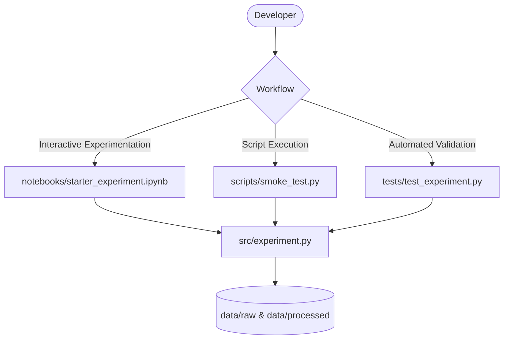
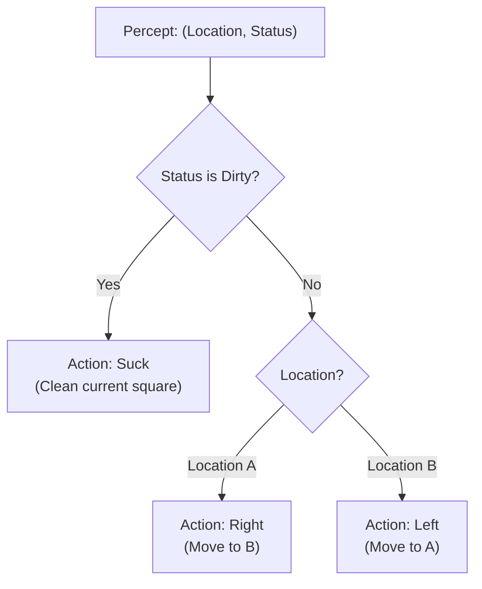
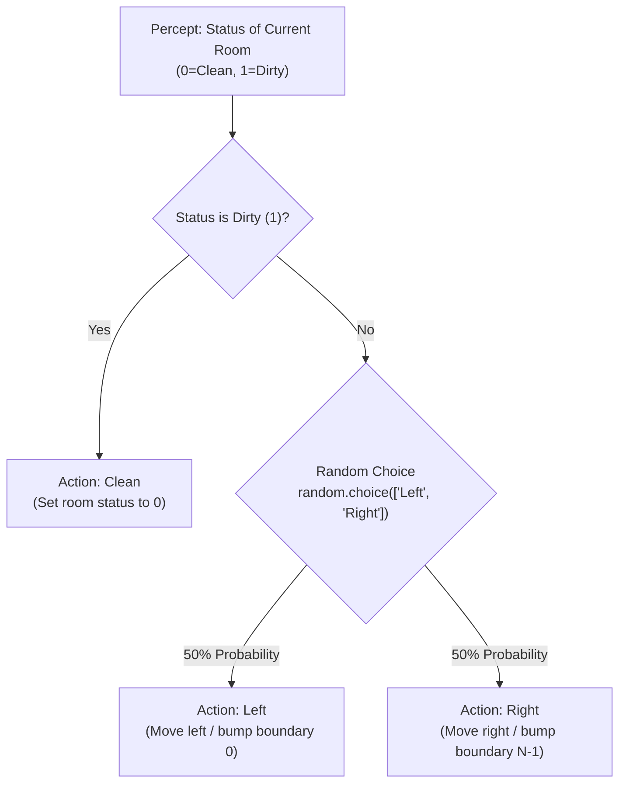
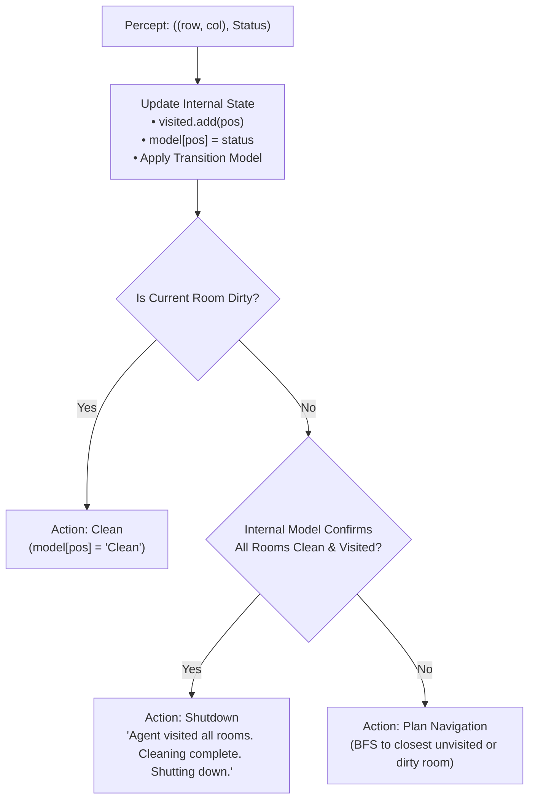
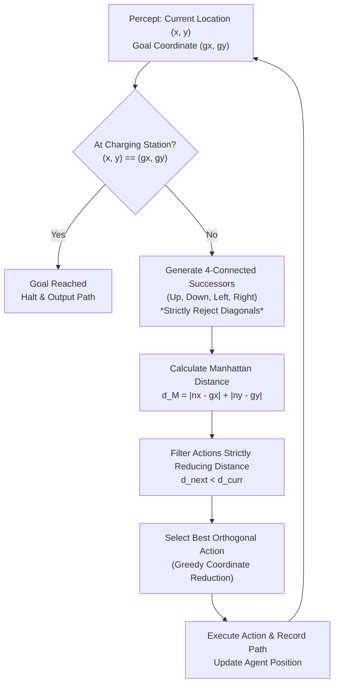

# AI Lab

A structured workspace for prototyping, experimenting with AI ideas, scripts, and models.

[](https://www.python.org/)
[](https://jupyter.org/)
[](https://docs.pytest.org/)
[](https://mermaid.js.org/)

## Tech Stack

| Layer | Tool |
| --- | --- |
| Language | Python 3 |
| Prototyping & Exploration | Jupyter Notebook (`.ipynb`) |
| Core Modules | `src/` (Clean, modular experiment runners) |
| Unit Testing | `unittest` / `pytest` in `tests/` |
| Data Layer | `data/raw/` and `data/processed/` |
| Diagrams | Mermaid in this README |

## Architecture



## Project Layout

```text
ai-lab/
├── notebooks/
│   ├── goal_based_navigation_agent.ipynb# Question 4: Goal-Based Navigation Agent simulation & Viva guide
│   ├── model_based_reflex_agent.ipynb   # Question 3: Model-Based Reflex Agent simulation & Viva guide
│   ├── randomized_reflex_agent.ipynb    # Question 2: Randomized Reflex Agent simulation & Viva guide
│   ├── simple_reflex_vacuum_agent.ipynb # Question 1: Simple Reflex Vacuum Agent simulation & Viva guide
│   └── starter_experiment.ipynb         # Interactive experimentation starter notebook
├── scripts/
│   ├── __init__.py                      # Scripts package marker
│   ├── run_goal_based_agent.py          # CLI & interactive runner for Question 4 (5x5 Grid Simulation)
│   ├── run_model_based_agent.py         # CLI & interactive runner for Question 3 (2x2 Grid Simulation)
│   ├── run_randomized_agent.py          # CLI & interactive runner for Question 2 (1D Grid Simulation)
│   ├── run_vacuum_agent.py              # CLI & interactive runner for Question 1 (2-Square & 3x3 Grid)
│   └── smoke_test.py                    # Starter entry point and verification smoke test
├── src/
│   ├── __init__.py                      # Package initialization & public exports
│   ├── __main__.py                      # CLI dispatcher (python -m src {vacuum,randomized,model-based,goal-based,smoke-test})
│   ├── experiment.py                    # Core experiment metrics and simulation runner
│   ├── goal_based_agent.py              # Question 4: Goal-Based Navigation Agent & 5x5 Grid Environment
│   ├── model_based_agent.py             # Question 3: Model-Based Reflex Agent & 2x2 Grid Environment
│   ├── randomized_agent.py              # Question 2: Randomized Reflex Agent & 1D Grid Environment
│   └── vacuum_agent.py                  # Question 1: Simple Reflex Vacuum Agent & Environments
├── tests/
│   ├── __init__.py                      # Test package marker
│   ├── test_experiment.py               # Unit test suite for experiment runner
│   ├── test_goal_based_agent.py         # Unit tests for Question 4 goal-based agent & 5x5 grid
│   ├── test_model_based_agent.py        # Unit tests for Question 3 model-based agent & 2x2 grid
│   ├── test_randomized_agent.py         # Unit tests for Question 2 randomized agent & 1D grid
│   ├── test_scripts.py                  # Unit tests for script runners & CLI dispatcher
│   └── test_vacuum_agent.py             # Unit tests for vacuum agent reflex rules & simulation traces
├── data/
│   ├── processed/                       # Processed artifacts & experiment outputs
│   └── raw/                             # Raw inputs & data snapshots
├── .gitignore                           # Comprehensive ignores (Python, Jupyter, venv, IDE)
├── pyproject.toml                       # Modern Python project configuration & packaging
├── README.md                            # Project documentation and practical guide
└── requirements.txt                     # Dependencies for notebooks and ML libraries
```

## Lab Practicals

### Question 1: Simple Reflex Vacuum Cleaner Agent

- **Syllabus Area**: Intelligent Agents
- **Difficulty**: 🟢 Beginner
- **Core AI Concept**: Simple Reflex Agent, Agent-Environment Interaction, Condition-Action Mapping
- **Complexity**: Time Complexity: $O(1)$ per step | Space Complexity: $O(1)$

#### Condition-Action Reflex Rules


#### Running the Vacuum Agent Simulation

1. **Default Sample Scenario** (Initial Location: `A`, Location A: `Dirty`, Location B: `Clean`, 5 Steps):
   ```bash
   python scripts/run_vacuum_agent.py
   ```

2. **Custom Location & Square States**:
   ```bash
   python scripts/run_vacuum_agent.py --location B --status-a Dirty --status-b Dirty --steps 5
   ```

3. **Interactive Mode**:
   ```bash
   python scripts/run_vacuum_agent.py --interactive
   ```

4. **Optional Challenge (3x3 Grid with Randomized Dirt Placement)**:
   ```bash
   python scripts/run_vacuum_agent.py --grid --steps 10
   ```

5. **Display Viva Voce Q&A and Theory Guide**:
   ```bash
   python scripts/run_vacuum_agent.py --viva
   ```

6. **Interactive Jupyter Notebook**:
   Open [`notebooks/simple_reflex_vacuum_agent.ipynb`](notebooks/simple_reflex_vacuum_agent.ipynb) in Jupyter Lab or Antigravity IDE.

---

### Question 2: Randomized Reflex Agent

- **Syllabus Area**: Intelligent Agents
- **Difficulty**: 🟢 Beginner
- **Core AI Concept**: Randomized Agent Behavior, Handling Unobservable States, Escaping Boundary Loops
- **Complexity**: Time Complexity: $O(N)$ average | Space Complexity: $O(N)$

#### Condition-Action Stochastic Rules


#### Running the Randomized Reflex Agent Simulation

1. **Sample Scenario with Exact 12-Step Reproducibility** (`[1, 0, 0, 1, 1]`, Start Index: `2`, Seed: `58`):
   ```bash
   python scripts/run_randomized_agent.py --seed 58
   ```
   *Output*:
   ```text
   All rooms clean in 12 steps.
   Total Navigation Moves   : 9
   Total Cleaning Actions   : 3
   Final Grid State         : [0, 0, 0, 0, 0]
   Final Agent Location     : Room [4]
   ```

2. **Custom Room State & Start Index**:
   ```bash
   python scripts/run_randomized_agent.py --state "1 0 1 1 0" --start-index 1
   ```

3. **Interactive Mode**:
   ```bash
   python scripts/run_randomized_agent.py --interactive
   ```

4. **Monte Carlo Empirical Benchmark (100 Trials)**:
   ```bash
   python scripts/run_randomized_agent.py --benchmark --trials 100
   ```

5. **Display Viva Voce Theory Guide**:
   ```bash
   python scripts/run_randomized_agent.py --viva
   ```

6. **Interactive Jupyter Notebook**:
   Open [`notebooks/randomized_reflex_agent.ipynb`](notebooks/randomized_reflex_agent.ipynb) in Jupyter Lab or Antigravity IDE.

---

### Question 3: Model-Based Reflex Agent

- **Syllabus Area**: Intelligent Agents
- **Difficulty**: 🟡 Intermediate
- **Core AI Concept**: Model-Based Reflex Agent, Internal State Representation, Transition Models, Sensor Models
- **Complexity**: Time Complexity: $O(N)$ | Space Complexity: $O(N)$ where $N=4$ for 2x2 grid

#### Model-Based Architecture & Decision Flow


#### Running the Model-Based Agent Simulation

1. **Default Sample Scenario** (2x2 Grid: `[[Dirty, Clean], [Dirty, Dirty]]`, Start at `(0, 0)`):
   ```bash
   python scripts/run_model_based_agent.py
   ```
   *Expected Output*:
   ```text
   Step  1: Pos (0, 0) | Percept: Dirty | Action: Clean    | Visited: {(0,0)}
   Step  2: Pos (0, 0) | Percept: Clean | Action: Down     | Visited: {(0,0)}
   Step  3: Pos (1, 0) | Percept: Dirty | Action: Clean    | Visited: {(0,0), (1,0)}
   Step  4: Pos (1, 0) | Percept: Clean | Action: Right    | Visited: {(0,0), (1,0)}
   Step  5: Pos (1, 1) | Percept: Dirty | Action: Clean    | Visited: {(0,0), (1,0), (1,1)}
   Step  6: Pos (1, 1) | Percept: Clean | Action: Up       | Visited: {(0,0), (1,0), (1,1)}
   Step  7: Pos (0, 1) | Percept: Clean | Action: Shutdown | Visited: {(0,0), (0,1), (1,0), (1,1)} -> Agent visited all rooms. Cleaning complete. Shutting down.
   ```

2. **Custom Grid & Start Position**:
   ```bash
   python scripts/run_model_based_agent.py --grid "Dirty Clean, Dirty Dirty" --start-row 0 --start-col 0
   ```

3. **Optional Challenge (Stochastic Sensor Failure)**:
   ```bash
   python scripts/run_model_based_agent.py --sensor-failure 0.2 --seed 42
   ```

4. **Interactive Walkthrough Mode**:
   ```bash
   python scripts/run_model_based_agent.py --interactive
   ```

5. **Display Viva Voce Reference & Theory Guide**:
   ```bash
   python scripts/run_model_based_agent.py --viva
   ```

6. **Interactive Jupyter Notebook**:
   Open [`notebooks/model_based_reflex_agent.ipynb`](notebooks/model_based_reflex_agent.ipynb) in Jupyter Lab or Antigravity IDE.

---

### Question 4: Goal-Based Navigation Agent

- **Syllabus Area**: Intelligent Agents
- **Difficulty**: 🟡 Intermediate
- **Core AI Concept**: Goal-Based Agent, Distance Metrics (Manhattan & Euclidean), Greedy Coordinate Reduction
- **Complexity**: Time Complexity: $O(D)$ | Space Complexity: $O(D)$ where $D = |x_1 - x_2| + |y_1 - y_2|$ is Manhattan distance

#### Goal-Based Decision Architecture


#### Running the Goal-Based Agent Simulation

1. **Default Sample Scenario** (Start: `(0, 0)`, Goal: `(3, 4)`):
   ```bash
   python scripts/run_goal_based_agent.py
   ```
   *Expected Output*:
   ```text
   Step  1: Pos (0, 0) -> Action: Down  -> Next: (1, 0) | Dist: 7 -> 6 (Decreased)
   Step  2: Pos (1, 0) -> Action: Down  -> Next: (2, 0) | Dist: 6 -> 5 (Decreased)
   Step  3: Pos (2, 0) -> Action: Down  -> Next: (3, 0) | Dist: 5 -> 4 (Decreased)
   Step  4: Pos (3, 0) -> Action: Right -> Next: (3, 1) | Dist: 4 -> 3 (Decreased)
   Step  5: Pos (3, 1) -> Action: Right -> Next: (3, 2) | Dist: 3 -> 2 (Decreased)
   Step  6: Pos (3, 2) -> Action: Right -> Next: (3, 3) | Dist: 2 -> 1 (Decreased)
   Step  7: Pos (3, 3) -> Action: Right -> Next: (3, 4) | Dist: 1 -> 0 (Decreased)

   Path: [(0, 0), (1, 0), (2, 0), (3, 0), (3, 1), (3, 2), (3, 3), (3, 4)]
   ```

2. **Custom Start & Goal Coordinates**:
   ```bash
   python scripts/run_goal_based_agent.py --start 1 1 --goal 4 2
   ```

3. **Random Goal Placement (with Seed Reproducibility)**:
   ```bash
   python scripts/run_goal_based_agent.py --random-goal --seed 42
   ```

4. **Optional Challenge (Explicit Diagonal Movement Prevention)**:
   ```bash
   python scripts/run_goal_based_agent.py --challenge
   ```

5. **Distance Metric Comparison (Manhattan $L_1$ vs. Euclidean $L_2$)**:
   ```bash
   python scripts/run_goal_based_agent.py --compare-metrics
   ```

6. **Interactive Terminal Mode**:
   ```bash
   python scripts/run_goal_based_agent.py --interactive
   ```

7. **Display Viva Voce Reference & Theory Guide**:
   ```bash
   python scripts/run_goal_based_agent.py --viva
   ```

8. **Interactive Jupyter Notebook**:
   Open [`notebooks/goal_based_navigation_agent.ipynb`](notebooks/goal_based_navigation_agent.ipynb) in Jupyter Lab or Antigravity IDE.


## Getting Started

### 1. Requirements & Setup

Ensure Python 3 is installed. To install dependencies for notebooks and experimentation:

```bash
pip install -r requirements.txt
```

### 2. Run the Starter Script

From the project root:

```bash
python scripts/smoke_test.py
```

### 3. Run Automated Tests

Execute the comprehensive test suite (including ExperimentRunner and Vacuum Agent tests):

```bash
python -m unittest discover -s tests
```

Or using pytest:

```bash
pytest
```

### 4. Interactive Jupyter Notebooks

Launch Jupyter to explore interactive experiments:

```bash
jupyter lab notebooks/simple_reflex_vacuum_agent.ipynb
```
or open directly in your IDE (VS Code / Antigravity).
