# AI Lab

A structured workspace for prototyping, experimenting with AI ideas, scripts, and models.

[](https://www.python.org/)
[](https://jupyter.org/)
[](https://docs.pytest.org/)
[](https://mermaid.js.org/)

## Tech Stack

| Layer | Tool |
| --- | --- |
| Language | Python 3 |
| Prototyping & Exploration | Jupyter Notebook (`.ipynb`) |
| Core Modules | `src/` (Clean, modular experiment runners) |
| Unit Testing | `unittest` / `pytest` in `tests/` |
| Data Layer | `data/raw/` and `data/processed/` |
| Diagrams | Mermaid in this README |

## Architecture

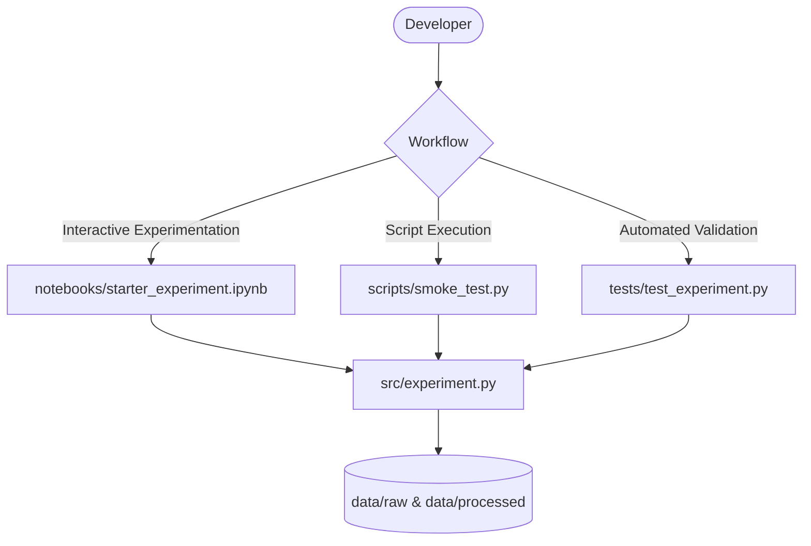

## Project Layout

```text
ai-lab/
├── notebooks/
│   ├── goal_based_navigation_agent.ipynb# Question 4: Goal-Based Navigation Agent simulation & Viva guide
│   ├── model_based_reflex_agent.ipynb   # Question 3: Model-Based Reflex Agent simulation & Viva guide
│   ├── multi_agent_simulation.ipynb     # Question 6: Multi-Agent Environment Simulation (4x4 Grid)
│   ├── randomized_reflex_agent.ipynb    # Question 2: Randomized Reflex Agent simulation & Viva guide
│   ├── simple_reflex_vacuum_agent.ipynb # Question 1: Simple Reflex Vacuum Agent simulation & Viva guide
│   ├── starter_experiment.ipynb         # Interactive experimentation starter notebook
│   ├── environment_type_classifier.ipynb# Question 8: Environment Type Classifier & Knowledge Base
│   ├── stochastic_vacuum_agent.ipynb    # Question 7: Stochastic Vacuum Agent simulation & Viva guide
│   ├── agent_performance_evaluator.ipynb# Question 9: Agent Performance Measure Evaluator simulation & Viva guide
│   ├── state_space_visualizer.ipynb     # Question 10: State-Space Visualizer for Reflex Agent & Viva guide
│   ├── breadth_first_search.ipynb       # Question 11: Breadth-First Search (BFS) on User-Defined Graph & Viva guide
│   ├── depth_first_search.ipynb         # Question 12: Depth-First Search (DFS) for Graph Traversal & Viva guide
│   ├── uniform_cost_search.ipynb        # Question 14: Uniform Cost Search (UCS) Implementation & Viva guide
│   ├── bfs_2d_maze_solver.ipynb         # Question 15: BFS 2D Maze Solver (Implicit Graph Search) & Viva guide
│   ├── depth_limited_search.ipynb       # Question 16: Depth-Limited Search (DLS), Tri-State Outcomes & Viva guide
│   └── utility_based_agent.ipynb        # Question 5: Utility-Based Agent simulation & Viva guide
├── scripts/
│   ├── __init__.py                      # Scripts package marker
│   ├── run_goal_based_agent.py          # CLI & interactive runner for Question 4 (5x5 Grid Simulation)
│   ├── run_model_based_agent.py         # CLI & interactive runner for Question 3 (2x2 Grid Simulation)
│   ├── run_multi_agent_simulation.py    # CLI & interactive runner for Question 6 (Builder vs Destroyer)
│   ├── run_randomized_agent.py          # CLI & interactive runner for Question 2 (1D Grid Simulation)
│   ├── run_stochastic_vacuum_agent.py   # CLI & interactive runner for Question 7 (Monte Carlo Simulation)
│   ├── run_utility_based_agent.py       # CLI & interactive runner for Question 5 (Utility Optimization)
│   ├── run_environment_classifier.py    # CLI & interactive runner for Question 8 (Environment Classifier)
│   ├── run_agent_performance_evaluator.py# CLI & interactive runner for Question 9 (PEAS Performance Evaluator)
│   ├── run_state_space_visualizer.py    # CLI & interactive runner for Question 10 (State-Space Graph Visualizer)
│   ├── run_breadth_first_search.py      # CLI & interactive runner for Question 11 (Level-Order BFS & Graph Depth)
│   ├── run_depth_first_search.py        # CLI & interactive runner for Question 12 (LIFO DFS & Recursive Comparison)
│   ├── run_uniform_cost_search.py       # CLI & interactive runner for Question 14 (Priority Queue UCS & Cycle Detection)
│   ├── run_bfs_maze_solver.py           # CLI & interactive runner for Question 15 (Implicit BFS Maze Solver & Moves)
│   ├── run_depth_limited_search.py      # CLI & interactive runner for Question 16 (DLS Bounded Search & Deepest Node)
│   ├── run_vacuum_agent.py              # CLI & interactive runner for Question 1 (2-Square & 3x3 Grid)
│   └── smoke_test.py                    # Starter entry point and verification smoke test
├── src/
│   ├── __init__.py                      # Package initialization & public exports
│   ├── __main__.py                      # CLI dispatcher (python -m src {vacuum,randomized,model-based,goal-based,utility-based,multi-agent,stochastic,environment-classifier,agent-evaluator,state-space,bfs,dfs,ucs,maze,dls,smoke-test})
│   ├── experiment.py                    # Core experiment metrics and simulation runner
│   ├── goal_based_agent.py              # Question 4: Goal-Based Navigation Agent & 5x5 Grid Environment
│   ├── model_based_agent.py             # Question 3: Model-Based Reflex Agent & 2x2 Grid Environment
│   ├── multi_agent_simulation.py        # Question 6: Multi-Agent Environment Simulation & Shared 4x4 Grid
│   ├── randomized_agent.py              # Question 2: Randomized Reflex Agent & 1D Grid Environment
│   ├── stochastic_vacuum_agent.py       # Question 7: Stochastic Vacuum Agent & Non-deterministic Environment
│   ├── environment_classifier.py        # Question 8: Environment Type Classifier & Knowledge Base
│   ├── utility_based_agent.py           # Question 5: Utility-Based Agent & Terrain Graph Cost Optimization
│   ├── agent_performance_evaluator.py   # Question 9: Autonomous Delivery Drone PEAS Performance Evaluator
│   ├── state_space_visualizer.py        # Question 10: State-Space Visualizer, Combinatorial Model & Graph Renderer
│   ├── breadth_first_search.py          # Question 11: Breadth-First Search, FIFO Frontier, Cycle Avoidance & Levels
│   ├── depth_first_search.py            # Question 12: Depth-First Search, LIFO Stack, Recursion, Cycles & Back-Edges
│   ├── uniform_cost_search.py          # Question 14: Uniform Cost Search (UCS), Min-Heap Frontier, Cumulative Cost & Cycles
│   ├── bfs_maze_solver.py               # Question 15: BFS 2D Grid Maze Solver, Dynamic Successors & Move Strings
│   ├── depth_limited_search.py          # Question 16: Depth-Limited Search (DLS), Bounded Recursion & Tri-State Outcomes
│   └── vacuum_agent.py                  # Question 1: Simple Reflex Vacuum Agent & Environments
├── tests/
│   ├── __init__.py                      # Test package marker
│   ├── test_experiment.py               # Unit test suite for experiment runner
│   ├── test_goal_based_agent.py         # Unit tests for Question 4 goal-based agent & 5x5 grid
│   ├── test_model_based_agent.py        # Unit tests for Question 3 model-based agent & 2x2 grid
│   ├── test_multi_agent_simulation.py   # Unit tests for Question 6 multi-agent simulation & rules
│   ├── test_randomized_agent.py         # Unit tests for Question 2 randomized agent & 1D grid
│   ├── test_scripts.py                  # Unit tests for script runners & CLI dispatcher
│   ├── test_stochastic_vacuum_agent.py  # Unit tests for Question 7 stochastic transitions & Monte Carlo
│   ├── test_utility_based_agent.py      # Unit tests for Question 5 utility-based agent & terrain costs
│   ├── test_agent_performance_evaluator.py# Unit tests for Question 9 linear evaluation, PEAS metric & CSV
│   ├── test_state_space_visualizer.py   # Unit tests for Question 10 combinatorial states, transitions & graph
│   ├── test_breadth_first_search.py     # Unit tests for Question 11 BFS traversal, tie-breaking, cycles & levels
│   ├── test_depth_first_search.py       # Unit tests for Question 12 DFS traversal, cycles, edge types & challenge
│   ├── test_uniform_cost_search.py      # Unit tests for Question 14 UCS optimality, priority queue & negative cycles
│   ├── test_bfs_maze_solver.py          # Unit tests for Question 15 BFS 2D maze solver, successors, moves & bounds
│   ├── test_depth_limited_search.py     # Unit tests for Question 16 DLS tri-states, limit budget & deepest node
│   └── test_vacuum_agent.py             # Unit tests for vacuum agent reflex rules & simulation traces
├── data/
│   ├── processed/                       # Processed artifacts & experiment outputs
│   └── raw/                             # Raw inputs & data snapshots
├── .gitignore                           # Comprehensive ignores (Python, Jupyter, venv, IDE)
├── pyproject.toml                       # Modern Python project configuration & packaging
├── README.md                            # Project documentation and practical guide
└── requirements.txt                     # Dependencies for notebooks and ML libraries
```

## Lab Practicals

### Question 1: Simple Reflex Vacuum Cleaner Agent

- **Syllabus Area**: Intelligent Agents
- **Difficulty**: 🟢 Beginner
- **Core AI Concept**: Simple Reflex Agent, Agent-Environment Interaction, Condition-Action Mapping
- **Complexity**: Time Complexity: $O(1)$ per step | Space Complexity: $O(1)$

#### Condition-Action Reflex Rules
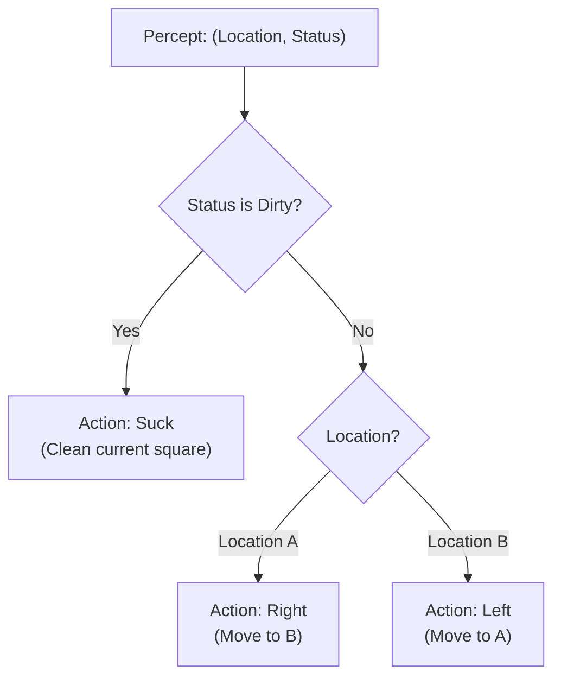

#### Running the Vacuum Agent Simulation

1. **Default Sample Scenario** (Initial Location: `A`, Location A: `Dirty`, Location B: `Clean`, 5 Steps):
   ```bash
   python scripts/run_vacuum_agent.py
   ```

2. **Custom Location & Square States**:
   ```bash
   python scripts/run_vacuum_agent.py --location B --status-a Dirty --status-b Dirty --steps 5
   ```

3. **Interactive Mode**:
   ```bash
   python scripts/run_vacuum_agent.py --interactive
   ```

4. **Optional Challenge (3x3 Grid with Randomized Dirt Placement)**:
   ```bash
   python scripts/run_vacuum_agent.py --grid --steps 10
   ```

5. **Display Viva Voce Q&A and Theory Guide**:
   ```bash
   python scripts/run_vacuum_agent.py --viva
   ```

6. **Interactive Jupyter Notebook**:
   Open [`notebooks/simple_reflex_vacuum_agent.ipynb`](notebooks/simple_reflex_vacuum_agent.ipynb) in Jupyter Lab or Antigravity IDE.

---

### Question 2: Randomized Reflex Agent

- **Syllabus Area**: Intelligent Agents
- **Difficulty**: 🟢 Beginner
- **Core AI Concept**: Randomized Agent Behavior, Handling Unobservable States, Escaping Boundary Loops
- **Complexity**: Time Complexity: $O(N)$ average | Space Complexity: $O(N)$

#### Condition-Action Stochastic Rules
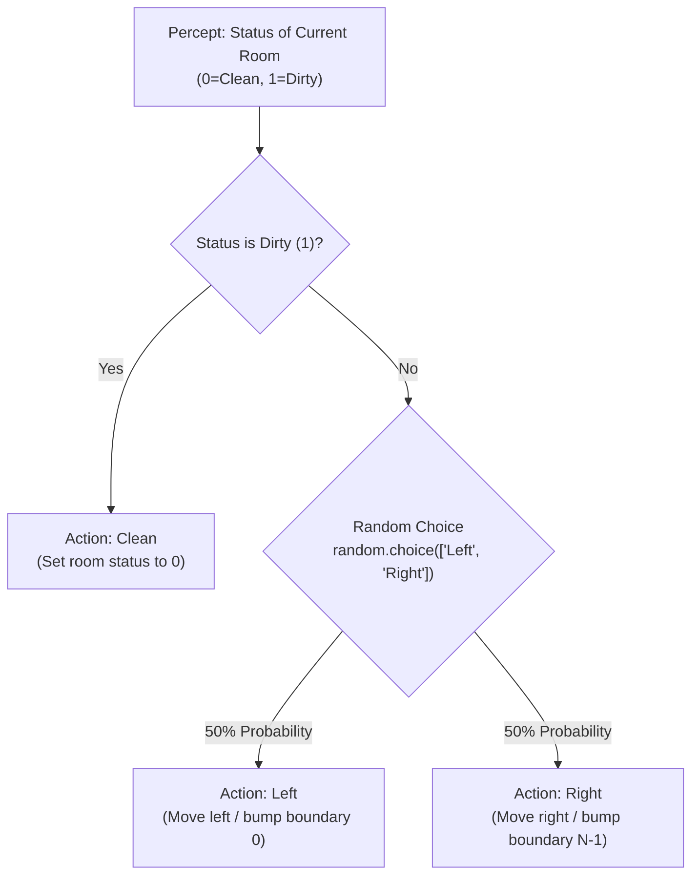

#### Running the Randomized Reflex Agent Simulation

1. **Sample Scenario with Exact 12-Step Reproducibility** (`[1, 0, 0, 1, 1]`, Start Index: `2`, Seed: `58`):
   ```bash
   python scripts/run_randomized_agent.py --seed 58
   ```
   *Output*:
   ```text
   All rooms clean in 12 steps.
   Total Navigation Moves   : 9
   Total Cleaning Actions   : 3
   Final Grid State         : [0, 0, 0, 0, 0]
   Final Agent Location     : Room [4]
   ```

2. **Custom Room State & Start Index**:
   ```bash
   python scripts/run_randomized_agent.py --state "1 0 1 1 0" --start-index 1
   ```

3. **Interactive Mode**:
   ```bash
   python scripts/run_randomized_agent.py --interactive
   ```

4. **Monte Carlo Empirical Benchmark (100 Trials)**:
   ```bash
   python scripts/run_randomized_agent.py --benchmark --trials 100
   ```

5. **Display Viva Voce Theory Guide**:
   ```bash
   python scripts/run_randomized_agent.py --viva
   ```

6. **Interactive Jupyter Notebook**:
   Open [`notebooks/randomized_reflex_agent.ipynb`](notebooks/randomized_reflex_agent.ipynb) in Jupyter Lab or Antigravity IDE.

---

### Question 3: Model-Based Reflex Agent

- **Syllabus Area**: Intelligent Agents
- **Difficulty**: 🟡 Intermediate
- **Core AI Concept**: Model-Based Reflex Agent, Internal State Representation, Transition Models, Sensor Models
- **Complexity**: Time Complexity: $O(N)$ | Space Complexity: $O(N)$ where $N=4$ for 2x2 grid

#### Model-Based Architecture & Decision Flow
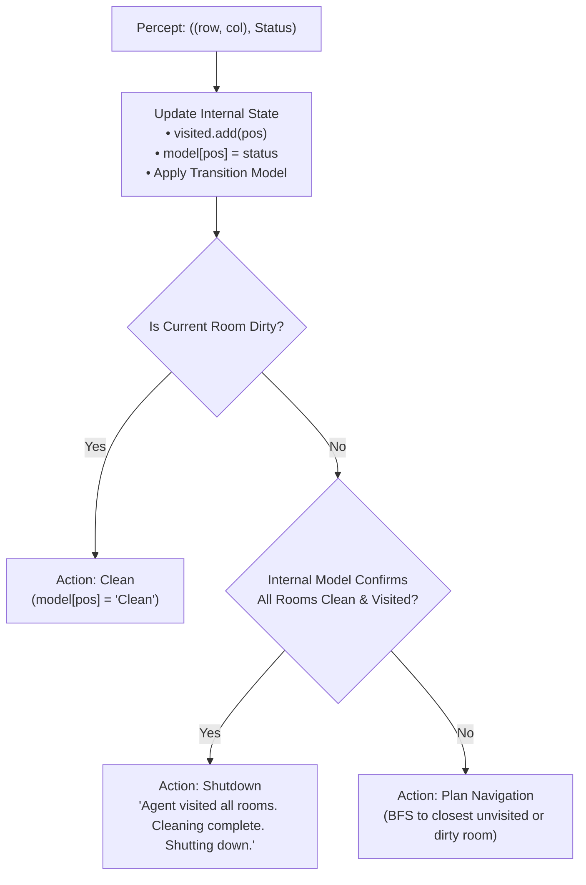

#### Running the Model-Based Agent Simulation

1. **Default Sample Scenario** (2x2 Grid: `[[Dirty, Clean], [Dirty, Dirty]]`, Start at `(0, 0)`):
   ```bash
   python scripts/run_model_based_agent.py
   ```
   *Expected Output*:
   ```text
   Step  1: Pos (0, 0) | Percept: Dirty | Action: Clean    | Visited: {(0,0)}
   Step  2: Pos (0, 0) | Percept: Clean | Action: Down     | Visited: {(0,0)}
   Step  3: Pos (1, 0) | Percept: Dirty | Action: Clean    | Visited: {(0,0), (1,0)}
   Step  4: Pos (1, 0) | Percept: Clean | Action: Right    | Visited: {(0,0), (1,0)}
   Step  5: Pos (1, 1) | Percept: Dirty | Action: Clean    | Visited: {(0,0), (1,0), (1,1)}
   Step  6: Pos (1, 1) | Percept: Clean | Action: Up       | Visited: {(0,0), (1,0), (1,1)}
   Step  7: Pos (0, 1) | Percept: Clean | Action: Shutdown | Visited: {(0,0), (0,1), (1,0), (1,1)} -> Agent visited all rooms. Cleaning complete. Shutting down.
   ```

2. **Custom Grid & Start Position**:
   ```bash
   python scripts/run_model_based_agent.py --grid "Dirty Clean, Dirty Dirty" --start-row 0 --start-col 0
   ```

3. **Optional Challenge (Stochastic Sensor Failure)**:
   ```bash
   python scripts/run_model_based_agent.py --sensor-failure 0.2 --seed 42
   ```

4. **Interactive Walkthrough Mode**:
   ```bash
   python scripts/run_model_based_agent.py --interactive
   ```

5. **Display Viva Voce Reference & Theory Guide**:
   ```bash
   python scripts/run_model_based_agent.py --viva
   ```

6. **Interactive Jupyter Notebook**:
   Open [`notebooks/model_based_reflex_agent.ipynb`](notebooks/model_based_reflex_agent.ipynb) in Jupyter Lab or Antigravity IDE.

---

### Question 4: Goal-Based Navigation Agent

- **Syllabus Area**: Intelligent Agents
- **Difficulty**: 🟡 Intermediate
- **Core AI Concept**: Goal-Based Agent, Distance Metrics (Manhattan & Euclidean), Greedy Coordinate Reduction
- **Complexity**: Time Complexity: $O(D)$ | Space Complexity: $O(D)$ where $D = |x_1 - x_2| + |y_1 - y_2|$ is Manhattan distance

#### Goal-Based Decision Architecture
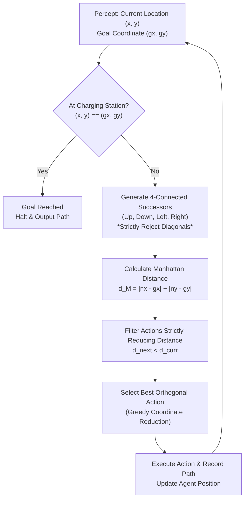

#### Running the Goal-Based Agent Simulation

1. **Default Sample Scenario** (Start: `(0, 0)`, Goal: `(3, 4)`):
   ```bash
   python scripts/run_goal_based_agent.py
   ```
   *Expected Output*:
   ```text
   Step  1: Pos (0, 0) -> Action: Down  -> Next: (1, 0) | Dist: 7 -> 6 (Decreased)
   Step  2: Pos (1, 0) -> Action: Down  -> Next: (2, 0) | Dist: 6 -> 5 (Decreased)
   Step  3: Pos (2, 0) -> Action: Down  -> Next: (3, 0) | Dist: 5 -> 4 (Decreased)
   Step  4: Pos (3, 0) -> Action: Right -> Next: (3, 1) | Dist: 4 -> 3 (Decreased)
   Step  5: Pos (3, 1) -> Action: Right -> Next: (3, 2) | Dist: 3 -> 2 (Decreased)
   Step  6: Pos (3, 2) -> Action: Right -> Next: (3, 3) | Dist: 2 -> 1 (Decreased)
   Step  7: Pos (3, 3) -> Action: Right -> Next: (3, 4) | Dist: 1 -> 0 (Decreased)

   Path: [(0, 0), (1, 0), (2, 0), (3, 0), (3, 1), (3, 2), (3, 3), (3, 4)]
   ```

2. **Custom Start & Goal Coordinates**:
   ```bash
   python scripts/run_goal_based_agent.py --start 1 1 --goal 4 2
   ```

3. **Random Goal Placement (with Seed Reproducibility)**:
   ```bash
   python scripts/run_goal_based_agent.py --random-goal --seed 42
   ```

4. **Optional Challenge (Explicit Diagonal Movement Prevention)**:
   ```bash
   python scripts/run_goal_based_agent.py --challenge
   ```

5. **Distance Metric Comparison (Manhattan $L_1$ vs. Euclidean $L_2$)**:
   ```bash
   python scripts/run_goal_based_agent.py --compare-metrics
   ```

6. **Interactive Terminal Mode**:
   ```bash
   python scripts/run_goal_based_agent.py --interactive
   ```

7. **Display Viva Voce Reference & Theory Guide**:
   ```bash
   python scripts/run_goal_based_agent.py --viva
   ```

8. **Interactive Jupyter Notebook**:
   Open [`notebooks/goal_based_navigation_agent.ipynb`](notebooks/goal_based_navigation_agent.ipynb) in Jupyter Lab or Antigravity IDE.

---

### Question 5: Utility-Based Agent Simulation

- **Syllabus Area**: Intelligent Agents
- **Difficulty**: 🟠 Advanced
- **Practical Type**: Optimization
- **Core AI Concept**: Utility-Based Agent, Cost Minimization vs. Utility Maximization, Expected Utility Theory
- **Complexity**: Time Complexity: $O(P \times L)$ | Space Complexity: $O(1)$ where $P$ is candidate paths and $L$ is path length

#### Decision & Optimization Flow
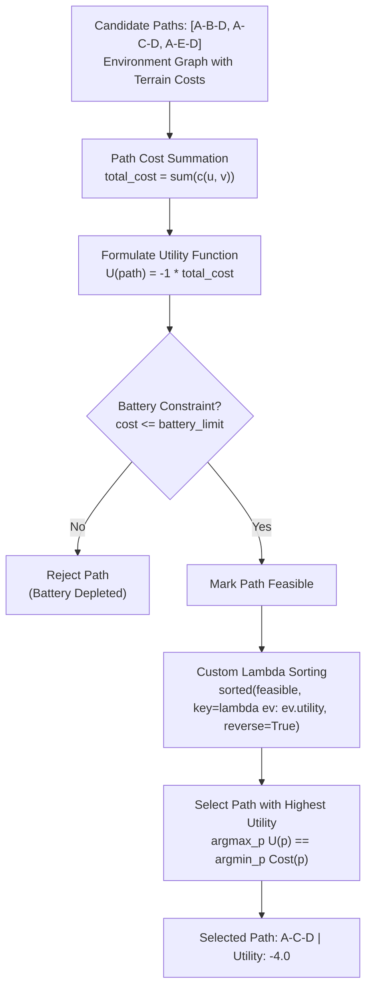

#### Running the Utility-Based Agent Simulation

1. **Default Run (3 Predefined Paths on Sample Graph)**:
   ```bash
   python scripts/run_utility_based_agent.py
   ```
   *Expected Output*:
   ```text
   Candidate Path Evaluations:
   ---------------------------------------------------------------------------
   #   Path             Terrain Breakdown          Cost    Utility  Status
   ---------------------------------------------------------------------------
   1   A-B-D            G:1 + W:5                  6.0     -6.0     FEASIBLE
   2   A-C-D            G:1 + M:3                  4.0     -4.0     SELECTED (Optimal)
   3   A-E-D            M:3 + W:5                  8.0     -8.0     FEASIBLE
   ---------------------------------------------------------------------------

   Optimization Result:
     Selected Path: A-C-D
     Total Cost:    4.0
     Utility:       -4.0
   ```

2. **Custom Paths via CLI**:
   ```bash
   python scripts/run_utility_based_agent.py --paths "A-B-D" "A-C-D"
   ```

3. **Optional Challenge (Battery Capacity Constraint)**:
   ```bash
   python scripts/run_utility_based_agent.py --challenge
   ```
   *Output*:
   ```text
   Battery Capacity Limit: 5.0 units
   Rule: Reject any path with total_cost > battery_limit regardless of utility.

   Challenge Analysis:
     [REJECTED] Path A-B-D      Cost: 6.0 > 5.0 (Battery Depleted)
     [ACCEPTED] Path A-C-D      Cost: 4.0 <= 5.0
     [REJECTED] Path A-E-D      Cost: 8.0 > 5.0 (Battery Depleted)

   Best Feasible Path: A-C-D (Cost: 4.0, Utility: -4.0)
   ```

4. **Auto-Discovery of All Directed Paths (DFS)**:
   ```bash
   python scripts/run_utility_based_agent.py --all-paths
   ```

5. **Top-Level Module Dispatcher**:
   ```bash
   python -m src utility-based
   ```

6. **Interactive Terminal Mode**:
   ```bash
   python scripts/run_utility_based_agent.py --interactive
   ```

7. **Display Viva Voce Reference & Theory Guide**:
   ```bash
   python scripts/run_utility_based_agent.py --viva
   ```

8. **Interactive Jupyter Notebook**:
   Open [`notebooks/utility_based_agent.ipynb`](notebooks/utility_based_agent.ipynb) in Jupyter Lab or Antigravity IDE.

---

### Question 6: Multi-Agent Environment Simulation

- **Syllabus Area**: Intelligent Agents
- **Difficulty**: 🟠 Advanced
- **Practical Type**: Simulation
- **Core AI Concept**: Multi-Agent Systems, Competitive/Zero-Sum Environments, Sequential vs. Episodic, Dynamic vs. Static, Turn-Based Execution, Collision Avoidance
- **Complexity**: Time Complexity: $O(S)$ where $S$ is steps | Space Complexity: $O(\text{Grid Size}) = O(16) = O(1)$

#### Multi-Agent Architecture & Turn-Based Interaction Loop
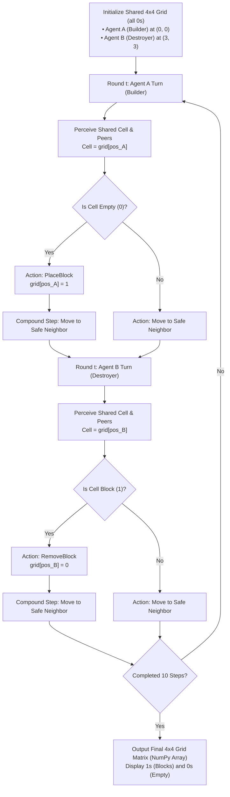

#### Running the Multi-Agent Simulation

1. **Default 10-Step Simulation** (4x4 Grid, Builder at `(0, 0)`, Destroyer at `(3, 3)`):
   ```bash
   python scripts/run_multi_agent_simulation.py --steps 10
   ```
   *Sample Output*:
   ```text
   Sample Output (NumPy Matrix displaying 1s and 0s):
   [[1 1 0 0]
    [1 1 1 0]
    [0 1 1 0]
    [0 0 0 0]]

   ======================================================================
                  MULTI-AGENT ENVIRONMENT SIMULATION SUMMARY             
   ======================================================================
   Execution Mode:             Compound Turns
   Total Rounds (Steps):       10
   Agent A:                    Agent_A (Builder) | Start: (0, 0) -> Final: (1, 3)
   Agent B:                    Agent_B (Destroyer) | Start: (3, 3) -> Final: (2, 0)
   Performance Metrics:        Builder placed 9 blocks | Destroyer removed 2 blocks | Net: +7
   Final Block Count in Grid:  7 / 16
   Collision Avoidance:        Disabled
   Collisions Avoided:         0
   Collisions Occurred:        1
   ----------------------------------------------------------------------
   Final Grid State Matrix (NumPy Array):
   [[1 1 0 0]
    [1 1 1 0]
    [0 1 1 0]
    [0 0 0 0]]
   ======================================================================
   ```

2. **Optional Challenge (Active Collision Awareness & Avoidance)**:
   ```bash
   python scripts/run_multi_agent_simulation.py --challenge
   ```
   *Output Highlights*:
   ```text
   Collision Avoidance: ENABLED (Optional Challenge)
   Collisions Avoided:  2
   Collisions Occurred: 0
   ```

3. **Discrete Turn Mode (Act OR Move)**:
   ```bash
   python scripts/run_multi_agent_simulation.py --mode discrete --steps 10
   ```

4. **Greedy Heuristic Movement Strategy**:
   ```bash
   python scripts/run_multi_agent_simulation.py --strategy greedy --steps 10
   ```

5. **Top-Level Module Dispatcher**:
   ```bash
   python -m src multi-agent --steps 10
   ```

6. **Interactive Step-by-Step Walkthrough**:
   ```bash
   python scripts/run_multi_agent_simulation.py --interactive
   ```

7. **Display Viva Voce Reference & Theory Guide**:
   ```bash
   python scripts/run_multi_agent_simulation.py --viva
   ```

8. **Interactive Jupyter Notebook**:
   Open [`notebooks/multi_agent_simulation.ipynb`](notebooks/multi_agent_simulation.ipynb) in Jupyter Lab or Antigravity IDE.

### Question 7: Stochastic Environment Vacuum Agent

- **Syllabus Area**: Intelligent Agents
- **Difficulty**: 🟠 Advanced
- **Practical Type**: Simulation
- **Core AI Concept**: Stochastic Environments, Non-deterministic Actions, Actuator Slippage, Monte Carlo Estimation
- **Python Concepts Tested**: `random` module (`random.random()`), statistical averaging (`statistics`), loops, dataclasses
- **Complexity**: Time Complexity: $O(\text{Runs} \times \text{Steps})$ | Space Complexity: $O(\text{Runs})$

#### Probabilistic Actuator State Transition Model
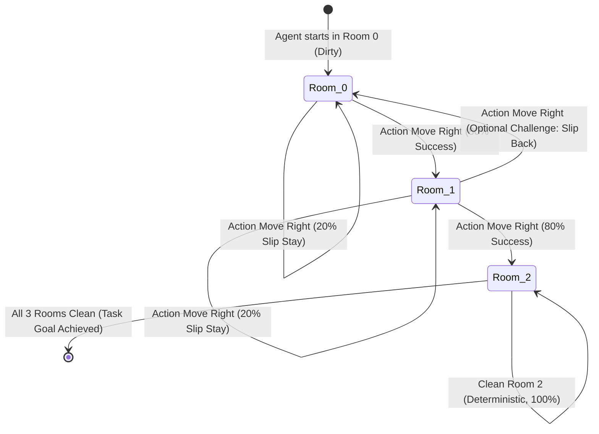

#### Theoretical Expectation vs. Deterministic Baseline

| Metric | Deterministic Baseline | Stochastic Environment ($p=0.8$) |
| :--- | :--- | :--- |
| **Cleaning Steps** | 3 steps ($1$ step per room) | 3 steps ($1$ step per room) |
| **Room Transitions** | 2 steps ($1$ step per move) | $\mathbb{E}[\text{Moves}] = 2 \times \frac{1}{0.8} = 2.5$ steps |
| **Total Expected Steps** | **5.0 steps** | **5.5 steps** |
| **Performance Penalty** | Baseline (0.0 steps) | **+0.5 steps (+10.0% execution delay)** |

#### Running the Stochastic Vacuum Agent Simulation

1. **Standard Monte Carlo Batch (20 Runs)**:
   ```bash
   python scripts/run_stochastic_vacuum_agent.py --runs 20
   ```
   *Expected Output*:
   ```text
   Average steps to clean 3 rooms: 5.4 steps
   ```

2. **Reproducible Benchmark (Seed 28 reproduces sample output exactly)**:
   ```bash
   python scripts/run_stochastic_vacuum_agent.py --runs 20 --seed 28
   ```

3. **Detailed Step-by-Step Trajectory Trace**:
   ```bash
   python scripts/run_stochastic_vacuum_agent.py --runs 20 --seed 28 --trace
   ```

4. **Optional Challenge: Actuator 'Slip Back' Mechanics**:
   ```bash
   python scripts/run_stochastic_vacuum_agent.py --challenge --seed 42
   ```

5. **Display Viva Voce Theory & Reference Guide**:
   ```bash
   python scripts/run_stochastic_vacuum_agent.py --viva
   ```

6. **Top-Level Package Dispatcher**:
   ```bash
   python -m src stochastic --runs 20 --seed 28
   ```

7. **Interactive Jupyter Notebook**:
   Open [`notebooks/stochastic_vacuum_agent.ipynb`](notebooks/stochastic_vacuum_agent.ipynb) in Jupyter Lab or Antigravity IDE.

---

### Question 8: Environment Type Classifier

- **Syllabus Area**: Intelligent Agents
- **Difficulty**: 🟡 Intermediate
- **Practical Type**: Knowledge Representation
- **Core AI Concept**: Environment Properties (PEAS), Environmental Taxonomy, Knowledge Dictionary Representation
- **Python Concepts Tested**: Tuples as dictionary keys, robust boolean input parsing, nearest-neighbor Hamming distance
- **Complexity**: Time Complexity: (1)$ dictionary lookup | Space Complexity: (K)$ for knowledge base ( \le 32$)

#### Knowledge Representation & Lookup Flowchart
`mermaid
flowchart TD
    User([User Prompt / CLI Input]) --> Parse[Parse Flexible Booleans]
    Parse --> Vector[5-Boolean Tuple Key: Obs, Det, Epi, Stat, Disc]
    Vector --> Lookup{O 1 Hash Key in Knowledge Base?}
    Lookup -->|Exact Key Found| Meta[Retrieve EnvironmentMetadata]
    Meta --> Success([Display Exact Match & PEAS Breakdown])
    Lookup -->|Unknown Combination| Challenge{Nearest-Neighbor Fallback?}
    Challenge -->|Enabled| Metric[Compute Hamming Distance D_H to all K entries]
    Metric --> Rank[Find Minimum Distance Tier]
    Rank --> Nearest([Display Nearest Environment & Property Differences])
    Challenge -->|Disabled| Graceful([Inform Unknown Combination Gracefully])
`

#### Canonical AI Environment Taxonomy (Russell & Norvig Table 2.1)

| Environment | Observable | Deterministic | Episodic | Static | Discrete | Agent Type |
| :--- | :---: | :---: | :---: | :---: | :---: | :--- |
| **Backgammon (with clock)** *(Sample)* | **True** | **False** (Dice) | **False** (Seq) | **False** (Clock) | **True** | Multi-Agent (Competitive) |
| **Backgammon (without clock)** | **True** | **False** (Dice) | **False** (Seq) | **True** | **True** | Multi-Agent (Competitive) |
| **Chess (with clock)** | **True** | **True** | **False** (Seq) | **False** (Clock) | **True** | Multi-Agent (Competitive) |
| **Chess (without clock) / Crossword** | **True** | **True** | **False** (Seq) | **True** | **True** | Multi / Single-Agent |
| **Poker (with clock)** | **False** (Hidden) | **False** (Deck) | **False** (Seq) | **False** (Clock) | **True** | Multi-Agent (Imperfect Info) |
| **Poker (without clock)** | **False** (Hidden) | **False** (Deck) | **False** (Seq) | **True** | **True** | Multi-Agent (Imperfect Info) |
| **Medical Diagnosis / Taxi Driving** | **False** | **False** | **False** (Seq) | **False** (Dynamic) | **False** (Cont) | Single / Multi-Agent |
| **Part-Picking Robot** | **False** | **False** | **True** (Episodic) | **False** (Belt) | **False** (Cont) | Single-Agent |
| **Image Analysis (Discrete)** | **True** | **True** | **True** (Episodic) | **True** | **True** | Single-Agent |
| **Battleship (Simplified)** | **False** | **True** | **False** (Seq) | **True** | **True** | Multi-Agent (Competitive) |

#### Running the Environment Type Classifier

1. **Interactive Prompt Mode** (Prompts user for 5 environmental properties):
   `ash
   python scripts/run_environment_classifier.py
   `

2. **Direct Tuple Input** (Sample execution matching Backgammon):
   `ash
   python scripts/run_environment_classifier.py --input True,False,False,False,True
   `
   *Expected Output*:
   `	ext
   Environment Match: Backgammon
   `

3. **Individual Environmental Dimension Flags**:
   `ash
   python scripts/run_environment_classifier.py --observable yes --deterministic yes --episodic no --static no --discrete yes
   `
   *Output*:
   `	ext
   Environment Match: Chess (with clock)
   `

4. **Standard Textbook Environments Demonstration Suite**:
   `ash
   python scripts/run_environment_classifier.py --demo
   `

5. **Optional Challenge: Nearest-Neighbor Distance Metric (Hamming Distance)**:
   `ash
   python scripts/run_environment_classifier.py --challenge
   `

6. **Display Viva Voce Theory & Reference Guide**:
   `ash
   python scripts/run_environment_classifier.py --viva
   `

7. **Top-Level Package Dispatcher**:
   `ash
   python -m src environment-classifier --input True,False,False,False,True
   `

8. **Interactive Jupyter Notebook**:
   Open [
otebooks/environment_type_classifier.ipynb](notebooks/environment_type_classifier.ipynb) in Jupyter Lab or Antigravity IDE.

---

### Question 9: Agent Performance Measure Evaluator

- **Syllabus Area**: Intelligent Agents
- **Difficulty**: 🟡 Intermediate
- **Practical Type**: Algorithm Design
- **Core AI Concept**: Performance Measure, Rationality, Omniscience vs. Rationality, PEAS Evaluation
- **Python Concepts Tested**: List iteration, arithmetic updates, string matching, CSV stream processing
- **Complexity**: Time Complexity: $O(N)$ log length | Space Complexity: $O(1)$ auxiliary space

#### Autonomous Delivery Drone PEAS Specification

| PEAS Dimension | Drone Specification | Impact on Agent Rationality |
| :--- | :--- | :--- |
| **Performance Measure (P)** | $+10$ / delivery, $-1$ / move, $-5$ / bump | Objective utility function balancing mission completion, latency, and flight safety |
| **Environment (E)** | Urban airspace, buildings, power lines, wind, landing pads | Dynamic, partially observable, stochastic, continuous 3D world |
| **Actuators (A)** | Quadcopter/hexacopter rotors, pitch/yaw motors, parcel winch/gripper | Translates movement actions into physical flight trajectory |
| **Sensors (S)** | GPS receiver, 3D LiDAR scanner, ultrasonic sonars, downward camera, IMU | Supplies real-time percepts for obstacle detection and landing |

#### Performance Score Evaluation Model

```mermaid
flowchart TD
  Log["Simulated Action Event Stream: [move, move, bump, move, deliver]"] --> Seq[Linear Sequential Processing O(N)]
  Seq --> Match{Action Type}
  Match -->|move| Cost["Subtract Move Cost (-1 pt)"]
  Match -->|bump| Penalty["Subtract Collision Penalty (-5 pts)"]
  Match -->|deliver| Reward["Add Delivery Reward (+10 pts)"]
  Cost --> Running["Update Running Score (O(1) Memory)"]
  Penalty --> Running
  Reward --> Running
  Running --> Next{More Events?}
  Next -->|Yes| Match
  Next -->|No| Final["Output Final PEAS Performance Score: 2 (10 - 3 moves - 5 bump)"]
```

#### Running the Agent Performance Evaluator

1. **Standard Sample Benchmark Run**:
   ```bash
   python scripts/run_agent_performance_evaluator.py
   ```
   *Expected Output*:
   ```text
   Performance Score: 2 (10 - 3 moves - 5 bump)
   ```

2. **Custom Inline Event Sequence**:
   ```bash
   python scripts/run_agent_performance_evaluator.py --events move,move,bump,move,deliver
   ```

3. **Detailed Step-by-Step Flight Audit Table**:
   ```bash
   python scripts/run_agent_performance_evaluator.py --detailed
   ```

4. **Optional Challenge: Read Action Log from External CSV File**:
   ```bash
   python scripts/run_agent_performance_evaluator.py --csv data/raw/drone_actions_sample.csv
   ```

5. **Automated Demonstration Benchmark Suite**:
   ```bash
   python scripts/run_agent_performance_evaluator.py --demo
   ```

6. **Interactive Step-by-Step Terminal Prompt**:
   ```bash
   python scripts/run_agent_performance_evaluator.py --interactive
   ```

7. **Display Viva Voce Theory & Reference Guide**:
   ```bash
   python scripts/run_agent_performance_evaluator.py --viva
   ```

8. **Top-Level Package Dispatcher**:
   ```bash
   python -m src agent-evaluator --events move,move,bump,move,deliver
   ```

9. **Interactive Jupyter Notebook**:
   Open [`notebooks/agent_performance_evaluator.ipynb`](notebooks/agent_performance_evaluator.ipynb) in Jupyter Lab or Antigravity IDE.

---

### Question 10: State-Space Visualizer for Reflex Agent

- **Syllabus Area**: Intelligent Agents
- **Difficulty**: 🟠 Advanced
- **Practical Type**: Visualization & State-Space Formulation
- **Core AI Concept**: State-Space Formulation, Transition Model, Goal States, Cyclic Transitions
- **Python Concepts Tested**: Combinatorial state generation (`itertools`), NetworkX directed graphs (`DiGraph` & `MultiDiGraph`), Matplotlib publication-grade plotting
- **Complexity**: Time Complexity: $O(|S|^2)$ | Space Complexity: $O(|S|^2)$
- **Optional Challenge**: Highlight the goal states (both rooms clean) in emerald green.

#### State Space Size Formula & Combinatorial Model

For an environment with $n$ locations and $k$ cleanliness status levels:
$$|S| = n \times k^n$$

For the standard 2-room vacuum cleaner environment ($n = 2, k = 2$):
$$|S| = 2 \times 2^2 = 8 \text{ discrete states}$$

#### The 8 Canonical States (Russell & Norvig AIMA Convention)

| State ID | Agent Location | Room A Status | Room B Status | Goal State? |
| :--- | :--- | :--- | :--- | :--- |
| **S1** | A | Dirty | Dirty | No |
| **S2** | B | Dirty | Dirty | No |
| **S3** | A | Clean | Dirty | No |
| **S4** | B | Clean | Dirty | No |
| **S5** | A | Dirty | Clean | No |
| **S6** | B | Dirty | Clean | No |
| **S7** | A | Clean | Clean | **YES (Emerald Green Goal State)** |
| **S8** | B | Clean | Clean | **YES (Emerald Green Goal State)** |

#### Action Transitions & Cyclic Self-Loop Dynamics

Valid actions are $A = \{\text{Left}, \text{Right}, \text{Suck}\}$. Total transitions across the state space:
$$8 \text{ states} \times 3 \text{ actions} = 24 \text{ directed transitions}$$

- **Cyclic Transitions (Self-Loops)**: Exactly 12 out of 24 transitions (50%) produce $\text{Result}(s, a) = s$:
  - 4 `Left` self-loops: Occur whenever agent is in Room A (States 1, 3, 5, 7).
  - 4 `Right` self-loops: Occur whenever agent is in Room B (States 2, 4, 6, 8).
  - 4 `Suck` self-loops: Occur whenever agent sucks in an already clean room (States 3, 6, 7, 8).
- **State-Changing Transitions**: Exactly 12 out of 24 transitions (50%) transition to a different state.

#### State Space Graph Architecture

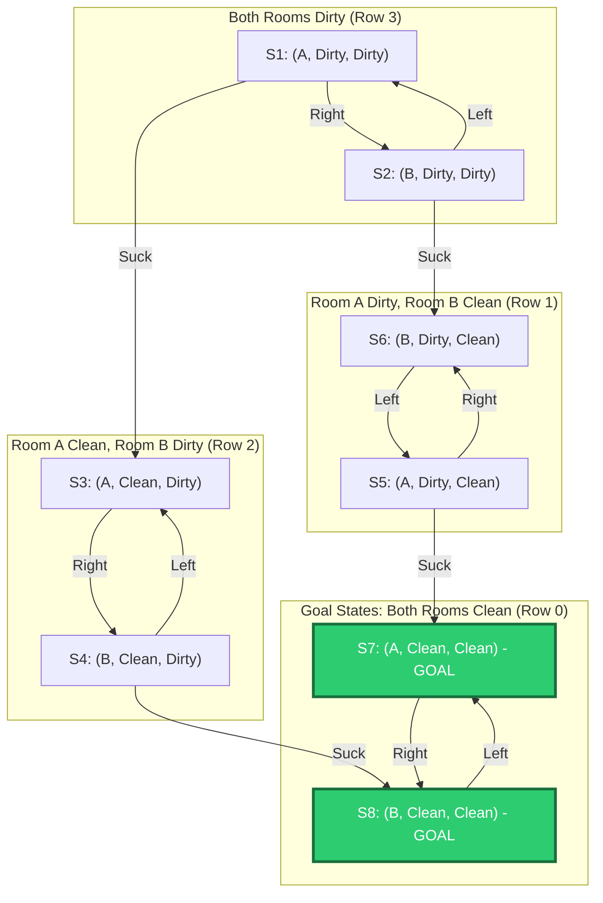

#### Running the State-Space Visualizer

1. **Default Run (ASCII Table & Graph Generation)**:
   ```bash
   python scripts/run_state_space_visualizer.py
   ```

2. **Display Interactive Matplotlib Graph Window**:
   ```bash
   python scripts/run_state_space_visualizer.py --show
   ```

3. **Save High-Resolution Graph Image**:
   ```bash
   python scripts/run_state_space_visualizer.py --save reports/state_space_graph.png
   ```

4. **Alternative Graph Topologies (Circular, Spring)**:
   ```bash
   python scripts/run_state_space_visualizer.py --layout circular --save reports/state_space_circular.png
   ```

5. **Display Detailed 8-State Transition Table**:
   ```bash
   python scripts/run_state_space_visualizer.py --table
   ```

6. **Display 8x8 Adjacency Matrix ($O(|S|^2)$)**:
   ```bash
   python scripts/run_state_space_visualizer.py --matrix
   ```

7. **Cyclic Transitions & Self-Loop Audit**:
   ```bash
   python scripts/run_state_space_visualizer.py --cycles
   ```

8. **Optimal Shortest Paths to Goal (BFS Search)**:
   ```bash
   python scripts/run_state_space_visualizer.py --search
   ```

9. **Run Complete Demonstration Suite**:
   ```bash
   python scripts/run_state_space_visualizer.py --demo
   ```

10. **Display Viva Voce Theory & Reference Guide**:
    ```bash
    python scripts/run_state_space_visualizer.py --viva
    ```

11. **Top-Level Package Dispatcher**:
    ```bash
    python -m src state-space --table
    ```

12. **Interactive Jupyter Notebook**:
    Open [`notebooks/state_space_visualizer.ipynb`](notebooks/state_space_visualizer.ipynb) in Jupyter Lab or Antigravity IDE.

---

### Question 11: Breadth-First Search (BFS) on User-Defined Graph

- **Syllabus Area**: Uninformed Search Techniques
- **Difficulty**: 🟢 Beginner
- **Practical Type**: Implementation & Level-Order Traversal
- **Core AI Concept**: Breadth-First Search (BFS), FIFO Frontier Queue, Visited / Explored Set
- **Python Concepts Tested**: Dictionaries (`Dict` adjacency list), `collections.deque`, `while` loops, path reconstruction
- **Expected Algorithm / Technique**: Level-order graph traversal (FIFO queue)
- **Complexity Expectation**: Time Complexity: $O(V + E)$ | Space Complexity: $O(V)$
- **Constraints / Conditions**: Nodes must be visited in alphabetical order if tied.
- **University Practical Importance**: Very High
- **Optional Challenge**: Modify to return the number of levels (depth) of the graph.

#### Problem Statement & Task Requirements

Write a Python program to implement Breadth-First Search (BFS) on a directed graph. The program must traverse the graph starting from a user-defined source node, maintain a visited set to avoid cycles, and print the nodes in the exact order they are expanded.

1. **Graph Representation**: Represent the directed graph using a Python dictionary (adjacency list).
2. **FIFO Frontier Queue**: Use `collections.deque` for the search frontier open list.
3. **Visited Set**: Maintain a `set` to track discovered nodes and avoid infinite loops on cycles.
4. **Deterministic Tie-Breaking**: When multiple successor nodes are tied at the same parent, expand them in alphabetical order.
5. **Output**: Print the nodes in the exact order they are expanded.
6. **Optional Challenge**: Return the total number of depth levels and the maximum depth of the graph.

#### Sample Input & Output Verification

- **Sample Graph**: `{'A': ['B', 'C'], 'B': ['D'], 'C': [], 'D': []}`
- **Start Node**: `'A'`
- **Expected Traversal**: `BFS Traversal: A, B, C, D`
- **Optional Challenge Levels**:
  - Level 0 (depth 0): `['A']`
  - Level 1 (depth 1): `['B', 'C']`
  - Level 2 (depth 2): `['D']`
  - Total Levels Count: `3` | Maximum Depth: `2`

#### Algorithm Walkthrough & Architectural Diagram

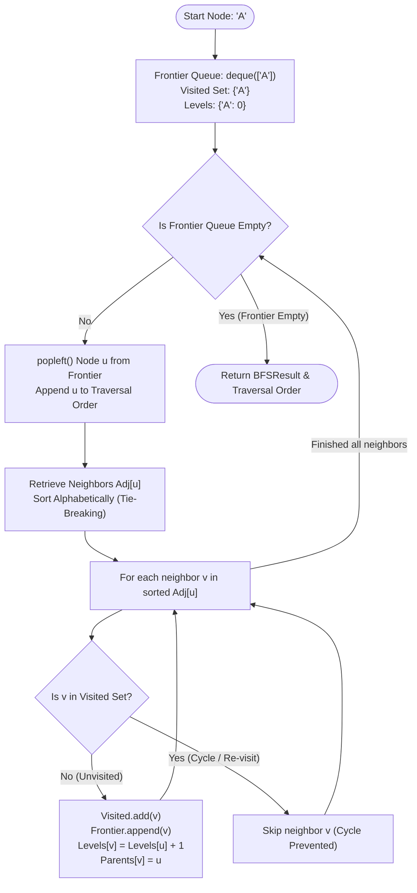

#### Chronological FIFO Frontier Trace Table (Sample Graph)

| Step | Node Expanded | Depth Level | Parent | Discovered & Enqueued | FIFO Frontier Queue Snapshot | Visited Set Snapshot |
| :--- | :--- | :--- | :--- | :--- | :--- | :--- |
| **1** | **A** | 0 | `ROOT` | `['B', 'C']` | `['B', 'C']` | `{'A', 'B', 'C'}` |
| **2** | **B** | 1 | `A` | `['D']` | `['C', 'D']` | `{'A', 'B', 'C', 'D'}` |
| **3** | **C** | 1 | `A` | `[]` (None) | `['D']` | `{'A', 'B', 'C', 'D'}` |
| **4** | **D** | 2 | `B` | `[]` (None) | `[]` (Empty) | `{'A', 'B', 'C', 'D'}` |

#### Performance & Asymptotic Complexity Analysis

- **Time Complexity: $O(V + E)$**
  - **Vertex Processing**: Every vertex $v \in V$ reachable from the start node is enqueued once and dequeued once from the `collections.deque` frontier. Because `deque.append()` and `deque.popleft()` operate in $O(1)$ amortized time, all queue manipulations take $O(V)$ time.
  - **Edge Processing**: When node $u$ is expanded, each of its outgoing directed edges $(u, v) \in E$ is scanned exactly once. Across the entire traversal, the sum of outgoing degrees is $\sum_{u \in V} \text{deg}^+(u) = O(E)$.
  - **Total Time**: $O(V + E)$ for adjacency list representation.
- **Space Complexity: $O(V)$**
  - **Visited Set**: Stores at most $V$ node identifiers, requiring $O(V)$ memory.
  - **Frontier Queue**: At any moment, the frontier contains vertices from at most two consecutive depth layers. In the worst case (e.g., a star graph or dense level), it stores $O(V)$ vertices.
  - **Parents & Levels Mappings**: Each maps at most $V$ vertices, requiring $O(V)$ memory.

#### Complete Execution Guide

1. **Default Run (Sample Graph from Question 11)**:
   ```bash
   python scripts/run_breadth_first_search.py
   ```

2. **Custom Graph via Command Line**:
   ```bash
   # Python dictionary literal
   python scripts/run_breadth_first_search.py --graph "{'A': ['B', 'C'], 'B': ['D'], 'C': [], 'D': []}" --start A

   # Compact adjacency format
   python scripts/run_breadth_first_search.py --graph "A: B, C; B: D; C:; D:" --start A

   # Directed edge-list format
   python scripts/run_breadth_first_search.py --graph "A->B, A->C, B->D" --start A
   ```

3. **Interactive Console Wizard**:
   ```bash
   python scripts/run_breadth_first_search.py --interactive
   ```

4. **Run Optional Challenge (Levels and Graph Depth Analysis)**:
   ```bash
   python scripts/run_breadth_first_search.py --challenge
   ```

5. **Run Benchmark Demonstration Suite (Cycles, Trees, Disconnected Graphs)**:
   ```bash
   python scripts/run_breadth_first_search.py --demo
   ```

6. **Generate and Save Graphical Visualization**:
   ```bash
   python scripts/run_breadth_first_search.py --save reports/bfs_traversal.png
   ```

7. **Display Viva Voce Theory & Reference Guide**:
   ```bash
   python scripts/run_breadth_first_search.py --viva
   ```

8. **Top-Level Package Dispatcher**:
   ```bash
   python -m src bfs --start A
   ```

9. **Interactive Jupyter Notebook**:
   Open [`notebooks/breadth_first_search.ipynb`](notebooks/breadth_first_search.ipynb) in Jupyter Lab or Antigravity IDE.

#### Viva Voce Questions & Authoritative Answers

##### 1. FIFO Queue Mechanism & `collections.deque` vs. `list`
- **Question**: Why does BFS require a FIFO queue, and why must `collections.deque` be used instead of a standard Python `list`?
- **Answer**:
  - BFS must explore states in exact order of their distance (depth) from the root. A First-In, First-Out (FIFO) queue guarantees that all nodes at level $k$ are dequeued and expanded before any node at level $k+1$ is expanded.
  - In CPython, `collections.deque` is implemented as a doubly-linked list of fixed-size contiguous memory blocks (chunks of 64 elements). Appending (`append()`) and popping from the left (`popleft()`) both execute in **$O(1)$ amortized time**.
  - In contrast, a Python `list` is a contiguous dynamic array of object references. While `list.append()` is $O(1)$ amortized, `list.pop(0)` is strictly **$O(N)$** because all remaining $N-1$ element pointers must be shifted in memory. Using `list.pop(0)` in BFS degrades overall search complexity from $O(V + E)$ to $O(V^2 + E)$.

##### 2. Completeness and Optimality of BFS
- **Question**: Is Breadth-First Search complete and optimal? Under what conditions?
- **Answer**:
  - **Completeness**: BFS is complete provided the branching factor $b$ is finite ($b < \infty$). In graph search with a `visited` set, it is guaranteed to terminate on finite graphs even if cyclic.
  - **Optimality**: BFS is optimal **if and only if all step costs are identical/uniform** (e.g., unit edge cost $c = 1$). Under uniform step costs, the shallowest goal state is guaranteed to be the least-cost path.
  - If step costs are non-uniform or arbitrary (e.g., varying road distances or terrain weights), BFS is **not optimal** because a deeper path with smaller weights might have lower total cost than a shallow path with heavy weights. In that case, **Uniform-Cost Search (UCS / Dijkstra's Algorithm)** must be used.

##### 3. Time Complexity Derivation
- **Question**: Derive the time complexity of BFS on both graph search and tree search formulations.
- **Answer**:
  - **Graph Search**: On a graph with $V$ vertices and $E$ edges using an adjacency list:
    $$\mathcal{O}(V + E)$$
    Each reachable vertex is pushed to the FIFO queue and visited set once ($O(V)$), and its outgoing adjacency list is traversed once during expansion ($\sum \text{deg}^+(u) = O(E)$).
  - **Tree Search (Branching Factor $b$, Goal Depth $d$)**:
    At depth 0: $1$ node.
    At depth 1: $b$ nodes.
    At depth 2: $b^2$ nodes.
    At depth $d$: $b^d$ nodes.
    Sum of geometric progression:
    $$T(b, d) = 1 + b + b^2 + \dots + b^d = \frac{b^{d+1} - 1}{b - 1} = \mathcal{O}(b^d)$$
    If the goal test is applied when a node is expanded rather than when generated, the algorithm explores nodes at level $d+1$, yielding $\mathcal{O}(b^{d+1})$.

##### 4. Space Complexity Bottleneck
- **Question**: Why is space complexity the primary practical limitation of BFS compared to DFS?
- **Answer**:
  - BFS has a space complexity of $\mathcal{O}(b^d)$ because every generated node must remain in memory (either in the frontier queue or the visited table). The frontier alone at level $d$ holds up to $b^d$ nodes.
  - In contrast, Depth-First Search (DFS) only needs to store the current active path from the root to the leaf plus unexpanded siblings, requiring only $\mathcal{O}(b \cdot d)$ linear memory.
  - For example, with branching factor $b = 10$ and depth $d = 8$, BFS must store $10^8$ nodes in memory ($\approx 10$ to $100\text{ GB}$ of RAM), exhausting system memory within minutes, whereas DFS requires storing only $10 \times 8 = 80$ nodes.

---

### Question 12: Depth-First Search (DFS) for Graph Traversal

- **Syllabus Area**: Uninformed Search Techniques
- **Difficulty**: 🟢 Beginner
- **Practical Type**: Implementation & Deep State-Space Exploration
- **Core AI Concept**: Depth-First Search (DFS), LIFO Frontier Stack, Backtracking, Visited Set, Cycle Prevention
- **Python Concepts Tested**: Recursion, explicit `list` stack manipulation (`append()` and `pop()`), dictionary adjacency lists
- **Expected Algorithm / Technique**: Depth-first traversal (LIFO frontier)
- **Complexity Expectation**: Time Complexity: $\mathcal{O}(V + E)$ | Space Complexity: $\mathcal{O}(V)$
- **Constraints / Conditions**: Graph may contain cycles (must prevent infinite loops).
- **University Practical Importance**: Very High
- **Optional Challenge**: Implement both iterative and recursive versions and compare output.

#### Problem Statement & Task Requirements

Implement Depth-First Search (DFS) in Python to traverse an unweighted graph. The program must explore as far as possible along each branch before backtracking. Output the exploration path.

1. **Stack or Recursion**: Implement DFS using an explicit stack (`list`) OR recursion.
2. **Cycle Avoidance**: Track explored nodes to prevent infinite loops in cyclic graphs.
3. **Neighbor Processing**: Process neighbor nodes systematically.
4. **Input Requirements**: Graph dictionary, Start node.
5. **Expected Output**: List of nodes in DFS traversal order.
6. **Optional Challenge**: Implement both iterative and recursive versions and compare output.

#### Sample Input & Output Verification

- **Sample Graph**: `{'1': ['2', '3'], '2': ['4'], '3': [], '4': []}`
- **Start Node**: `'1'`
- **Expected Traversal**: `DFS Traversal: 1, 3, 2, 4`

#### Traversal Order Nuance: Forward-Push Stack vs. Standard Recursion

A classic and insightful property of Depth-First Search is how successor node ordering impacts the visited sequence:

1. **Iterative DFS with Standard Forward-Push (Sample Output Match)**:
   - When node `'1'` expands its neighbors `['2', '3']` and pushes them onto the LIFO stack in order (`stack.append('2')`, then `stack.append('3')`), node `'3'` sits at the **top** of the stack.
   - The subsequent `stack.pop()` extracts `'3'` first, resulting in the exploration order:
     $$\mathbf{1 \to 3 \to 2 \to 4}$$
   - This matches the university problem statement's exact sample output!
2. **Standard Recursive DFS (Left-to-Right)**:
   - In standard recursive DFS, a loop `for neighbor in graph[node]` visits `'2'` before `'3'`. It explores deeply down `'2'` to `'4'`, backtracks to `'1'`, and then visits `'3'`:
     $$\mathbf{1 \to 2 \to 4 \to 3}$$
3. **Order-Preserving Iterative DFS (Reverse-Push)**:
   - If the iterative algorithm pushes neighbors in reversed order (`for neighbor in reversed(graph[node]): stack.append(neighbor)`), node `'2'` remains on top of the stack and is popped first, producing the identical sequence to standard recursion:
     $$\mathbf{1 \to 2 \to 4 \to 3}$$

Both ordering models are supported and compared side-by-side in this laboratory implementation.

#### Algorithm Walkthrough & Architectural Diagram

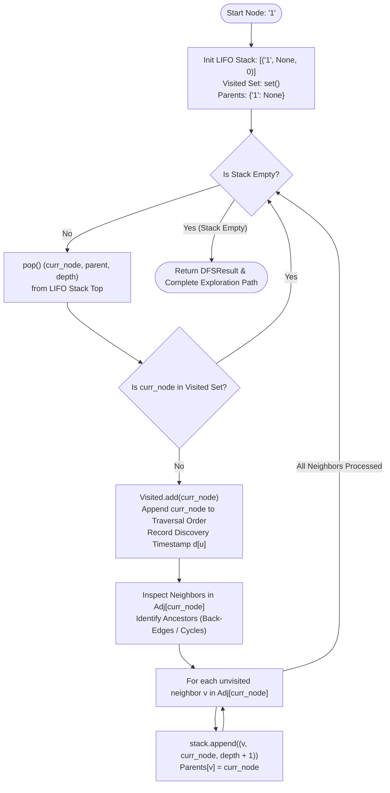

#### Chronological LIFO Frontier Trace Table (Sample Graph)

| Step | Node Popped | Action | Depth | Parent | Unvisited Pushed to Stack | LIFO Stack Snapshot (Top on Right) | Visited Nodes Sequence |
| :--- | :--- | :--- | :--- | :--- | :--- | :--- | :--- |
| **1** | **1** | `EXPAND` | 0 | `ROOT` | `['2', '3']` | `['2', '3']` (Top: 3) | `['1']` |
| **2** | **3** | `EXPAND` | 1 | `1` | `[]` (None) | `['2']` (Top: 2) | `['1', '3']` |
| **3** | **2** | `EXPAND` | 1 | `1` | `['4']` | `['4']` (Top: 4) | `['1', '3', '2']` |
| **4** | **4** | `EXPAND` | 2 | `2` | `[]` (None) | `[]` (Empty) | `['1', '3', '2', '4']` |

#### Optional Challenge: Side-by-Side Comparison of Iterative vs. Recursive DFS

| Implementation Variant | Traversal Order | Step Count | Frontier Mechanism | Order Preserved? |
| :--- | :--- | :--- | :--- | :--- |
| **1. Iterative (Standard Forward-Push)** | `1, 3, 2, 4` | 4 | Explicit `list` stack (`pop()`) | No (LIFO reverses order) |
| **2. Recursive (Standard Forward-Call)** | `1, 2, 4, 3` | 8 | Implicit runtime call stack | Yes (Left-to-right) |
| **3. Iterative (Order-Preserving Reverse-Push)** | `1, 2, 4, 3` | 4 | Explicit `list` stack (`pop()`) | Yes (Matches standard recursion) |
| **4. Recursive (Reversed-Call)** | `1, 3, 2, 4` | 8 | Implicit runtime call stack | No (Matches forward-push stack) |

#### Performance & Asymptotic Complexity Analysis

- **Time Complexity: $\mathcal{O}(V + E)$**
  - **Vertex Processing**: Every vertex $v \in V$ reachable from the start node is pushed and popped from the stack at most once. Visited set operations (`add`, `in`) execute in $\mathcal{O}(1)$ average time. Total vertex time is $\mathcal{O}(V)$.
  - **Edge Processing**: When node $u$ is expanded, each of its outgoing directed edges $(u, v) \in E$ is evaluated once to check whether $v$ is an ancestor (back edge), unvisited neighbor (tree edge), or cross edge. The sum across all vertices is $\sum_{u \in V} \text{deg}^+(u) = \mathcal{O}(E)$.
  - **Total Time**: $\mathcal{O}(V + E)$ for adjacency list graph representation.
- **Space Complexity: $\mathcal{O}(V)$ (Graph Search) / $\mathcal{O}(b \cdot m)$ (Tree Search)**
  - **Graph Search**: The `visited` set and LIFO stack store at most $V$ node labels, yielding $\mathcal{O}(V)$ auxiliary memory.
  - **Tree Search Advantage**: Unlike BFS which must maintain the entire exponential frontier width $\mathcal{O}(b^d)$, DFS needs to retain only the single current branch from root to leaf, plus unexpanded sibling choices at each level, requiring strictly linear memory $\mathcal{O}(b \cdot m)$ where $b$ is the branching factor and $m$ is the maximum tree depth.

#### Complete Execution Guide

1. **Default Run (Sample Graph from Question 12: Output `1, 3, 2, 4`)**:
   ```bash
   python scripts/run_depth_first_search.py
   ```

2. **Custom Graph via Command Line**:
   ```bash
   # Python dictionary literal
   python scripts/run_depth_first_search.py --graph "{'1': ['2', '3'], '2': ['4'], '3': [], '4': []}" --start 1

   # Compact adjacency format
   python scripts/run_depth_first_search.py --graph "1: 2, 3; 2: 4; 3:; 4:" --start 1

   # Directed edge-list format
   python scripts/run_depth_first_search.py --graph "1->2, 1->3, 2->4" --start 1
   ```

3. **Optional Challenge (Iterative vs. Recursive Comparison)**:
   ```bash
   python scripts/run_depth_first_search.py --challenge
   ```

4. **Interactive Console Wizard**:
   ```bash
   python scripts/run_depth_first_search.py --interactive
   ```

5. **Run Benchmark Demonstration Suite (Cycles, Trees, Disconnected Graphs, DAGs)**:
   ```bash
   python scripts/run_depth_first_search.py --demo
   ```

6. **Generate and Save Graphical Visualization**:
   ```bash
   python scripts/run_depth_first_search.py --save reports/dfs_traversal.png
   ```

7. **Display Viva Voce Theory & Reference Guide**:
   ```bash
   python scripts/run_depth_first_search.py --viva
   ```

8. **Top-Level Package Dispatcher**:
   ```bash
   python -m src dfs --start 1
   ```

9. **Interactive Jupyter Notebook**:
   Open [`notebooks/depth_first_search.ipynb`](notebooks/depth_first_search.ipynb) in Jupyter Lab or Antigravity IDE.

#### Viva Voce Questions & Authoritative Answers

##### 1. Stack vs. Queue (LIFO vs. FIFO)
- **Question**: What is the fundamental difference between the frontier data structures of DFS and BFS, and how are they implemented in Python?
- **Answer**:
  - DFS uses a **Last-In, First-Out (LIFO) Stack**, whereas BFS uses a **First-In, First-Out (FIFO) Queue**.
  - In DFS, the most recently generated successor is expanded first, forcing search deep along a single branch before backtracking. In BFS, nodes are expanded in chronological discovery order, enforcing level-by-level exploration.
  - In Python, an iterative DFS stack is implemented directly using a built-in `list` with amortized $\mathcal{O}(1)$ `append()` and $\mathcal{O}(1)$ `pop()`. In contrast, BFS requires `collections.deque` because `list.pop(0)` is $\mathcal{O}(N)$ due to dynamic memory element shifting.

##### 2. Why DFS is Not Optimal
- **Question**: Why is Depth-First Search considered non-optimal, even when step costs are uniform?
- **Answer**:
  - An algorithm is optimal if it guarantees returning the lowest-cost solution path.
  - DFS is **not optimal** because it commits deeply down the first branch it encounters. If a goal node exists at depth 1 along branch B, but branch A plunges down 1,000 edges to another goal, DFS will explore all 1,000 edges along branch A and return that path without ever checking branch B.
  - Even under uniform unit edge costs ($c = 1$), BFS is optimal because it guarantees finding the shallowest goal, whereas DFS finds an arbitrary path dictated strictly by neighbor expansion order.

##### 3. Space Complexity Advantage of DFS over BFS
- **Question**: Why does DFS possess a decisive space complexity advantage over BFS in practical AI problems?
- **Answer**:
  - Space complexity is the primary practical bottleneck of BFS, and the greatest asset of DFS.
  - In a state space with branching factor $b = 10$ and goal depth $d = 8$:
    - **BFS** must store the entire current frontier layer: $\mathcal{O}(b^d) = 10^8$ nodes ($\approx 10\text{ to }100\text{ GB}$ of RAM), exhausting system memory within minutes.
    - **DFS** only retains the single active branch path plus unexpanded siblings at each level: $\mathcal{O}(b \cdot m) = 10 \times 8 = 80$ nodes, requiring mere kilobytes of memory.

##### 4. Completeness of DFS
- **Question**: Under what conditions is DFS complete or incomplete?
- **Answer**:
  - **Graph Search DFS (with a visited set)**: Complete on finite state spaces because the visited set prevents revisiting expanded vertices, guaranteeing termination even in cyclic graphs.
  - **Tree Search DFS (without a visited set)**: Incomplete on cyclic graphs (it gets trapped in infinite loops) and incomplete on infinite state spaces (it can plunge endlessly down infinite branches).
  - **Iterative Deepening Search (IDS)**: Solves this dilemma by pairing the $\mathcal{O}(b \cdot d)$ linear memory advantage of DFS with the completeness and optimality of BFS via progressive depth limits.

##### 5. Cycle Detection via Back-Edges (CLRS Classification)
- **Question**: How does Depth-First Search detect cycles in directed graphs?
- **Answer**:
  - In CLRS DFS edge classification, an edge $(u, v)$ is a **Back Edge** if vertex $v$ is an ancestor of vertex $u$ in the active DFS search tree (i.e., $v$ is currently on the active recursion stack / un-finished).
  - **Theorem**: A directed graph $G$ contains a directed cycle **if and only if** a DFS traversal of $G$ encounters at least one back edge.

---

### Question 14: Uniform Cost Search (UCS) Implementation

- **Syllabus Area**: Uninformed Search Techniques
- **Difficulty**: 🟡 Intermediate
- **Practical Type**: Implementation
- **Core AI Concepts**: Uniform Cost Search (UCS), Priority Queue, Optimal Cost Search, Dijkstra's Algorithm Variant
- **Python Concepts Tested**: `heapq` module, min-heap invariant, tuple sorting, lazy deletion
- **Complexity Expectation**: Time: $\mathcal{O}(E \log V)$, Space: $\mathcal{O}(V)$
- **Sample Input**: `A->B:1, B->C:2, A->C:4. Start:A, Goal:C`
- **Sample Output**: `Path: A->B->C, Total Cost: 3`
- **University Practical Importance**: High

#### Problem Statement

Write a Python program to implement **Uniform Cost Search (UCS)** on a weighted directed graph to find the minimum cost path between a source and a destination. The algorithm must use a priority queue to always expand the lowest-cost node.

#### Task Requirements & Architecture

1. **Weighted Graph Representation**: Graph represented with explicit directed edge costs $c(u, v) > 0$. Supports arrow syntax (`A->B:1, B->C:2, A->C:4`), adjacency lists, JSON mappings, and edge tuples.
2. **Priority Queue Frontier**: Utilizes Python's standard `heapq` module maintaining a binary min-heap where the minimum element is accessible at index 0.
3. **Cumulative Cost Tracking $g(n)$**: Tracks the exact path cost $g(n)$ from the origin start state to current state $n$.
4. **Path & Cost Return**: Reconstructs the optimal sequence of vertices and reports the minimum total cost.
5. **Goal Test Placement**: Enforces the foundational AI requirement that the goal test is executed **upon expansion** (popping from the queue), NOT upon generation.
6. **Optional Challenge**: Detects non-positive edge weights and implements a Bellman-Ford cycle detection engine that identifies and isolates reachable negative cycles.

#### Theoretical Background & Key Mechanisms

1. **Uninformed Optimal Path Search**:
   - Uniform Cost Search is an uninformed (blind) search technique that generalizes Breadth-First Search to state spaces with non-uniform step costs.
   - It operates without a heuristic estimate ($h(n) = 0$), guiding exploration solely by cumulative cost $g(n)$.
   - While BFS finds the path with the minimum number of edges, UCS finds the path with the minimum cumulative edge cost.

2. **Priority Queue & Python Tuple Sorting**:
   - In Python, `heapq` operates on lists in-place.
   - Queue elements are structured as tuples: `(cost, tie_breaker, node_id, path)`.
   - Python compares tuple elements lexicographically: `(cost_a, tie_a, ...) < (cost_b, tie_b, ...)`.
   - The cumulative cost is always the primary sorting key. If costs match, a deterministic tie-breaker (alphabetical by node label, monotonic sequence counter for FIFO, or hop count) resolves priority, preventing `TypeError` on non-comparable payloads.

3. **Goal Test Timing (Expansion vs. Generation)**:
   - In BFS, testing for goal upon generation is valid because all step costs are equal ($c = 1$).
   - In UCS, a goal generated early via a direct high-cost edge (e.g. $A \to C: 4$) must **not** cause termination; an indirect cheaper path (e.g. $A \to B: 1 \to C: 2$, cost 3) might still exist in the frontier.
   - Terminating only when the goal is **popped from the min-heap** guarantees that no cheaper path remains anywhere in the search space.

4. **Lazy Deletion of Stale Entries**:
   - Standard binary heaps do not support efficient $\mathcal{O}(\log N)$ `decrease_key`.
   - When a cheaper path to an unexpanded node is discovered, the new tuple is pushed to the heap.
   - When popped, if `current_cost > best_cost[node]`, the entry is discarded in $\mathcal{O}(1)$ time as a superseded state.

#### Sample Execution Trace (Question 14 Default)

- **Input Graph**: `A->B:1, B->C:2, A->C:4`
- **Start**: `A`, **Goal**: `C`

```text
Step  | Node   | g(n)  | Action         | Parent | Enqueued         | Frontier Priority Queue 
----------------------------------------------------------------------------------------------
1     | A      | 0     | EXPAND         | START  | [B:1, C:4]       | [B:1, C:4]
2     | B      | 1     | EXPAND         | A      | [C:3]            | [C:3, C:4]
3     | C      | 3     | GOAL_REACHED   | B      | -                | [C:4]
```

**Output**:
```text
Path: A->B->C, Total Cost: 3
```

#### Running Question 14 Implementations

1. **Default Run (Sample Input from Question 14)**:
   ```bash
   python scripts/run_uniform_cost_search.py
   ```

2. **Custom Graph, Start, and Goal**:
   ```bash
   python scripts/run_uniform_cost_search.py --graph "A->B:1, B->C:2, A->C:4" --start A --goal C
   ```

3. **Interactive Console Mode**:
   ```bash
   python scripts/run_uniform_cost_search.py --interactive
   ```

4. **Optional Challenge (Negative Edges & Bellman-Ford Negative Cycle Detection)**:
   ```bash
   python scripts/run_uniform_cost_search.py --challenge
   ```

5. **Automated Benchmark Suite (Diamond, Cyclic, Romania Map, Disconnected)**:
   ```bash
   python scripts/run_uniform_cost_search.py --demo
   ```

6. **Generate Graphical Visual Diagram**:
   ```bash
   python scripts/run_uniform_cost_search.py --save reports/ucs_optimal_path.png
   ```

7. **Display Viva Voce Theory Guide**:
   ```bash
   python scripts/run_uniform_cost_search.py --viva
   ```

8. **Top-Level Package Dispatcher**:
   ```bash
   python -m src ucs --start A --goal C
   ```

9. **Interactive Jupyter Notebook**:
   Open [`notebooks/uniform_cost_search.ipynb`](notebooks/uniform_cost_search.ipynb) in Jupyter Lab or Antigravity IDE.

#### Viva Voce Questions & Authoritative Answers

##### 1. UCS vs. BFS
- **Question**: What is the key difference between Uniform Cost Search (UCS) and Breadth-First Search (BFS)?
- **Answer**:
  - **Step Costs**: BFS assumes uniform step costs ($c = 1$ per hop) and explores level by level based on edge count. UCS accommodates arbitrary non-negative costs ($c(u, v) \ge \epsilon > 0$) and explores based on cumulative path cost $g(n)$.
  - **Frontier Data Structure**: BFS uses a First-In, First-Out (FIFO) queue (`collections.deque` with $\mathcal{O}(1)$ push/pop), whereas UCS uses a Priority Queue (`heapq` min-heap with $\mathcal{O}(\log N)$ push/pop).
  - **Optimality**: BFS is optimal only when step costs are equal. When costs vary, BFS may choose a path with fewer hops but much higher cost. UCS is guaranteed to find the minimal cost path for non-negative weights.
  - **Equivalence**: When all edge weights in a graph are identical positive constants, UCS expands nodes in identical order to BFS (up to tie-breaking).

##### 2. Priority Queue Mechanisms & Python `heapq`
- **Question**: How does Python's `heapq` manage the frontier, and how does tuple sorting prevent comparison errors?
- **Answer**:
  - `heapq` maintains a binary min-heap on top of a standard Python `list` where element 0 is always the minimum. Children of index $i$ reside at $2i + 1$ and $2i + 2$.
  - When pushing tuples `(cost, tie_breaker, node_id, path)`, Python compares tuple items sequentially from left to right.
  - By inserting a deterministic secondary key (node label for alphabetical order or a monotonic integer counter for FIFO order), Python never evaluates the path list or non-comparable objects on equal costs, guaranteeing strict reproducibility and zero `TypeError` exceptions.
  - Because Python heaps lack an $\mathcal{O}(\log N)$ `decrease_key` method, UCS uses **lazy deletion**: newly discovered cheaper paths are pushed into the heap; stale entries popped later with `cost > best_cost[node]` are discarded in $\mathcal{O}(1)$ time.

##### 3. Effect of Negative Edge Weights on UCS
- **Question**: What happens when a graph contains negative edge weights or negative cycles in UCS?
- **Answer**:
  - **Greedy Invariant Violation**: UCS relies on the invariant that path cost $g(n)$ is monotonically non-decreasing along any path ($g(v) \ge g(u)$ because $c(u, v) \ge 0$). Once a node is popped and added to `explored`, its cost is assumed final. A negative edge breaks this guarantee because an explored node could later receive a cheaper path.
  - **Suboptimality**: UCS with a closed/explored set will produce suboptimal paths because it refuses to reopen closed vertices.
  - **Negative Cycles**: If a cycle has a net negative sum, looping through it reduces path cost toward $-\infty$. An uninformed search without cycle detection will either loop infinitely or produce undefined behavior.
  - **Proper Alternative**: Graphs with negative edges require the **Bellman-Ford algorithm** ($\mathcal{O}(V \cdot E)$), which successfully relaxes edges $|V|-1$ times and detects negative cycles on the $|V|$-th pass.

##### 4. Goal Test Placement: Expansion vs. Generation
- **Question**: Why MUST the goal test in Uniform Cost Search be performed upon expansion rather than generation?
- **Answer**:
  - In BFS, testing upon generation is sound because the first time a goal node is generated, it is guaranteed to be at the shallowest depth level.
  - In UCS, the first path generated to a goal node might have a high cost (e.g. $A \to \text{Goal}: 10$). A multi-hop path through an unexpanded frontier node might be vastly cheaper (e.g. $A \to B: 1 \to \text{Goal}: 2$, total 3).
  - If UCS stopped upon generation of Goal at cost 10, it would fail to find the optimal path. Testing only upon extraction (expansion) from the min-heap guarantees that all nodes with cost $< g(\text{Goal})$ have already been expanded, proving optimality.

##### 5. Search Algorithm Comparison Matrix

| Algorithm | Frontier Data Structure | Optimal? | Complete? | Time Complexity | Space Complexity |
| :--- | :--- | :--- | :--- | :--- | :--- |
| **BFS** | FIFO Queue (`deque`) | Yes (if uniform costs) | Yes (finite $b$) | $\mathcal{O}(b^d) / \mathcal{O}(V + E)$ | $\mathcal{O}(b^d) / \mathcal{O}(V)$ |
| **DFS** | LIFO Stack (`list` / recursion) | No | No (infinite paths) | $\mathcal{O}(b^m) / \mathcal{O}(V + E)$ | $\mathcal{O}(b \cdot m) / \mathcal{O}(V)$ |
| **UCS** | Priority Queue (`heapq` min-heap) | Yes ($c \ge \epsilon > 0$) | Yes ($c \ge \epsilon > 0$) | $\mathcal{O}(E \log V)$ | $\mathcal{O}(V)$ |
| **Greedy Best-First** | Priority Queue (by $h(n)$) | No | No (loops possible) | $\mathcal{O}(b^m)$ | $\mathcal{O}(b^m)$ |
| **A\* Search** | Priority Queue (by $f = g + h$) | Yes (admissible $h$) | Yes ($c \ge \epsilon > 0$) | $\mathcal{O}(b^d) \text{ to } \mathcal{O}(E \log V)$ | $\mathcal{O}(b^d) / \mathcal{O}(V)$ |

---

### Question 15: BFS 2D Maze Solver (Implicit Graph Search)

- **Syllabus Area**: Uninformed Search Techniques
- **Difficulty**: 🟡 Intermediate
- **Practical Type**: Problem Solving
- **Core AI Concepts**: Grid Search, Successor Function, Implicit Graph Exploration
- **Python Concepts Tested**: 2D array indexing, coordinate tuples, `collections.deque`, set hashing
- **Expected Algorithm / Technique**: Breadth-First Search (BFS) on implicit graphs
- **Recommended Python Libraries**: `collections`
- **Complexity Expectation**: Time: $\mathcal{O}(N \times M)$, Space: $\mathcal{O}(N \times M)$
- **Constraints / Conditions**: Grid can be non-square ($N \ne M$)
- **Sample Input**: `[[0, 1, 0], [0, 0, 0], [1, 1, 0]]`
- **Sample Output**: `Shortest steps: 4`
- **Optional Challenge**: Output a string of moves: `"D, R, R, D"`
- **University Practical Importance**: High

#### Problem Statement

Design a Python program that uses **Breadth-First Search (BFS)** to solve a 2D grid maze. The maze is represented as a 2D list where `0` is an open path and `1` is a wall. The agent can move **Up**, **Down**, **Left**, and **Right** (orthogonal transitions). Find the shortest path from the top-left corner `(0, 0)` to the bottom-right corner `(N-1, M-1)`.

#### Task Requirements & Architecture

1. **2D Grid Parsing & Normalization**: Supports native 2D Python lists, JSON strings (`"[[0,1,0],[0,0,0],[1,1,0]]"`), multiline space/comma separated matrices, and ASCII character grids (`.` for open, `#` for wall). Handles non-square dimensions ($N \ne M$) seamlessly.
2. **Dynamic Successor Function**: Computes valid next coordinates on demand without pre-building an explicit graph. Evaluates:
   - **Boundary Safety**: $0 \le \text{next\_r} < N$ and $0 \le \text{next\_c} < M$.
   - **Obstacle Checking**: $\text{grid}[\text{next\_r}][\text{next\_c}] == 0$.
3. **Visited Coordinate Tracking**: Employs a Python `set` of coordinate tuples `(r, c)`. Marks nodes visited upon **enqueueing** (generation time) to prevent duplicate insertions into the queue and eliminate exponential branch explosion.
4. **Shortest Path Length Guarantee**: Returns the integer number of shortest steps to reach the destination ($4$ for sample input, $-1$ if unreachable).
5. **Optional Challenge (Directional Moves String)**: Tracks predecessor parent pointers `(parent_coord, action)` and reconstructs the chronological action string (e.g. `"D, R, R, D"`).

#### Theoretical Background & Key Mechanisms

1. **Implicit vs. Explicit Graphs**:
   - In an *explicit graph*, all nodes and connections are pre-stored in memory as an adjacency list or matrix.
   - In an *implicit graph* (such as a 2D grid maze or chess board), states and edges are generated dynamically using an initial state and a successor function $S(s) \to \{(a, s')\}$. This avoids allocating $N \times M$ nodes and up to $4NM$ edges upfront.

2. **FIFO Frontier & `collections.deque`**:
   - BFS requires First-In, First-Out (FIFO) queue ordering to explore states level by level.
   - In Python, `collections.deque` provides $\mathcal{O}(1)$ amortized `append()` and `popleft()`.
   - Using standard Python `list.pop(0)` incurs an $\mathcal{O}(K)$ memory-shift penalty on every dequeue, degrading overall time complexity from $\mathcal{O}(NM)$ to an unacceptable $\mathcal{O}((NM)^2)$.

3. **Manhattan Distance Relation (Admissible Heuristic)**:
   - For orthogonal grid movement, Manhattan distance $D_{\text{Manhattan}} = |r_{\text{start}} - r_{\text{goal}}| + |c_{\text{start}} - c_{\text{goal}}|$ represents the strict theoretical minimum path length.
   - In an **obstacle-free grid**, the BFS shortest path length is strictly equal to the Manhattan distance.
   - In a grid with walls, detours are required, so $\text{BFS Steps} \ge D_{\text{Manhattan}}$. Therefore, Manhattan distance serves as an admissible heuristic for informed algorithms like A*.

4. **Enqueue-Time vs. Expansion-Time Visited Marking**:
   - In unweighted BFS, states must be marked as visited as soon as they are **enqueued**.
   - If visited marking was deferred until expansion (dequeueing), multiple paths discovered on the same level would enqueue duplicate copies of the same cell, leading to combinatorial memory explosion.

#### Sample Execution Trace (Question 15 Default)

- **Input Grid**: `[[0, 1, 0], [0, 0, 0], [1, 1, 0]]`
- **Start**: `(0, 0)`, **Goal**: `(2, 2)`

```text
=== ASCII SOLUTION GRID ===
S # .
* * *
# # G

=== STEP-BY-STEP FIFO FRONTIER TRACE ===
Step  | Popped (r,c)   | Action   | Dist | Frontier (FIFO Queue)  | Generated Successors
------+----------------+----------+------+------------------------+---------------------
1     | (0, 0)         | START    | 0    | (1, 0)                 | D:(1, 0)
2     | (1, 0)         | D        | 1    | (1, 1)                 | R:(1, 1)
3     | (1, 1)         | R        | 2    | (1, 2)                 | R:(1, 2)
4     | (1, 2)         | R        | 3    | (0, 2), (2, 2)         | U:(0, 2), D:(2, 2)
5     | (0, 2)         | U        | 4    | (2, 2)                 | 
6     | (2, 2)         | D        | 4    |                        | 
```

**Output**:
```text
Shortest steps: 4
Moves: "D, R, R, D"
Path: [(0, 0), (1, 0), (1, 1), (1, 2), (2, 2)]
```

#### Running Question 15 Implementations

1. **Default Run (Sample Input from Question 15)**:
   ```bash
   python scripts/run_bfs_maze_solver.py
   ```

2. **Custom Grid via CLI (JSON or ASCII string)**:
   ```bash
   python scripts/run_bfs_maze_solver.py --grid "[[0,1,0],[0,0,0],[1,1,0]]"
   ```

3. **Custom Start and Goal Coordinates**:
   ```bash
   python scripts/run_bfs_maze_solver.py --grid "[[0,0,0],[1,1,0],[0,0,0]]" --start 0,0 --goal 2,0
   ```

4. **Optional Challenge (String of Moves: `"D, R, R, D"`)**:
   ```bash
   python scripts/run_bfs_maze_solver.py --challenge
   ```

5. **Automated Benchmark Suite (Non-Square, Serpentine, Blocked, Single-Cell)**:
   ```bash
   python scripts/run_bfs_maze_solver.py --demo
   ```

6. **Interactive Console Input**:
   ```bash
   python scripts/run_bfs_maze_solver.py --interactive
   ```

7. **Generate and Save Graphical Diagram**:
   ```bash
   python scripts/run_bfs_maze_solver.py --save reports/bfs_maze_solution.png
   ```

8. **Display Viva Voce Theory Guide**:
   ```bash
   python scripts/run_bfs_maze_solver.py --viva
   ```

9. **Top-Level Package Dispatcher**:
   ```bash
   python -m src maze
   ```

10. **Interactive Jupyter Notebook**:
    Open [`notebooks/bfs_2d_maze_solver.ipynb`](notebooks/bfs_2d_maze_solver.ipynb) in Jupyter Lab or Antigravity IDE.

#### Viva Voce Questions & Authoritative Answers

##### 1. Implicit vs. Explicit Graphs
- **Question**: Why is a 2D grid maze modeled as an implicit graph rather than an explicit graph?
- **Answer**: In an explicit graph, all vertices, edges, and connections are pre-allocated in memory (e.g. adjacency lists). In an implicit graph, states (coordinates) and edges (valid moves) are generated dynamically on demand using an initial state and a successor function $S(s)$. For an $N \times M$ grid, dynamic successor generation uses $O(1)$ memory per step rather than pre-allocating thousands of edge objects in memory.

##### 2. Dynamic Successor Function & Action Safety
- **Question**: How does the successor function ensure the agent never crashes or causes errors?
- **Answer**: For each cardinal displacement (Up, Down, Left, Right), the successor function enforces two mandatory checks:
  1. **Boundary check**: $0 \le r < N$ and $0 \le c < M$, preventing `IndexError`.
  2. **Obstacle check**: $\text{grid}[r][c] == 0$, guaranteeing the agent cannot enter walls (`1`).

##### 3. Manhattan Distance as an Admissible Lower Bound
- **Question**: What is the relationship between Manhattan distance and the BFS shortest path length on a grid?
- **Answer**: Because movement is strictly orthogonal (4-connected), Manhattan distance $L_1 = |r_1 - r_2| + |c_1 - c_2|$ is the absolute minimum number of steps required to reach the destination in the absence of obstacles. In an open grid, BFS steps equal Manhattan distance. When walls are present, detours increase the path length ($\text{BFS Steps} \ge D_{\text{Manhattan}}$). Manhattan distance never overestimates true distance, making it an admissible heuristic.

##### 4. Frontier Queue Mechanics: `collections.deque` vs. Python `list`
- **Question**: Why is `collections.deque` strictly required over Python's built-in `list` for BFS?
- **Answer**: Python lists are contiguous arrays; `list.pop(0)` requires shifting all $K-1$ remaining pointers left in memory, taking $\mathcal{O}(K)$ time. `collections.deque` is a doubly-linked list of blocks in C, giving $\mathcal{O}(1)$ amortized `popleft()` and `append()`. Using `list.pop(0)` degrades overall BFS runtime from $\mathcal{O}(NM)$ to $\mathcal{O}((NM)^2)$.

---

### Question 16: Depth-Limited Search (DLS)

- **Syllabus Area**: Uninformed Search Techniques
- **Difficulty**: 🟠 Advanced
- **Practical Type**: Algorithm Design
- **Core AI Concept**: Depth-Limited Search (DLS), Incompleteness Mitigation, Tri-State Search Cutoffs
- **Python Concepts Tested**: Recursion, multi-state returns, parameter decrementing, branch backtracking
- **Expected Algorithm / Technique**: Bounded Depth-First Search (`recursive_dls`)
- **Recommended Python Libraries**: Standard Library Only (no external dependencies required)
- **Complexity Expectation**:
  - **Time Complexity**: $\mathcal{O}(b^l)$, where $b$ is the branching factor and $l$ is the depth limit.
  - **Space Complexity**: $\mathcal{O}(b \cdot l)$, linear space proportional to maximum recursion stack depth.
- **Constraints / Conditions**: Depth limit is non-negative ($l \ge 0$).
- **Sample Input**: Limit: 2, Goal is at depth 3.
- **Sample Output**: `Result: Cutoff`
- **Optional Challenge**: Keep track of the deepest node reached before cutoff.
- **University Practical Importance**: Viva Important.

#### Theoretical Foundations & Algorithmic Design

##### 1. The Infinite State-Space Problem & DFS Failure Mode
Standard Depth-First Search (DFS) explores unguided down the first available branch. In infinite state spaces (e.g. arithmetic progression $n \to 2n, n+1$, unbounded theorem proving, or continuous motion) or finite state spaces with cycles, standard DFS can plunge forever down an infinite path ($m = \infty$). It will never backtrack, thus failing to find a goal even if one exists at depth 1 on an adjacent branch.

##### 2. Bounded Recursion & Parameter Decrementing
Depth-Limited Search (DLS) resolves this failure mode by supplying a maximum depth bound $l$. The search operates recursively:
$$\text{recursive\_dls}(u, \text{goal}, \text{limit}, \text{path})$$
- On each recursive step to a child vertex $v \in \text{Adj}[u]$, the remaining limit is strictly decremented:
  $$\text{limit}_{\text{child}} = \text{limit}_{\text{current}} - 1$$
- When $\text{limit} == 0$, further downward expansion is blocked.

##### 3. The Tri-State Return Model
Unlike binary search algorithms (Found / Not Found), DLS produces three semantic states:
1. **Success**: The goal node is discovered at depth $d \le l$. Returns the reconstructed path $\langle \text{start}, \dots, \text{goal} \rangle$.
2. **Cutoff**: The goal was not found within depth $l$, but at least one branch was truncated because the depth budget was exhausted ($\text{limit} == 0$). Indicates incompleteness at limit $l$; the goal might still exist at depth $d > l$.
3. **Failure**: The entire reachable search space was completely explored to natural dead ends without hitting any depth cutoffs. We have proved with certainty that the goal does **not** exist in this connected component.

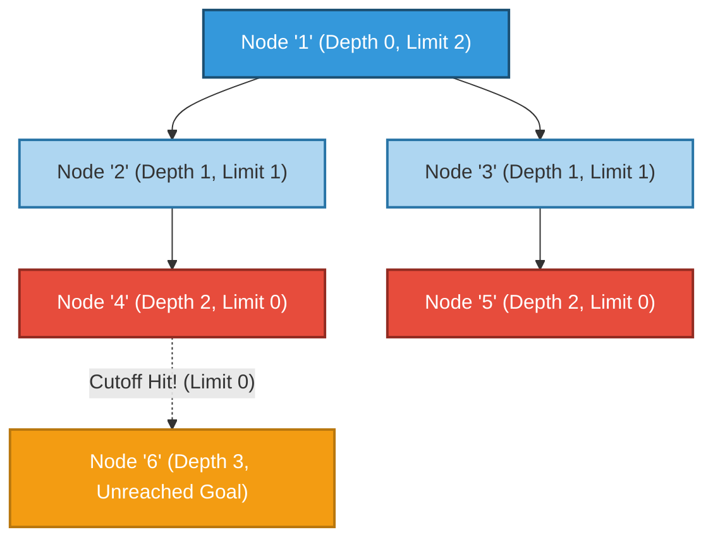

#### Execution Commands & Usage Examples

1. **Default Syllabus Sample Run** (Limit: 2, Goal at depth 3 -> `Result: Cutoff`):
   ```bash
   python scripts/run_depth_limited_search.py
   ```

2. **Success State Run** (Limit increased to 3 -> `Result: Path: ['1', '2', '4', '6']`):
   ```bash
   python scripts/run_depth_limited_search.py --start 1 --goal 6 --limit 3
   ```

3. **Optional Challenge Demonstration** (Deepest node tracking before cutoff):
   ```bash
   python scripts/run_depth_limited_search.py --challenge
   ```

4. **Comprehensive Benchmark Suite** (Cutoff, Success, Failure, Cyclic graphs):
   ```bash
   python scripts/run_depth_limited_search.py --demo
   ```

5. **Display Step-by-Step Execution Trace Table**:
   ```bash
   python scripts/run_depth_limited_search.py --table
   ```

6. **Generate Graphical Visualizations**:
   ```bash
   python scripts/run_depth_limited_search.py --save reports/dls_search.png
   ```

7. **Display Viva Voce Theory Guide**:
   ```bash
   python scripts/run_depth_limited_search.py --viva
   ```

8. **Top-Level Package Dispatcher**:
   ```bash
   python -m src dls --start 1 --goal 6 --limit 2
   ```

9. **Interactive Jupyter Notebook**:
   Open [`notebooks/depth_limited_search.ipynb`](notebooks/depth_limited_search.ipynb) in Jupyter Lab or Antigravity IDE.

#### Viva Voce Questions & Authoritative Answers

##### 1. Infinite State Spaces & DFS Failure Mode
- **Question**: Why does standard DFS fail in infinite state spaces, and how does DLS resolve this?
- **Answer**: In an infinite state space (or continuous navigation, or unbounded recursive rules), DFS ventures down an infinite branch ($m = \infty$) without ever backtracking. Even if a goal exists at depth 1 on a neighboring branch, DFS will never discover it. DLS enforces a strict depth limit bound $l$. Once depth $l$ is reached, the search halts and backtracks, transforming an unbounded infinite exploration into a strictly finite search.

##### 2. Drawbacks of Standard DFS
- **Question**: What are the key drawbacks of standard Depth-First Search?
- **Answer**:
  1. **Incompleteness**: Gets trapped in infinite paths or cycles without visited sets.
  2. **Non-Optimality**: Returns the first path found along its deepest branch, which may be significantly longer or more expensive than a shallow alternative.
  3. **Stack Overflow**: Risk of exceeding the maximum recursion depth (`RecursionError` in Python) in deep trees.

##### 3. Cutoff vs. Failure Distinction
- **Question**: What is the difference between Cutoff and Failure in DLS, and why is this distinction critical?
- **Answer**:
  - **Cutoff**: The goal was not found within depth $l$, but at least one node reached depth $l$ and had successors that were suppressed by the depth limit. The goal *might* exist deeper ($d > l$).
  - **Failure**: The entire reachable space was exhaustively traversed to natural leaves without hitting any cutoffs. We have proved with certainty that the goal does *not* exist in this connected component.
  - **Foundation for Iterative Deepening Search (IDS)**: IDS uses this signal. If DLS returns Cutoff, IDS increments the limit ($l \leftarrow l + 1$). If DLS returns Failure, IDS halts immediately because searching deeper will never find nonexistent states.

##### 4. Time & Space Complexity of DLS
- **Question**: What are the time and space complexities of DLS, and how do they compare with BFS?
- **Answer**:
  - **Time Complexity**: $\mathcal{O}(b^l)$, where $b$ is the branching factor and $l$ is the depth limit.
  - **Space Complexity**: $\mathcal{O}(b \cdot l)$, requiring memory only for the active recursion stack and unexpanded siblings along the path. Unlike BFS, which suffers from an exponential memory bottleneck $\mathcal{O}(b^d)$, DLS retains the linear memory advantage of DFS.

---

## Getting Started

### 1. Requirements & Setup

Ensure Python 3 is installed. To install dependencies for notebooks and experimentation:

```bash
pip install -r requirements.txt
```

### 2. Run the Starter Script

From the project root:

```bash
python scripts/smoke_test.py
```

### 3. Run Automated Tests

Execute the comprehensive test suite (including ExperimentRunner and Agent tests):

```bash
python -m unittest discover -s tests
```

Or using pytest:

```bash
pytest
```

### 4. Interactive Jupyter Notebooks

Launch Jupyter to explore interactive experiments:

```bash
jupyter lab notebooks/multi_agent_simulation.ipynb
```
or open directly in your IDE (VS Code / Antigravity).
