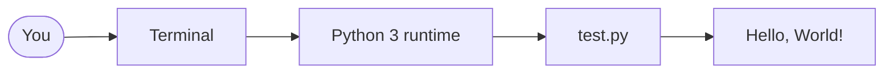

# AI Lab

A local workspace for experimenting with AI ideas, scripts, and prototypes.

[](https://www.python.org/)
[](https://mermaid.js.org/)

## Tech stack

| Layer | Tool |
| --- | --- |
| Language | Python 3 |
| Runtime | Local interpreter (`python`) |
| Entry point | `test.py` |
| Diagrams | Mermaid in this README |

## Architecture



How a run flows:

1. You invoke `python test.py` from the project root.
2. The Python runtime loads the script.
3. The script prints a greeting to the terminal.

## Current status

This repo is a starter. Right now it contains a single Python script that prints a greeting.

## Requirements

- Python 3

## Run

From the project root:

```bash
python test.py
```

Expected output:

```text
Hello, World!
```

## Project layout

```text
ai-lab/
├── test.py      # starter script
├── .gitignore   # ignores editor files such as .vscode
└── README.md
```

## Next steps

Use this folder as a sandbox: add notebooks, models, experiments, and notes as you go.
