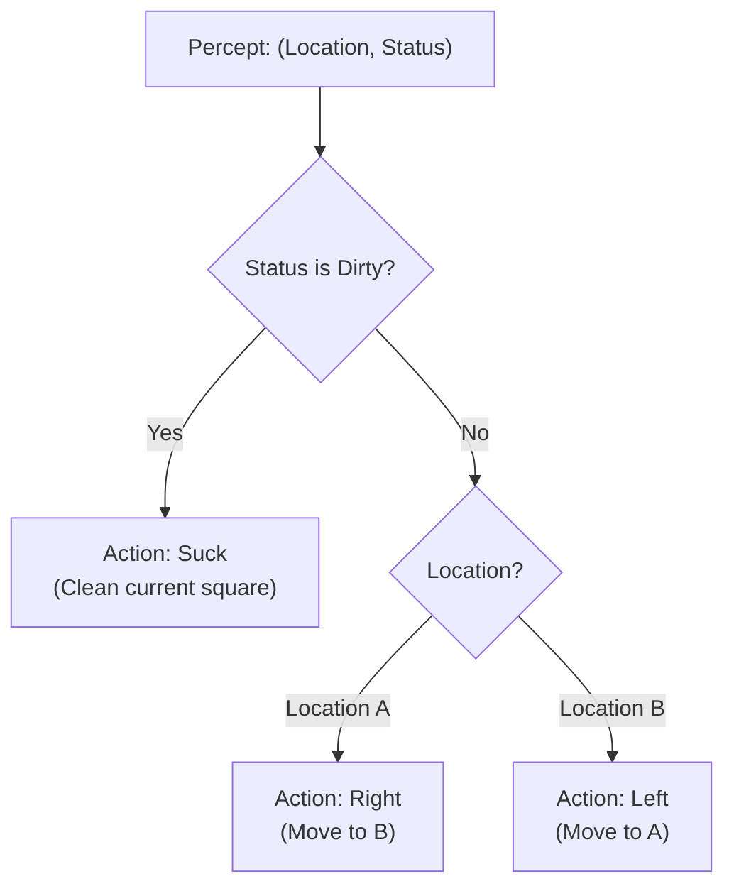
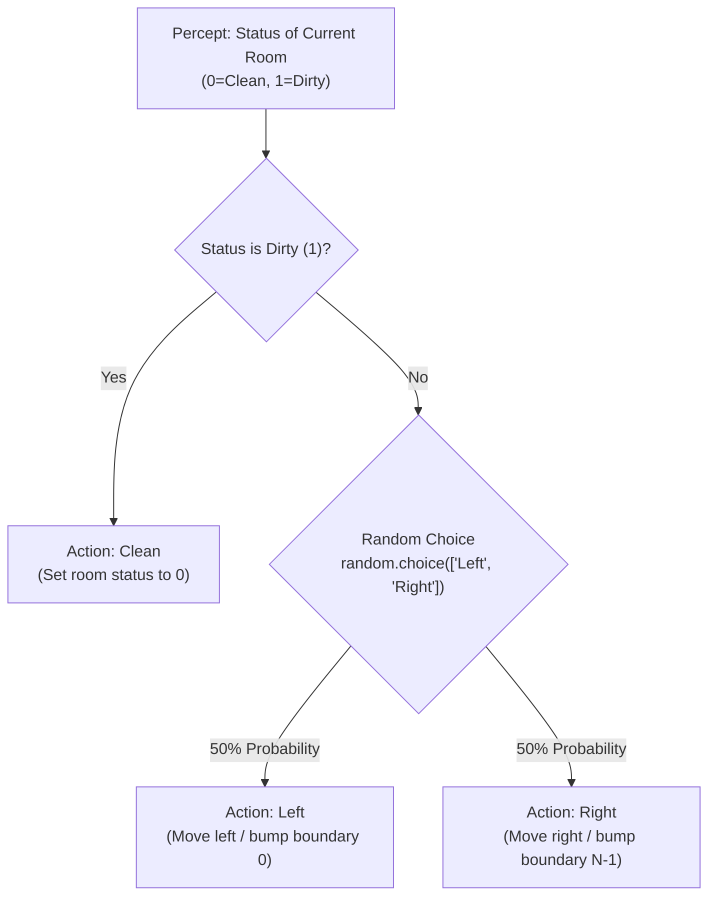
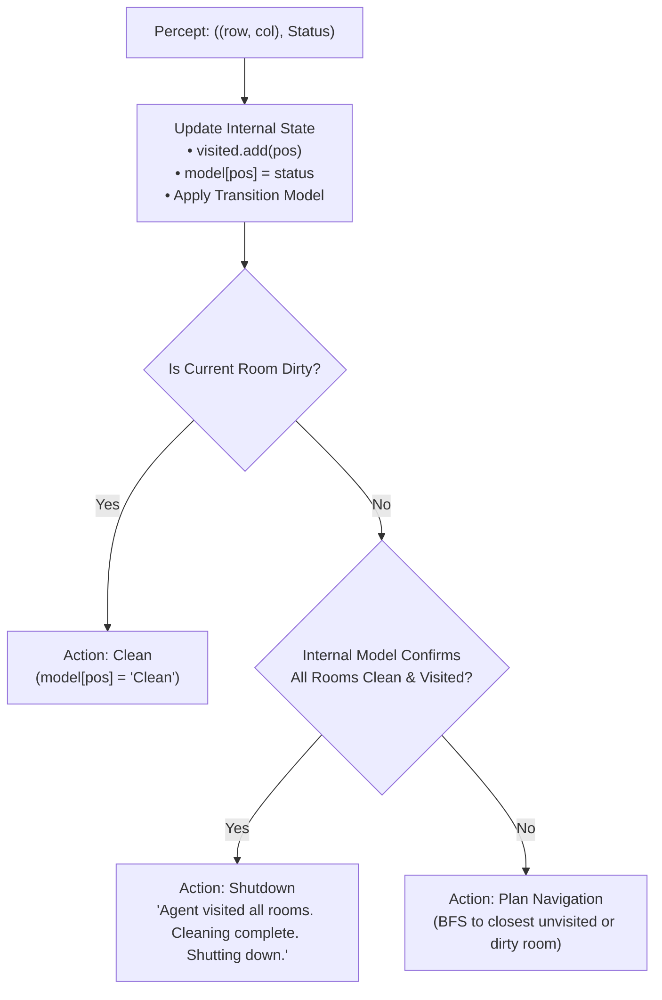
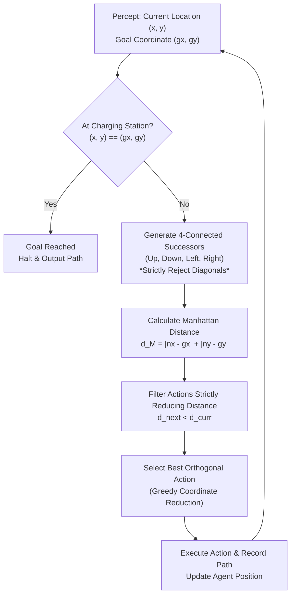
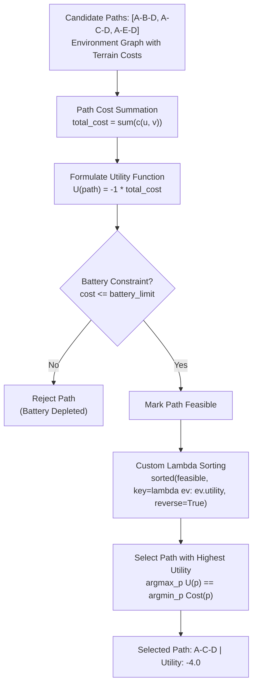
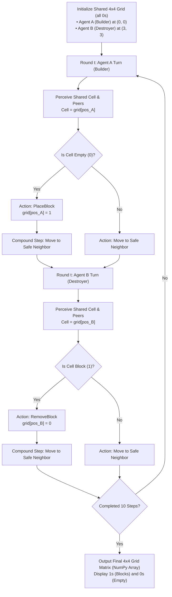
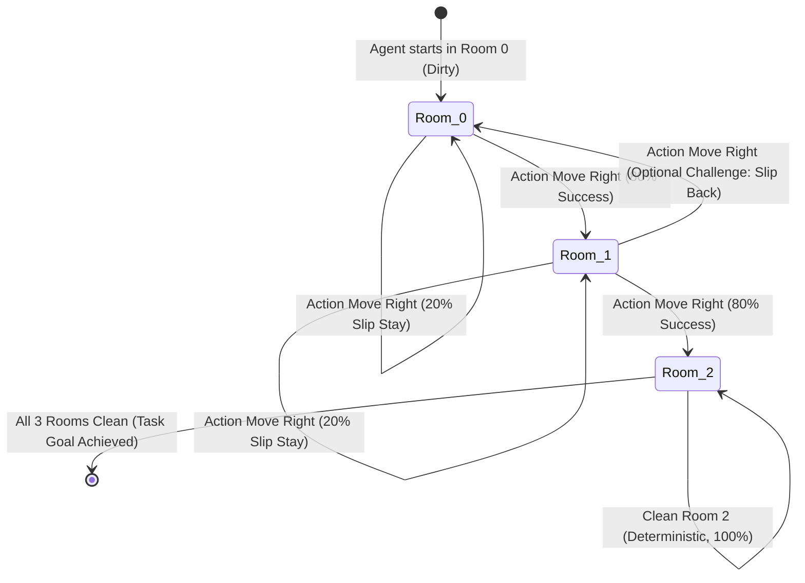

# AI Lab

A structured workspace for prototyping, experimenting with AI ideas, scripts, and models.

[](https://www.python.org/)
[](https://jupyter.org/)
[](https://docs.pytest.org/)
[](https://mermaid.js.org/)

## Tech Stack

| Layer | Tool |
| --- | --- |
| Language | Python 3 |
| Prototyping & Exploration | Jupyter Notebook (`.ipynb`) |
| Core Modules | `src/` (Clean, modular experiment runners) |
| Unit Testing | `unittest` / `pytest` in `tests/` |
| Data Layer | `data/raw/` and `data/processed/` |
| Diagrams | Mermaid in this README |

## Architecture


## Project Layout

```text
ai-lab/
├── notebooks/
│   ├── goal_based_navigation_agent.ipynb# Question 4: Goal-Based Navigation Agent simulation & Viva guide
│   ├── model_based_reflex_agent.ipynb   # Question 3: Model-Based Reflex Agent simulation & Viva guide
│   ├── multi_agent_simulation.ipynb     # Question 6: Multi-Agent Environment Simulation (4x4 Grid)
│   ├── randomized_reflex_agent.ipynb    # Question 2: Randomized Reflex Agent simulation & Viva guide
│   ├── simple_reflex_vacuum_agent.ipynb # Question 1: Simple Reflex Vacuum Agent simulation & Viva guide
│   ├── starter_experiment.ipynb         # Interactive experimentation starter notebook
│   ├── environment_type_classifier.ipynb# Question 8: Environment Type Classifier & Knowledge Base
│   ├── stochastic_vacuum_agent.ipynb    # Question 7: Stochastic Vacuum Agent simulation & Viva guide
│   ├── agent_performance_evaluator.ipynb# Question 9: Agent Performance Measure Evaluator simulation & Viva guide
│   └── utility_based_agent.ipynb        # Question 5: Utility-Based Agent simulation & Viva guide
├── scripts/
│   ├── __init__.py                      # Scripts package marker
│   ├── run_goal_based_agent.py          # CLI & interactive runner for Question 4 (5x5 Grid Simulation)
│   ├── run_model_based_agent.py         # CLI & interactive runner for Question 3 (2x2 Grid Simulation)
│   ├── run_multi_agent_simulation.py    # CLI & interactive runner for Question 6 (Builder vs Destroyer)
│   ├── run_randomized_agent.py          # CLI & interactive runner for Question 2 (1D Grid Simulation)
│   ├── run_stochastic_vacuum_agent.py   # CLI & interactive runner for Question 7 (Monte Carlo Simulation)
│   ├── run_utility_based_agent.py       # CLI & interactive runner for Question 5 (Utility Optimization)
│   ├── run_environment_classifier.py    # CLI & interactive runner for Question 8 (Environment Classifier)
│   ├── run_agent_performance_evaluator.py# CLI & interactive runner for Question 9 (PEAS Performance Evaluator)
│   ├── run_vacuum_agent.py              # CLI & interactive runner for Question 1 (2-Square & 3x3 Grid)
│   └── smoke_test.py                    # Starter entry point and verification smoke test
├── src/
│   ├── __init__.py                      # Package initialization & public exports
│   ├── __main__.py                      # CLI dispatcher (python -m src {vacuum,randomized,model-based,goal-based,utility-based,multi-agent,stochastic,environment-classifier,smoke-test})
│   ├── experiment.py                    # Core experiment metrics and simulation runner
│   ├── goal_based_agent.py              # Question 4: Goal-Based Navigation Agent & 5x5 Grid Environment
│   ├── model_based_agent.py             # Question 3: Model-Based Reflex Agent & 2x2 Grid Environment
│   ├── multi_agent_simulation.py        # Question 6: Multi-Agent Environment Simulation & Shared 4x4 Grid
│   ├── randomized_agent.py              # Question 2: Randomized Reflex Agent & 1D Grid Environment
│   ├── stochastic_vacuum_agent.py       # Question 7: Stochastic Vacuum Agent & Non-deterministic Environment
│   ├── environment_classifier.py        # Question 8: Environment Type Classifier & Knowledge Base
│   ├── utility_based_agent.py           # Question 5: Utility-Based Agent & Terrain Graph Cost Optimization
│   ├── agent_performance_evaluator.py   # Question 9: Autonomous Delivery Drone PEAS Performance Evaluator
│   └── vacuum_agent.py                  # Question 1: Simple Reflex Vacuum Agent & Environments
├── tests/
│   ├── __init__.py                      # Test package marker
│   ├── test_experiment.py               # Unit test suite for experiment runner
│   ├── test_goal_based_agent.py         # Unit tests for Question 4 goal-based agent & 5x5 grid
│   ├── test_model_based_agent.py        # Unit tests for Question 3 model-based agent & 2x2 grid
│   ├── test_multi_agent_simulation.py   # Unit tests for Question 6 multi-agent simulation & rules
│   ├── test_randomized_agent.py         # Unit tests for Question 2 randomized agent & 1D grid
│   ├── test_scripts.py                  # Unit tests for script runners & CLI dispatcher
│   ├── test_stochastic_vacuum_agent.py  # Unit tests for Question 7 stochastic transitions & Monte Carlo
│   ├── test_utility_based_agent.py      # Unit tests for Question 5 utility-based agent & terrain costs
│   ├── test_agent_performance_evaluator.py# Unit tests for Question 9 linear evaluation, PEAS metric & CSV
│   └── test_vacuum_agent.py             # Unit tests for vacuum agent reflex rules & simulation traces
├── data/
│   ├── processed/                       # Processed artifacts & experiment outputs
│   └── raw/                             # Raw inputs & data snapshots
├── .gitignore                           # Comprehensive ignores (Python, Jupyter, venv, IDE)
├── pyproject.toml                       # Modern Python project configuration & packaging
├── README.md                            # Project documentation and practical guide
└── requirements.txt                     # Dependencies for notebooks and ML libraries
```

## Lab Practicals

### Question 1: Simple Reflex Vacuum Cleaner Agent

- **Syllabus Area**: Intelligent Agents
- **Difficulty**: 🟢 Beginner
- **Core AI Concept**: Simple Reflex Agent, Agent-Environment Interaction, Condition-Action Mapping
- **Complexity**: Time Complexity: $O(1)$ per step | Space Complexity: $O(1)$

#### Condition-Action Reflex Rules


#### Running the Vacuum Agent Simulation

1. **Default Sample Scenario** (Initial Location: `A`, Location A: `Dirty`, Location B: `Clean`, 5 Steps):
   ```bash
   python scripts/run_vacuum_agent.py
   ```

2. **Custom Location & Square States**:
   ```bash
   python scripts/run_vacuum_agent.py --location B --status-a Dirty --status-b Dirty --steps 5
   ```

3. **Interactive Mode**:
   ```bash
   python scripts/run_vacuum_agent.py --interactive
   ```

4. **Optional Challenge (3x3 Grid with Randomized Dirt Placement)**:
   ```bash
   python scripts/run_vacuum_agent.py --grid --steps 10
   ```

5. **Display Viva Voce Q&A and Theory Guide**:
   ```bash
   python scripts/run_vacuum_agent.py --viva
   ```

6. **Interactive Jupyter Notebook**:
   Open [`notebooks/simple_reflex_vacuum_agent.ipynb`](notebooks/simple_reflex_vacuum_agent.ipynb) in Jupyter Lab or Antigravity IDE.

---

### Question 2: Randomized Reflex Agent

- **Syllabus Area**: Intelligent Agents
- **Difficulty**: 🟢 Beginner
- **Core AI Concept**: Randomized Agent Behavior, Handling Unobservable States, Escaping Boundary Loops
- **Complexity**: Time Complexity: $O(N)$ average | Space Complexity: $O(N)$

#### Condition-Action Stochastic Rules


#### Running the Randomized Reflex Agent Simulation

1. **Sample Scenario with Exact 12-Step Reproducibility** (`[1, 0, 0, 1, 1]`, Start Index: `2`, Seed: `58`):
   ```bash
   python scripts/run_randomized_agent.py --seed 58
   ```
   *Output*:
   ```text
   All rooms clean in 12 steps.
   Total Navigation Moves   : 9
   Total Cleaning Actions   : 3
   Final Grid State         : [0, 0, 0, 0, 0]
   Final Agent Location     : Room [4]
   ```

2. **Custom Room State & Start Index**:
   ```bash
   python scripts/run_randomized_agent.py --state "1 0 1 1 0" --start-index 1
   ```

3. **Interactive Mode**:
   ```bash
   python scripts/run_randomized_agent.py --interactive
   ```

4. **Monte Carlo Empirical Benchmark (100 Trials)**:
   ```bash
   python scripts/run_randomized_agent.py --benchmark --trials 100
   ```

5. **Display Viva Voce Theory Guide**:
   ```bash
   python scripts/run_randomized_agent.py --viva
   ```

6. **Interactive Jupyter Notebook**:
   Open [`notebooks/randomized_reflex_agent.ipynb`](notebooks/randomized_reflex_agent.ipynb) in Jupyter Lab or Antigravity IDE.

---

### Question 3: Model-Based Reflex Agent

- **Syllabus Area**: Intelligent Agents
- **Difficulty**: 🟡 Intermediate
- **Core AI Concept**: Model-Based Reflex Agent, Internal State Representation, Transition Models, Sensor Models
- **Complexity**: Time Complexity: $O(N)$ | Space Complexity: $O(N)$ where $N=4$ for 2x2 grid

#### Model-Based Architecture & Decision Flow


#### Running the Model-Based Agent Simulation

1. **Default Sample Scenario** (2x2 Grid: `[[Dirty, Clean], [Dirty, Dirty]]`, Start at `(0, 0)`):
   ```bash
   python scripts/run_model_based_agent.py
   ```
   *Expected Output*:
   ```text
   Step  1: Pos (0, 0) | Percept: Dirty | Action: Clean    | Visited: {(0,0)}
   Step  2: Pos (0, 0) | Percept: Clean | Action: Down     | Visited: {(0,0)}
   Step  3: Pos (1, 0) | Percept: Dirty | Action: Clean    | Visited: {(0,0), (1,0)}
   Step  4: Pos (1, 0) | Percept: Clean | Action: Right    | Visited: {(0,0), (1,0)}
   Step  5: Pos (1, 1) | Percept: Dirty | Action: Clean    | Visited: {(0,0), (1,0), (1,1)}
   Step  6: Pos (1, 1) | Percept: Clean | Action: Up       | Visited: {(0,0), (1,0), (1,1)}
   Step  7: Pos (0, 1) | Percept: Clean | Action: Shutdown | Visited: {(0,0), (0,1), (1,0), (1,1)} -> Agent visited all rooms. Cleaning complete. Shutting down.
   ```

2. **Custom Grid & Start Position**:
   ```bash
   python scripts/run_model_based_agent.py --grid "Dirty Clean, Dirty Dirty" --start-row 0 --start-col 0
   ```

3. **Optional Challenge (Stochastic Sensor Failure)**:
   ```bash
   python scripts/run_model_based_agent.py --sensor-failure 0.2 --seed 42
   ```

4. **Interactive Walkthrough Mode**:
   ```bash
   python scripts/run_model_based_agent.py --interactive
   ```

5. **Display Viva Voce Reference & Theory Guide**:
   ```bash
   python scripts/run_model_based_agent.py --viva
   ```

6. **Interactive Jupyter Notebook**:
   Open [`notebooks/model_based_reflex_agent.ipynb`](notebooks/model_based_reflex_agent.ipynb) in Jupyter Lab or Antigravity IDE.

---

### Question 4: Goal-Based Navigation Agent

- **Syllabus Area**: Intelligent Agents
- **Difficulty**: 🟡 Intermediate
- **Core AI Concept**: Goal-Based Agent, Distance Metrics (Manhattan & Euclidean), Greedy Coordinate Reduction
- **Complexity**: Time Complexity: $O(D)$ | Space Complexity: $O(D)$ where $D = |x_1 - x_2| + |y_1 - y_2|$ is Manhattan distance

#### Goal-Based Decision Architecture


#### Running the Goal-Based Agent Simulation

1. **Default Sample Scenario** (Start: `(0, 0)`, Goal: `(3, 4)`):
   ```bash
   python scripts/run_goal_based_agent.py
   ```
   *Expected Output*:
   ```text
   Step  1: Pos (0, 0) -> Action: Down  -> Next: (1, 0) | Dist: 7 -> 6 (Decreased)
   Step  2: Pos (1, 0) -> Action: Down  -> Next: (2, 0) | Dist: 6 -> 5 (Decreased)
   Step  3: Pos (2, 0) -> Action: Down  -> Next: (3, 0) | Dist: 5 -> 4 (Decreased)
   Step  4: Pos (3, 0) -> Action: Right -> Next: (3, 1) | Dist: 4 -> 3 (Decreased)
   Step  5: Pos (3, 1) -> Action: Right -> Next: (3, 2) | Dist: 3 -> 2 (Decreased)
   Step  6: Pos (3, 2) -> Action: Right -> Next: (3, 3) | Dist: 2 -> 1 (Decreased)
   Step  7: Pos (3, 3) -> Action: Right -> Next: (3, 4) | Dist: 1 -> 0 (Decreased)

   Path: [(0, 0), (1, 0), (2, 0), (3, 0), (3, 1), (3, 2), (3, 3), (3, 4)]
   ```

2. **Custom Start & Goal Coordinates**:
   ```bash
   python scripts/run_goal_based_agent.py --start 1 1 --goal 4 2
   ```

3. **Random Goal Placement (with Seed Reproducibility)**:
   ```bash
   python scripts/run_goal_based_agent.py --random-goal --seed 42
   ```

4. **Optional Challenge (Explicit Diagonal Movement Prevention)**:
   ```bash
   python scripts/run_goal_based_agent.py --challenge
   ```

5. **Distance Metric Comparison (Manhattan $L_1$ vs. Euclidean $L_2$)**:
   ```bash
   python scripts/run_goal_based_agent.py --compare-metrics
   ```

6. **Interactive Terminal Mode**:
   ```bash
   python scripts/run_goal_based_agent.py --interactive
   ```

7. **Display Viva Voce Reference & Theory Guide**:
   ```bash
   python scripts/run_goal_based_agent.py --viva
   ```

8. **Interactive Jupyter Notebook**:
   Open [`notebooks/goal_based_navigation_agent.ipynb`](notebooks/goal_based_navigation_agent.ipynb) in Jupyter Lab or Antigravity IDE.

---

### Question 5: Utility-Based Agent Simulation

- **Syllabus Area**: Intelligent Agents
- **Difficulty**: 🟠 Advanced
- **Practical Type**: Optimization
- **Core AI Concept**: Utility-Based Agent, Cost Minimization vs. Utility Maximization, Expected Utility Theory
- **Complexity**: Time Complexity: $O(P \times L)$ | Space Complexity: $O(1)$ where $P$ is candidate paths and $L$ is path length

#### Decision & Optimization Flow


#### Running the Utility-Based Agent Simulation

1. **Default Run (3 Predefined Paths on Sample Graph)**:
   ```bash
   python scripts/run_utility_based_agent.py
   ```
   *Expected Output*:
   ```text
   Candidate Path Evaluations:
   ---------------------------------------------------------------------------
   #   Path             Terrain Breakdown          Cost    Utility  Status
   ---------------------------------------------------------------------------
   1   A-B-D            G:1 + W:5                  6.0     -6.0     FEASIBLE
   2   A-C-D            G:1 + M:3                  4.0     -4.0     SELECTED (Optimal)
   3   A-E-D            M:3 + W:5                  8.0     -8.0     FEASIBLE
   ---------------------------------------------------------------------------

   Optimization Result:
     Selected Path: A-C-D
     Total Cost:    4.0
     Utility:       -4.0
   ```

2. **Custom Paths via CLI**:
   ```bash
   python scripts/run_utility_based_agent.py --paths "A-B-D" "A-C-D"
   ```

3. **Optional Challenge (Battery Capacity Constraint)**:
   ```bash
   python scripts/run_utility_based_agent.py --challenge
   ```
   *Output*:
   ```text
   Battery Capacity Limit: 5.0 units
   Rule: Reject any path with total_cost > battery_limit regardless of utility.

   Challenge Analysis:
     [REJECTED] Path A-B-D      Cost: 6.0 > 5.0 (Battery Depleted)
     [ACCEPTED] Path A-C-D      Cost: 4.0 <= 5.0
     [REJECTED] Path A-E-D      Cost: 8.0 > 5.0 (Battery Depleted)

   Best Feasible Path: A-C-D (Cost: 4.0, Utility: -4.0)
   ```

4. **Auto-Discovery of All Directed Paths (DFS)**:
   ```bash
   python scripts/run_utility_based_agent.py --all-paths
   ```

5. **Top-Level Module Dispatcher**:
   ```bash
   python -m src utility-based
   ```

6. **Interactive Terminal Mode**:
   ```bash
   python scripts/run_utility_based_agent.py --interactive
   ```

7. **Display Viva Voce Reference & Theory Guide**:
   ```bash
   python scripts/run_utility_based_agent.py --viva
   ```

8. **Interactive Jupyter Notebook**:
   Open [`notebooks/utility_based_agent.ipynb`](notebooks/utility_based_agent.ipynb) in Jupyter Lab or Antigravity IDE.

---

### Question 6: Multi-Agent Environment Simulation

- **Syllabus Area**: Intelligent Agents
- **Difficulty**: 🟠 Advanced
- **Practical Type**: Simulation
- **Core AI Concept**: Multi-Agent Systems, Competitive/Zero-Sum Environments, Sequential vs. Episodic, Dynamic vs. Static, Turn-Based Execution, Collision Avoidance
- **Complexity**: Time Complexity: $O(S)$ where $S$ is steps | Space Complexity: $O(\text{Grid Size}) = O(16) = O(1)$

#### Multi-Agent Architecture & Turn-Based Interaction Loop


#### Running the Multi-Agent Simulation

1. **Default 10-Step Simulation** (4x4 Grid, Builder at `(0, 0)`, Destroyer at `(3, 3)`):
   ```bash
   python scripts/run_multi_agent_simulation.py --steps 10
   ```
   *Sample Output*:
   ```text
   Sample Output (NumPy Matrix displaying 1s and 0s):
   [[1 1 0 0]
    [1 1 1 0]
    [0 1 1 0]
    [0 0 0 0]]

   ======================================================================
                  MULTI-AGENT ENVIRONMENT SIMULATION SUMMARY             
   ======================================================================
   Execution Mode:             Compound Turns
   Total Rounds (Steps):       10
   Agent A:                    Agent_A (Builder) | Start: (0, 0) -> Final: (1, 3)
   Agent B:                    Agent_B (Destroyer) | Start: (3, 3) -> Final: (2, 0)
   Performance Metrics:        Builder placed 9 blocks | Destroyer removed 2 blocks | Net: +7
   Final Block Count in Grid:  7 / 16
   Collision Avoidance:        Disabled
   Collisions Avoided:         0
   Collisions Occurred:        1
   ----------------------------------------------------------------------
   Final Grid State Matrix (NumPy Array):
   [[1 1 0 0]
    [1 1 1 0]
    [0 1 1 0]
    [0 0 0 0]]
   ======================================================================
   ```

2. **Optional Challenge (Active Collision Awareness & Avoidance)**:
   ```bash
   python scripts/run_multi_agent_simulation.py --challenge
   ```
   *Output Highlights*:
   ```text
   Collision Avoidance: ENABLED (Optional Challenge)
   Collisions Avoided:  2
   Collisions Occurred: 0
   ```

3. **Discrete Turn Mode (Act OR Move)**:
   ```bash
   python scripts/run_multi_agent_simulation.py --mode discrete --steps 10
   ```

4. **Greedy Heuristic Movement Strategy**:
   ```bash
   python scripts/run_multi_agent_simulation.py --strategy greedy --steps 10
   ```

5. **Top-Level Module Dispatcher**:
   ```bash
   python -m src multi-agent --steps 10
   ```

6. **Interactive Step-by-Step Walkthrough**:
   ```bash
   python scripts/run_multi_agent_simulation.py --interactive
   ```

7. **Display Viva Voce Reference & Theory Guide**:
   ```bash
   python scripts/run_multi_agent_simulation.py --viva
   ```

8. **Interactive Jupyter Notebook**:
   Open [`notebooks/multi_agent_simulation.ipynb`](notebooks/multi_agent_simulation.ipynb) in Jupyter Lab or Antigravity IDE.

### Question 7: Stochastic Environment Vacuum Agent

- **Syllabus Area**: Intelligent Agents
- **Difficulty**: 🟠 Advanced
- **Practical Type**: Simulation
- **Core AI Concept**: Stochastic Environments, Non-deterministic Actions, Actuator Slippage, Monte Carlo Estimation
- **Python Concepts Tested**: `random` module (`random.random()`), statistical averaging (`statistics`), loops, dataclasses
- **Complexity**: Time Complexity: $O(\text{Runs} \times \text{Steps})$ | Space Complexity: $O(\text{Runs})$

#### Probabilistic Actuator State Transition Model


#### Theoretical Expectation vs. Deterministic Baseline

| Metric | Deterministic Baseline | Stochastic Environment ($p=0.8$) |
| :--- | :--- | :--- |
| **Cleaning Steps** | 3 steps ($1$ step per room) | 3 steps ($1$ step per room) |
| **Room Transitions** | 2 steps ($1$ step per move) | $\mathbb{E}[\text{Moves}] = 2 \times \frac{1}{0.8} = 2.5$ steps |
| **Total Expected Steps** | **5.0 steps** | **5.5 steps** |
| **Performance Penalty** | Baseline (0.0 steps) | **+0.5 steps (+10.0% execution delay)** |

#### Running the Stochastic Vacuum Agent Simulation

1. **Standard Monte Carlo Batch (20 Runs)**:
   ```bash
   python scripts/run_stochastic_vacuum_agent.py --runs 20
   ```
   *Expected Output*:
   ```text
   Average steps to clean 3 rooms: 5.4 steps
   ```

2. **Reproducible Benchmark (Seed 28 reproduces sample output exactly)**:
   ```bash
   python scripts/run_stochastic_vacuum_agent.py --runs 20 --seed 28
   ```

3. **Detailed Step-by-Step Trajectory Trace**:
   ```bash
   python scripts/run_stochastic_vacuum_agent.py --runs 20 --seed 28 --trace
   ```

4. **Optional Challenge: Actuator 'Slip Back' Mechanics**:
   ```bash
   python scripts/run_stochastic_vacuum_agent.py --challenge --seed 42
   ```

5. **Display Viva Voce Theory & Reference Guide**:
   ```bash
   python scripts/run_stochastic_vacuum_agent.py --viva
   ```

6. **Top-Level Package Dispatcher**:
   ```bash
   python -m src stochastic --runs 20 --seed 28
   ```

7. **Interactive Jupyter Notebook**:
   Open [`notebooks/stochastic_vacuum_agent.ipynb`](notebooks/stochastic_vacuum_agent.ipynb) in Jupyter Lab or Antigravity IDE.

---

### Question 8: Environment Type Classifier

- **Syllabus Area**: Intelligent Agents
- **Difficulty**: 🟡 Intermediate
- **Practical Type**: Knowledge Representation
- **Core AI Concept**: Environment Properties (PEAS), Environmental Taxonomy, Knowledge Dictionary Representation
- **Python Concepts Tested**: Tuples as dictionary keys, robust boolean input parsing, nearest-neighbor Hamming distance
- **Complexity**: Time Complexity: (1)$ dictionary lookup | Space Complexity: (K)$ for knowledge base ( \le 32$)

#### Knowledge Representation & Lookup Flowchart
`mermaid
flowchart TD
    User([User Prompt / CLI Input]) --> Parse[Parse Flexible Booleans]
    Parse --> Vector[5-Boolean Tuple Key: Obs, Det, Epi, Stat, Disc]
    Vector --> Lookup{O 1 Hash Key in Knowledge Base?}
    Lookup -->|Exact Key Found| Meta[Retrieve EnvironmentMetadata]
    Meta --> Success([Display Exact Match & PEAS Breakdown])
    Lookup -->|Unknown Combination| Challenge{Nearest-Neighbor Fallback?}
    Challenge -->|Enabled| Metric[Compute Hamming Distance D_H to all K entries]
    Metric --> Rank[Find Minimum Distance Tier]
    Rank --> Nearest([Display Nearest Environment & Property Differences])
    Challenge -->|Disabled| Graceful([Inform Unknown Combination Gracefully])
`

#### Canonical AI Environment Taxonomy (Russell & Norvig Table 2.1)

| Environment | Observable | Deterministic | Episodic | Static | Discrete | Agent Type |
| :--- | :---: | :---: | :---: | :---: | :---: | :--- |
| **Backgammon (with clock)** *(Sample)* | **True** | **False** (Dice) | **False** (Seq) | **False** (Clock) | **True** | Multi-Agent (Competitive) |
| **Backgammon (without clock)** | **True** | **False** (Dice) | **False** (Seq) | **True** | **True** | Multi-Agent (Competitive) |
| **Chess (with clock)** | **True** | **True** | **False** (Seq) | **False** (Clock) | **True** | Multi-Agent (Competitive) |
| **Chess (without clock) / Crossword** | **True** | **True** | **False** (Seq) | **True** | **True** | Multi / Single-Agent |
| **Poker (with clock)** | **False** (Hidden) | **False** (Deck) | **False** (Seq) | **False** (Clock) | **True** | Multi-Agent (Imperfect Info) |
| **Poker (without clock)** | **False** (Hidden) | **False** (Deck) | **False** (Seq) | **True** | **True** | Multi-Agent (Imperfect Info) |
| **Medical Diagnosis / Taxi Driving** | **False** | **False** | **False** (Seq) | **False** (Dynamic) | **False** (Cont) | Single / Multi-Agent |
| **Part-Picking Robot** | **False** | **False** | **True** (Episodic) | **False** (Belt) | **False** (Cont) | Single-Agent |
| **Image Analysis (Discrete)** | **True** | **True** | **True** (Episodic) | **True** | **True** | Single-Agent |
| **Battleship (Simplified)** | **False** | **True** | **False** (Seq) | **True** | **True** | Multi-Agent (Competitive) |

#### Running the Environment Type Classifier

1. **Interactive Prompt Mode** (Prompts user for 5 environmental properties):
   `ash
   python scripts/run_environment_classifier.py
   `

2. **Direct Tuple Input** (Sample execution matching Backgammon):
   `ash
   python scripts/run_environment_classifier.py --input True,False,False,False,True
   `
   *Expected Output*:
   `	ext
   Environment Match: Backgammon
   `

3. **Individual Environmental Dimension Flags**:
   `ash
   python scripts/run_environment_classifier.py --observable yes --deterministic yes --episodic no --static no --discrete yes
   `
   *Output*:
   `	ext
   Environment Match: Chess (with clock)
   `

4. **Standard Textbook Environments Demonstration Suite**:
   `ash
   python scripts/run_environment_classifier.py --demo
   `

5. **Optional Challenge: Nearest-Neighbor Distance Metric (Hamming Distance)**:
   `ash
   python scripts/run_environment_classifier.py --challenge
   `

6. **Display Viva Voce Theory & Reference Guide**:
   `ash
   python scripts/run_environment_classifier.py --viva
   `

7. **Top-Level Package Dispatcher**:
   `ash
   python -m src environment-classifier --input True,False,False,False,True
   `

8. **Interactive Jupyter Notebook**:
   Open [
otebooks/environment_type_classifier.ipynb](notebooks/environment_type_classifier.ipynb) in Jupyter Lab or Antigravity IDE.

---

### Question 9: Agent Performance Measure Evaluator

- **Syllabus Area**: Intelligent Agents
- **Difficulty**: 🟡 Intermediate
- **Practical Type**: Algorithm Design
- **Core AI Concept**: Performance Measure, Rationality, Omniscience vs. Rationality, PEAS Evaluation
- **Python Concepts Tested**: List iteration, arithmetic updates, string matching, CSV stream processing
- **Complexity**: Time Complexity: $O(N)$ log length | Space Complexity: $O(1)$ auxiliary space

#### Autonomous Delivery Drone PEAS Specification

| PEAS Dimension | Drone Specification | Impact on Agent Rationality |
| :--- | :--- | :--- |
| **Performance Measure (P)** | $+10$ / delivery, $-1$ / move, $-5$ / bump | Objective utility function balancing mission completion, latency, and flight safety |
| **Environment (E)** | Urban airspace, buildings, power lines, wind, landing pads | Dynamic, partially observable, stochastic, continuous 3D world |
| **Actuators (A)** | Quadcopter/hexacopter rotors, pitch/yaw motors, parcel winch/gripper | Translates movement actions into physical flight trajectory |
| **Sensors (S)** | GPS receiver, 3D LiDAR scanner, ultrasonic sonars, downward camera, IMU | Supplies real-time percepts for obstacle detection and landing |

#### Performance Score Evaluation Model

```mermaid
flowchart TD
  Log["Simulated Action Event Stream: [move, move, bump, move, deliver]"] --> Seq[Linear Sequential Processing O(N)]
  Seq --> Match{Action Type}
  Match -->|move| Cost["Subtract Move Cost (-1 pt)"]
  Match -->|bump| Penalty["Subtract Collision Penalty (-5 pts)"]
  Match -->|deliver| Reward["Add Delivery Reward (+10 pts)"]
  Cost --> Running["Update Running Score (O(1) Memory)"]
  Penalty --> Running
  Reward --> Running
  Running --> Next{More Events?}
  Next -->|Yes| Match
  Next -->|No| Final["Output Final PEAS Performance Score: 2 (10 - 3 moves - 5 bump)"]
```

#### Running the Agent Performance Evaluator

1. **Standard Sample Benchmark Run**:
   ```bash
   python scripts/run_agent_performance_evaluator.py
   ```
   *Expected Output*:
   ```text
   Performance Score: 2 (10 - 3 moves - 5 bump)
   ```

2. **Custom Inline Event Sequence**:
   ```bash
   python scripts/run_agent_performance_evaluator.py --events move,move,bump,move,deliver
   ```

3. **Detailed Step-by-Step Flight Audit Table**:
   ```bash
   python scripts/run_agent_performance_evaluator.py --detailed
   ```

4. **Optional Challenge: Read Action Log from External CSV File**:
   ```bash
   python scripts/run_agent_performance_evaluator.py --csv data/raw/drone_actions_sample.csv
   ```

5. **Automated Demonstration Benchmark Suite**:
   ```bash
   python scripts/run_agent_performance_evaluator.py --demo
   ```

6. **Interactive Step-by-Step Terminal Prompt**:
   ```bash
   python scripts/run_agent_performance_evaluator.py --interactive
   ```

7. **Display Viva Voce Theory & Reference Guide**:
   ```bash
   python scripts/run_agent_performance_evaluator.py --viva
   ```

8. **Top-Level Package Dispatcher**:
   ```bash
   python -m src agent-evaluator --events move,move,bump,move,deliver
   ```

9. **Interactive Jupyter Notebook**:
   Open [`notebooks/agent_performance_evaluator.ipynb`](notebooks/agent_performance_evaluator.ipynb) in Jupyter Lab or Antigravity IDE.

---

## Getting Started

### 1. Requirements & Setup

Ensure Python 3 is installed. To install dependencies for notebooks and experimentation:

```bash
pip install -r requirements.txt
```

### 2. Run the Starter Script

From the project root:

```bash
python scripts/smoke_test.py
```

### 3. Run Automated Tests

Execute the comprehensive test suite (including ExperimentRunner and Agent tests):

```bash
python -m unittest discover -s tests
```

Or using pytest:

```bash
pytest
```

### 4. Interactive Jupyter Notebooks

Launch Jupyter to explore interactive experiments:

```bash
jupyter lab notebooks/multi_agent_simulation.ipynb
```
or open directly in your IDE (VS Code / Antigravity).
