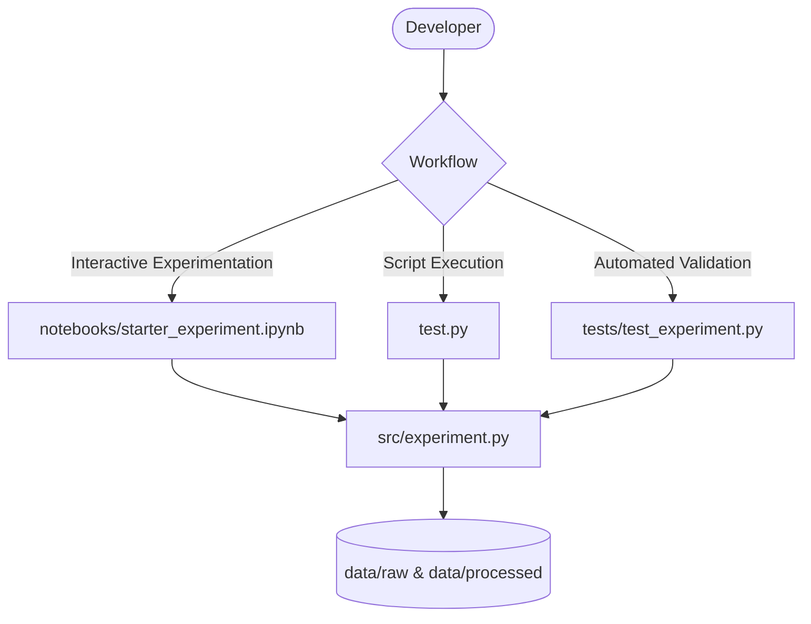

# AI Lab

A structured workspace for prototyping, experimenting with AI ideas, scripts, and models.

[](https://www.python.org/)
[](https://jupyter.org/)
[](https://docs.pytest.org/)
[](https://mermaid.js.org/)

## Tech Stack

| Layer | Tool |
| --- | --- |
| Language | Python 3 |
| Prototyping & Exploration | Jupyter Notebook (`.ipynb`) |
| Core Modules | `src/` (Clean, modular experiment runners) |
| Unit Testing | `unittest` / `pytest` in `tests/` |
| Data Layer | `data/raw/` and `data/processed/` |
| Diagrams | Mermaid in this README |

## Architecture



## Project Layout

```text
ai-lab/
├── data/
│   ├── raw/                 # Original immutable datasets
│   └── processed/           # Cleaned & transformed datasets
├── notebooks/
│   └── starter_experiment.ipynb  # Interactive experimentation notebook
├── src/
│   ├── __init__.py          # Package initialization
│   └── experiment.py        # Core experiment metrics and simulation runner
├── tests/
│   ├── __init__.py          # Test package marker
│   └── test_experiment.py   # Unit test suite covering edge cases
├── .gitignore               # Comprehensive ignores (Python, Jupyter, venv, IDE)
├── README.md                # Project documentation and guide
├── requirements.txt         # Dependencies for notebooks and ML libraries
└── test.py                  # Starter entry point and verification script
```

## Getting Started

### 1. Requirements & Setup

Ensure Python 3 is installed. To install dependencies for notebooks and experimentation:

```bash
pip install -r requirements.txt
```

### 2. Run the Starter Script

From the project root:

```bash
python test.py
```

### 3. Run Automated Tests

Execute the test suite to verify module behavior:

```bash
python -m unittest discover -s tests
```

Or using pytest:

```bash
pytest
```

### 4. Interactive Jupyter Notebooks

Launch Jupyter to explore interactive experiments:

```bash
jupyter lab notebooks/starter_experiment.ipynb
```
or open `notebooks/starter_experiment.ipynb` directly in your IDE (VS Code / Antigravity).
